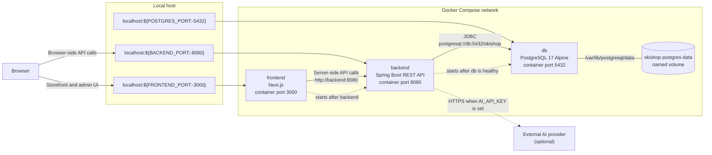

# Codex Ski Shop Zero Hit Radar

`Codex Ski Shop Zero Hit Radar` is a full-stack demo application based on a ski equipment e-commerce site.

Customers can search for products, and the backend records valid keywords that return zero search results. On the Zero Hit Radar dashboard, administrators can review unsuccessful search keywords as "latent demand" and use the search count, most recent search date and time, estimated opportunity loss, priority, and AI consultation results to inform purchasing and product-planning decisions.

This repository is intended for future release as OSS. Configuration is managed through environment variables, demo credentials are clearly identified, and the application includes a fallback that keeps the overall system operational when no AI API key is configured.

## Table of Contents

- [Key Features](#key-features)
- [System Architecture](#system-architecture)
- [Directory Structure](#directory-structure)
- [Number of Files Implemented with AI-Driven Development](#number-of-files-implemented-with-ai-driven-development)
- [Technology Stack](#technology-stack)
- [Prerequisites](#prerequisites)
- [Run with Docker Compose](#run-with-docker-compose)
- [Connect to PostgreSQL and Inspect the Database and Tables](#connect-to-postgresql-and-inspect-the-database-and-tables)
- [Demo Login Credentials](#demo-login-credentials)
- [Environment Variables](#environment-variables)
- [Primary User Journeys](#primary-user-journeys)
- [Local Development](#local-development)
- [Primary APIs](#primary-apis)
- [Zero Hit Radar Specification](#zero-hit-radar-specification)
- [Testing and Quality Verification](#testing-and-quality-verification)
- [Review Remediation Status and TODOs](#review-remediation-status-and-todos)
- [Troubleshooting](#troubleshooting)
- Pre-Submission Check
- OSS Publication Checklist
- [Related Documentation](#related-documentation)

## Key Features

### For Customers

- Display the ski shop home page
- Display the initial product catalog
- Search products by product name, manufacturer, category, and description
- Filter by category and change the sort order
- Provide natural UI states for successful results, zero results, loading, and API failures

### For Administrators

- Sign in with an administrator account configured through environment variables
- Protect administrator APIs with a Bearer token
- View the Zero Hit keyword list
- View search count, first search date and time, most recent search date and time, priority, and estimated opportunity loss
- Analyze Zero Hits over a specified recent period
- Request an AI consultation for a Zero Hit keyword
- Return a fallback response when no AI API key is configured

### OSS-Oriented Features

- Separate local configuration with `.env`
- Provide safe sample configuration in `.env.example`
- Apply database migrations and load seed data with Flyway
- Provide reproducible startup instructions with Docker Compose
- Include backend and frontend tests, static analysis, and E2E tests
- Return API errors in a stable JSON format
- Use a fallback design that avoids excessive dependence on an external AI provider

## System Architecture

### Container Topology



Docker Compose starts the following three services.

| Service | URL | Role |
| --- | --- | --- |
| `frontend` | `http://localhost:3000` | Storefront and administration UI built with Next.js |
| `backend` | `http://localhost:8080` | Spring Boot REST API |
| `db` | `localhost:5432` | PostgreSQL database |

Solid arrows represent application traffic or storage attachment. Dotted arrows represent startup dependencies rather than network requests.

- **Host access:** Docker publishes the frontend, backend, and database on ports `3000`, `8080`, and `5432` by default. Override them with `FRONTEND_PORT`, `BACKEND_PORT`, and `POSTGRES_PORT` when a host port is already in use.
- **Frontend routing:** The browser loads the UI through `localhost:3000` and uses `NEXT_PUBLIC_API_BASE_URL` for browser-side API requests. Next.js server-side requests use `INTERNAL_API_BASE_URL`, which defaults to the Compose DNS name `http://backend:8080`.
- **Backend persistence:** Spring Boot connects to PostgreSQL through the internal hostname `db:5432`. Product and Zero Hit data are stored in the `skishop-postgres-data` named volume, so they survive container replacement and normal Compose restarts.
- **Startup order:** PostgreSQL must pass its `pg_isready` health check before the backend starts. The frontend starts after the backend container has started; Compose does not currently wait for a backend health check.
- **Optional AI integration:** The backend contacts the external AI provider only when `AI_API_KEY` is configured. Without a key, the application uses its built-in fallback response and remains operational.

The host database port is intended for local inspection and development tools. Container-to-container traffic always uses Compose service names and container ports, regardless of host-port overrides.

## Directory Structure

```text
.
├── backend/         Spring Boot API, Flyway migrations, backend tests, and Dockerfile
├── frontend/        Next.js App Router UI, typed API client, Vitest, Playwright, and Dockerfile
├── code-review/     TypeScript CLI for Java code review
├── docs/            Implementation and review guides for AI agents
├── images/          Reference images for screen designs
├── review-reports/  Example code review and manual verification outputs
├── sample-java-code/ Sample code for the Java review CLI
├── spec-design/     Requirements, backend design, and frontend design
├── .env.example     Safe sample environment variables for local startup
└── docker-compose.yml
```

## Number of Files Implemented with AI-Driven Development

As of 2026-06-05, the number of files implemented through AI-driven development was counted for the `frontend`, `backend`, and `code-review` projects, excluding dependency libraries and generated artifacts.

| Project | Implemented Files | Primary Scope |
| --- | ---: | --- |
| `frontend` | 95 | Next.js App Router, React components, API client, type definitions, tests, Docker / lint / test configuration, and static images |
| `backend` | 101 | Spring Boot API, domain / service / repository / controller, DTOs, Flyway migrations, integration tests, and Docker / Maven configuration |
| `code-review` | 76 | TypeScript CLI, orchestrator, agent runner, report generator, review result handling, unit / E2E tests, and Java fixtures |
| Total | 272 | Total for the three projects above |

The count excludes dependency libraries, build artifacts, coverage / report output, test execution results, and automatically generated files. Specifically, `node_modules`, `.next`, `dist`, `target`, `coverage`, `playwright-report`, `test-results`, `package-lock.json`, `next-env.d.ts`, `tsconfig.tsbuildinfo`, `.mvn`, Maven wrapper files, `.gitkeep`, and the Spring Initializr `HELP.md` were excluded.

To recalculate the counts, run the following commands from the repository root.

```bash
find frontend -type f \( -path '*/node_modules/*' -o -path '*/.next/*' -o -path '*/coverage/*' -o -path '*/playwright-report/*' -o -path '*/test-results/*' \) -prune -o -type f ! -name 'package-lock.json' ! -name 'next-env.d.ts' ! -name 'tsconfig.tsbuildinfo' ! -name '.gitkeep' -print | wc -l
find backend -type f \( -path '*/target/*' -o -path '*/.mvn/*' \) -prune -o -type f ! -name '.gitkeep' ! -name 'mvnw' ! -name 'mvnw.cmd' ! -name 'HELP.md' -print | wc -l
find code-review -type f \( -path '*/node_modules/*' -o -path '*/dist/*' -o -path '*/coverage/*' \) -prune -o -type f ! -name 'package-lock.json' -print | wc -l
```

## Technology Stack

| Area | Technology |
| --- | --- |
| Frontend | Next.js, React, TypeScript, CSS Modules |
| Frontend testing | Vitest, Testing Library, Playwright |
| Backend | Java 21, Spring Boot, Spring Web MVC, Spring Security |
| Persistence | Spring Data JPA, PostgreSQL |
| DB migration | Flyway |
| AI integration | Spring AI, OpenAI-compatible provider |
| Build and runtime | Maven, npm, Docker, Docker Compose |
| Review assistance | Java Code Review Orchestrator written in TypeScript |

## Prerequisites

To start the complete system with Docker Compose:

- Docker
- Docker Compose

For local development of individual components:

- Java 21
- Node.js 20 or later
- npm
- PostgreSQL or Docker

## Run with Docker Compose

Run the following commands from the repository root.

```bash
cp .env.example .env
docker compose up --build
```

After startup, the following URLs are available.

- Frontend: `http://localhost:3000`
- Backend health check: `http://localhost:8080/actuator/health`
- Product API example: `http://localhost:8080/api/products?limit=3`

To stop the services:

```bash
docker compose down
```

To also delete the local database volume and restart from the initial state:

```bash
docker compose down -v
```

## Connect to PostgreSQL and Inspect the Database and Tables

The PostgreSQL instance started by Docker Compose runs as the `db` service and is exposed to the host at `localhost:5432`. When using the values from `.env.example`, the connection details are as follows.

| Item | Value |
| --- | --- |
| Host | `localhost` |
| Port | `5432` |
| Database | `skishop` |
| User | `skishop` |
| Password | `skishop-local-password` |
| Docker Compose service | `db` |

### Connect with psql Inside the Docker Container

Even if `psql` is not installed locally, you can use the `psql` executable included in the PostgreSQL container.

```bash
docker compose exec -T db psql -U skishop -d skishop -c "\l"
```

The database list displays `skishop` as the application database.

```text
Name
--------
postgres
skishop
template0
template1
```

Run the following command to inspect the tables that have been created.

```bash
docker compose exec -T db psql -U skishop -d skishop -c "\dt"
```

The three primary tables are listed below.

| Table | Role |
| --- | --- |
| `products` | Product seed data. The initial state contains 100 records. |
| `zero_hit_searches` | Aggregated data for keywords that returned zero search results. |
| `flyway_schema_history` | History of applied Flyway migrations. |

To inspect only the table names with SQL:

```bash
docker compose exec -T db psql -U skishop -d skishop -c "select table_name from information_schema.tables where table_schema = 'public' order by table_name;"
```

### Connect with a Locally Installed psql

If `psql` is installed on the host machine, connect through the exposed port at `localhost:5432`.

```bash
PGPASSWORD=skishop-local-password psql -h localhost -p 5432 -U skishop -d skishop
```

To verify the connection with a one-line command:

```bash
PGPASSWORD=skishop-local-password psql -h localhost -p 5432 -U skishop -d skishop -c "select current_database() as database, current_user as user_name;"
```

### Inspect Data

Check the number of product seed records.

```bash
docker compose exec -T db psql -U skishop -d skishop -c "select count(*) as product_count from products;"
```

If the initial seed was loaded correctly, the result is `100` records.

Inspect a sample of the product data.

```bash
docker compose exec -T db psql -U skishop -d skishop -c "select manufacturer, name, category, price, stock_status from products order by created_at desc limit 5;"
```

Inspect the Zero Hit data.

```bash
docker compose exec -T db psql -U skishop -d skishop -c "select id, keyword, normalized_keyword, hit_count, priority, estimated_opportunity_loss, first_searched_at, last_searched_at from zero_hit_searches order by last_searched_at desc limit 5;"
```

If no zero-result search has been performed yet, `zero_hit_searches` is empty. To generate a zero-result search through the API for verification, run the following command.

```bash
curl -sS "http://localhost:8080/api/products/search?q=readme-db-check-unique-keyword"
```

If the response includes `"zeroHitRecorded":true`, the search was recorded as a Zero Hit. Query `zero_hit_searches` again to confirm that the keyword was saved.

To inspect the history of applied Flyway migrations:

```bash
docker compose exec -T db psql -U skishop -d skishop -c "select version, description, success, installed_on from flyway_schema_history order by installed_rank;"
```

The following migrations are currently applied.

| Version | Description |
| --- | --- |
| `1` | `create products and zero hit searches` |
| `2` | `seed products` |
| `3` | `zero hit invariants` |

Notes:

- If `POSTGRES_PORT` has been changed, specify the new port with `-p` when connecting from the host.
- If `POSTGRES_USER`, `POSTGRES_PASSWORD`, or `POSTGRES_DB` has been changed, replace the user, password, and database in the commands above with the same values.
- Never include production database passwords or connection strings in a public repository or shared logs.

## Demo Login Credentials

When the values from `.env.example` are used without modification, you can sign in to the administration UI with the following credentials.

| Item | Value |
| --- | --- |
| Username | `admin@example.com` |
| Password | `change-me` |

`ADMIN_PASSWORD={noop}change-me` uses the Spring Security encoding format for demo credentials. Always use a strong password and a securely encoded value in production or a publicly accessible demo environment.

## Environment Variables

For local Docker Compose usage, copy `.env.example` to `.env`.

```bash
cp .env.example .env
```

The primary environment variables are listed below.

| Variable | Description | Example |
| --- | --- | --- |
| `POSTGRES_DB` | PostgreSQL database name | `skishop` |
| `POSTGRES_USER` | PostgreSQL user | `skishop` |
| `POSTGRES_PASSWORD` | PostgreSQL password | `skishop-local-password` |
| `POSTGRES_PORT` | Host-side PostgreSQL port | `5432` |
| `BACKEND_PORT` | Host-side backend port | `8080` |
| `FRONTEND_PORT` | Host-side frontend port | `3000` |
| `ADMIN_USERNAME` | Administrator login ID | `admin@example.com` |
| `ADMIN_PASSWORD` | Administrator password in Spring Security format | `{noop}change-me` |
| `ADMIN_TOKEN_TTL` | Administrator token lifetime | `PT8H` |
| `CORS_ALLOWED_ORIGINS` | Origins permitted for browser access | `http://localhost:3000` |
| `NEXT_PUBLIC_API_BASE_URL` | Backend URL visible to the browser | `http://localhost:8080` |
| `INTERNAL_API_BASE_URL` | Backend URL for SSR inside the container | `http://backend:8080` |
| `AI_API_KEY` | AI provider API key. Empty enables the fallback | Empty string |
| `AI_MODEL` | Model name used for AI consultations | `gpt-4.1-mini` |

Important:

- Do not commit `.env`, API keys, tokens, passwords, or personal information.
- `NEXT_PUBLIC_API_BASE_URL` must be a URL that the browser can resolve. The Docker Compose browser configuration uses `http://localhost:8080`.
- `http://backend:8080` is resolved only within the Docker network and is normally inaccessible from the browser.
- Even when `AI_API_KEY` is empty, the AI consultation feature returns a fallback response, so the core demo remains functional.

## Primary User Journeys

### Storefront

1. Open `http://localhost:3000`.
2. Confirm that the initial product catalog is displayed from the seed data.
3. Search for an existing product or manufacturer name, such as `Atomic`.
4. Confirm that each product card displays the manufacturer, product name, category, price, and stock status.
5. Search for a nonexistent keyword, such as `wide touring plate`.
6. Confirm that the zero-results state is displayed and the backend records the Zero Hit keyword.

### Administrator

1. Open `http://localhost:3000/login`.
2. Sign in with the demo administrator account or a configured administrator account.
3. Open the Zero Hit Radar dashboard.
4. Confirm that the zero-result keyword searched above is displayed with its search count, priority, and estimated opportunity loss.
5. Select the keyword and run `AI Consultation`.
6. When `AI_API_KEY` is empty, confirm that a demo response with `providerStatus: FALLBACK` is returned.

## Local Development

### Backend Development

```bash
cd backend
./mvnw test
./mvnw verify
./mvnw spring-boot:run
```

Running `./mvnw verify` generates the JaCoCo coverage report.

```text
backend/target/site/jacoco/index.html
```

Backend-only Docker smoke test:

```bash
cd backend
docker compose -f compose.smoke.yml up --build -d
curl http://localhost:8080/actuator/health
curl "http://localhost:8080/api/products?limit=3"
docker compose -f compose.smoke.yml down -v
```

### Frontend Development

```bash
cd frontend
npm install
npm run lint
npm run typecheck
npm test
npm run build
npm run e2e
npm run dev
```

After starting the development server, open `http://localhost:3000`. To connect to a locally running backend, set the following environment variable as needed.

```bash
NEXT_PUBLIC_API_BASE_URL=http://localhost:8080
```

The Playwright E2E tests mock the backend API in the browser and verify the home page, product catalog, login, Zero Hit dashboard, and AI fallback.

### Java Code Review Orchestrator

`code-review/` contains a TypeScript CLI that evaluates Java-related code from multiple specialized review perspectives. It is not required to run the application, but it can be used to automate Java implementation reviews and evaluate CI/CD integration.

```bash
cd code-review
npm install
npm run lint
npm run test
npm run build
```

Reviews that use the Codex SDK require `CODEX_API_KEY` or `OPENAI_API_KEY`. Before publishing output, verify that no secrets remain in keys or event logs.

## Primary APIs

| Method | Path | Description | Authentication |
| --- | --- | --- | --- |
| `GET` | `/actuator/health` | Health check | Not required |
| `GET` | `/api/products` | Product catalog. Supports `limit`, `category`, and `sort` | Not required |
| `GET` | `/api/products/search` | Product search. Records a Zero Hit when no results are found | Not required |
| `POST` | `/api/auth/login` | Administrator login | Not required |
| `GET` | `/api/auth/me` | Retrieve the current administrator from the Bearer token | Required |
| `GET` | `/api/admin/zero-hits` | Retrieve the Zero Hit list and aggregates | Required |
| `POST` | `/api/admin/ai-consult` | Request an AI consultation about a Zero Hit keyword | Required |

API errors are returned in a stable JSON payload like the following.

```json
{
  "timestamp": "2026-06-04T12:00:00Z",
  "status": 400,
  "message": "Invalid request",
  "code": "VALIDATION_ERROR",
  "path": "/api/products/search",
  "errors": []
}
```

## Zero Hit Radar Specification

Zero Hit Radar is not merely a search log. It aggregates "potential demand that customers searched for but could not find."

- Searches containing an empty string or only whitespace are not recorded.
- Searches returning one or more results are not recorded.
- A search is recorded only when a valid, non-empty keyword returns zero results.
- Keywords are normalized by trimming leading and trailing whitespace, converting to lowercase, and collapsing consecutive whitespace.
- If the same normalized keyword returns zero results again, no new row is created; instead, `hitCount` is incremented.
- Estimated opportunity loss is calculated from `hitCount` and the average product price.
- Priority is recalculated based on demand strength.
- AI consultation responses are not persisted in the MVP.

## Testing and Quality Verification

To maintain quality suitable for an OSS release, run the following checks after making changes whenever possible.

### Backend Verification

```bash
cd backend
./mvnw test
./mvnw verify
```

Verification points:

- Confirm that the REST API responds according to the design documents
- Confirm that Zero Hit normalization, upsert behavior, priority, and estimated opportunity loss work correctly
- Confirm that authentication failures, expired tokens, and AI provider failures return safe responses
- Review both line coverage and branch coverage in the JaCoCo report

### Frontend Verification

```bash
cd frontend
npm run lint
npm run typecheck
npm test
npm run build
npm run e2e
```

Verification points:

- Confirm that the home page, product catalog, login, and administration dashboard render correctly
- Confirm that the loading, empty, API error, authentication failure, and AI fallback states provide a natural UX
- Confirm that primary buttons and navigation paths are connected and functional
- Confirm that primary user journeys pass in Playwright

#### Playwright E2E Tests

During initial setup, install the browsers used by Playwright.

```bash
cd frontend
npm install
npx playwright install
```

Run the E2E tests.

```bash
npm run e2e
```

`npm run e2e` executes `playwright test`. The `webServer` configuration in `frontend/playwright.config.ts` starts `npm run dev` automatically when needed and runs tests against `http://localhost:3000`. When a local development server is already running, local test execution reuses the existing server.

The current Playwright E2E tests mock the backend API in the browser and verify the following primary UX flows without requiring the backend to run separately.

- Home page product display, search, and zero-results state
- Product catalog search, category filtering, and sorting
- Administrator login, Zero Hit dashboard, and AI consultation fallback

The following commands are useful for debugging and manual verification.

```bash
npx playwright test --headed
npx playwright test --ui
npx playwright show-report
npx playwright test zero-hit-radar.spec.ts
```

### Full Stack

```bash
docker compose up --build
```

Verification points:

- Confirm that `frontend`, `backend`, and `db` start successfully
- Confirm that the storefront is displayed at `http://localhost:3000`
- Confirm that `http://localhost:8080/actuator/health` returns a healthy response
- Generate a zero-result keyword through product search and confirm it in the administration UI
- Confirm that the AI consultation fallback is displayed when `AI_API_KEY` is not configured

The target is at least 80% for both line coverage and branch coverage. If either target is not met, document the reason and the additional tests required in an issue, PR, or review record.

## Review Remediation Status and TODOs

The remediation plan for the report at `review-reports/manual-backend-full/backend/check-report-1.md` is documented in `spec-design/modify-issues/full-review-modify-plan.md`.

At this time, work from Phase A through Phase C of that plan is complete. Through Phase C, the project has documented design decisions, implemented validation / auth hardening, added a PostgreSQL atomic upsert for Zero Hit recording, enforced aggregate invariants, removed raw keyword logging, and confirmed that backend `./mvnw verify` succeeds.

Phase D and later remain as the following TODO actions because forcing their implementation within the four-hour time limit could lead to future breaking changes or application defects. When addressing them, follow the recommended implementation order and completion checks for each phase in `spec-design/modify-issues/full-review-modify-plan.md`, and update the backend / frontend / design documents / tests together.

Future TODOs:

- Phase G: Separate secrets / profiles and revalidate Docker Compose
- Phase E: AI provider resilience, timeout, and transaction separation
- Phase F: ProblemDetail, logging, correlation ID, and security headers
- Phase D: Separate the side effects of GET search across the backend / frontend / design docs
- Phase H: Pagination, projection, null safety, and entity annotations
- Phase I: Introduce domain value objects
- Phase J: Test, dependency, and release hygiene, plus coverage verification

## Troubleshooting

| Symptom | What to Check |
| --- | --- |
| Port conflict | Change `FRONTEND_PORT`, `BACKEND_PORT`, or `POSTGRES_PORT` in `.env`. |
| The frontend cannot connect to the backend | Confirm that `NEXT_PUBLIC_API_BASE_URL=http://localhost:8080`. |
| The browser cannot connect to `http://backend:8080` | This hostname is for use inside Docker containers. Use `http://localhost:8080` from the browser. |
| CORS error | Confirm that `CORS_ALLOWED_ORIGINS=http://localhost:3000`. |
| Administrator login fails | Check `ADMIN_USERNAME` and `ADMIN_PASSWORD`. The login password for the demo value `{noop}change-me` is `change-me`. |
| AI consultation uses the fallback | This is expected when `AI_API_KEY` is empty. Configure a key only when using live AI. |
| The database needs to be reset | Run `docker compose down -v` to delete the volume, then restart the services. |
| Flyway migration fails | Check whether the database volume contains an old schema, and run `docker compose down -v` if necessary. |

## Related Documentation

- Requirements: `spec-design/zero-hit-radar-requirment.md`
- Detailed backend design: `spec-design/backend-design.md`
- Detailed frontend design: `spec-design/front-design.md`
- Backend full review report: `review-reports/manual-backend-full/backend/check-report-1.md`
- Backend full review modify plan: `spec-design/modify-issues/full-review-modify-plan.md`
- Backend README: `backend/README.md`
- Frontend README: `frontend/README.md`
- Java Code Review Orchestrator README: `code-review/README.md`
- Submission guide: `docs/submission-guide.md`
- Working guidelines for AI agents: `AGENTS.md`

## License

This entire repository is intended to be released under the Apache License 2.0. See `LICENSE` for details.

The contents of `code-review/` are also treated as Apache-2.0. Before publishing the complete repository, confirm that the licenses of any added third-party materials or generated artifacts are consistent with this policy.
