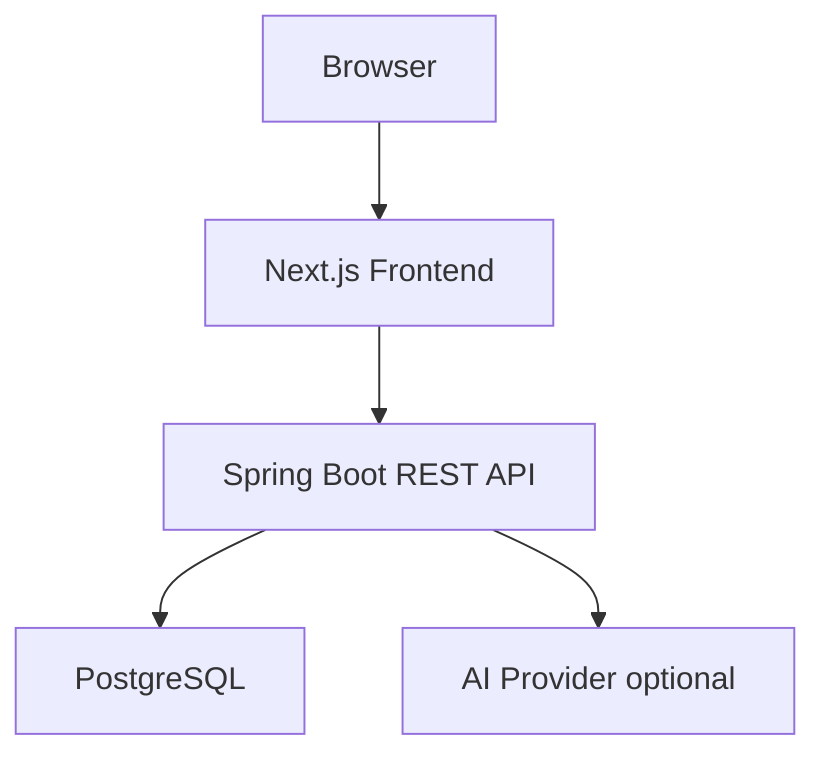

# Codex Ski Shop Zero Hit Radar

`Codex Ski Shop Zero Hit Radar` は、スキー用品 EC サイトを題材にしたフルスタックのデモアプリケーションです。

一般ユーザーが商品検索を行い、検索結果が 0 件だった有効なキーワードをバックエンドで記録します。管理者は Zero Hit Radar ダッシュボードで、見つからなかった検索キーワードを「潜在需要」として確認し、検索回数、最終検索日時、推定機会損失、優先度、AI 相談結果をもとに仕入れや商品企画の判断材料を得られます。

このリポジトリは将来的な OSS 公開を想定しています。設定は環境変数で管理し、デモ用認証情報は明示し、AI API キーが未設定でもアプリケーション全体が破綻しない fallback を備えています。

## 目次

- [主な機能](#主な機能)
- [システム構成](#システム構成)
- [ディレクトリ構成](#ディレクトリ構成)
- [AI 駆動開発で実装したファイル数](#ai-駆動開発で実装したファイル数)
- [技術スタック](#技術スタック)
- [前提条件](#前提条件)
- [Docker Compose で起動する](#docker-compose-で起動する)
- [PostgreSQL に接続して DB と Table を確認する](#postgresql-に接続して-db-と-table-を確認する)
- [デモ用ログイン情報](#デモ用ログイン情報)
- [環境変数](#環境変数)
- [主要ユーザージャーニー](#主要ユーザージャーニー)
- [ローカル開発](#ローカル開発)
- [主要 API](#主要-api)
- [Zero Hit Radar の仕様](#zero-hit-radar-の仕様)
- [テストと品質確認](#テストと品質確認)
- [レビュー対応状況と TODO](#レビュー対応状況と-todo)
- [トラブルシューティング](#トラブルシューティング)
- [提出前チェック](#提出前チェック)
- [OSS 公開前チェックリスト](#oss-公開前チェックリスト)
- [関連ドキュメント](#関連ドキュメント)

## 主な機能

### 一般ユーザー向け

- スキーショップのトップページ表示
- 初期商品一覧の表示
- 商品名、メーカー、カテゴリ、説明を対象にした商品検索
- カテゴリ絞り込みと並び替え
- 検索結果あり、検索結果 0 件、ロード中、API 失敗時の自然な UI 表示

### 管理者向け

- 環境変数で設定した管理者アカウントによるログイン
- Bearer token による管理者 API 保護
- Zero Hit キーワード一覧
- 検索回数、初回検索日時、最終検索日時、優先度、推定機会損失の表示
- 直近期間を指定した Zero Hit 分析
- Zero Hit キーワードに関する AI 相談
- AI API キー未設定時の fallback 回答

### OSS 公開を意識した特徴

- `.env` によるローカル設定の分離
- `.env.example` による安全なサンプル設定
- Flyway による DB マイグレーションと seed データ投入
- Docker Compose による再現可能な起動手順
- バックエンド、フロントエンドそれぞれのテスト、静的解析、E2E テスト
- API エラーを安定した JSON 形式で返す設計
- 外部 AI プロバイダーに依存しすぎない fallback 設計

## システム構成



Docker Compose では次の 3 サービスを起動します。

| サービス | URL | 役割 |
| --- | --- | --- |
| `frontend` | `http://localhost:3000` | Next.js によるストアフロントと管理画面 |
| `backend` | `http://localhost:8080` | Spring Boot REST API |
| `db` | `localhost:5432` | PostgreSQL データベース |

ブラウザは `frontend` にアクセスし、フロントエンドは `backend` の REST API を呼び出します。バックエンドは商品データと Zero Hit データを PostgreSQL に永続化します。

## ディレクトリ構成

```text
.
├── backend/         Spring Boot API、Flyway migration、バックエンドテスト、Dockerfile
├── frontend/        Next.js App Router UI、型付き API client、Vitest、Playwright、Dockerfile
├── code-review/     Java コードレビュー用 TypeScript CLI
├── docs/            AI エージェント向け実装・レビューガイド
├── images/          画面デザイン参考画像
├── review-reports/  コードレビューや手動確認の出力例
├── sample-java-code/ Java レビュー CLI 用サンプルコード
├── spec-design/     要件定義、バックエンド設計、フロントエンド設計
├── .env.example     ローカル起動用の安全なサンプル環境変数
└── docker-compose.yml
```

## AI 駆動開発で実装したファイル数

2026-06-05 時点で、`frontend`、`backend`、`code-review` の各プロジェクトについて、依存ライブラリと生成物を除外して AI 駆動開発で実装したファイル数を集計しました。

| プロジェクト | 実装ファイル数 | 主な対象 |
| --- | ---: | --- |
| `frontend` | 95 | Next.js App Router、React components、API client、型定義、テスト、Docker / lint / test 設定、静的画像 |
| `backend` | 101 | Spring Boot API、domain / service / repository / controller、DTO、Flyway migration、統合テスト、Docker / Maven 設定 |
| `code-review` | 76 | TypeScript CLI、orchestrator、agent runner、report generator、review result handling、unit / E2E test、Java fixture |
| 合計 | 272 | 上記 3 プロジェクトの合計 |

集計では、依存ライブラリ、ビルド成果物、coverage / report、テスト実行結果、自動生成ファイルを除外しています。具体的には、`node_modules`、`.next`、`dist`、`target`、`coverage`、`playwright-report`、`test-results`、`package-lock.json`、`next-env.d.ts`、`tsconfig.tsbuildinfo`、`.mvn`、Maven wrapper、`.gitkeep`、Spring Initializr の `HELP.md` を対象外にしました。

再集計する場合は、リポジトリルートで次を実行します。

```bash
find frontend -type f \( -path '*/node_modules/*' -o -path '*/.next/*' -o -path '*/coverage/*' -o -path '*/playwright-report/*' -o -path '*/test-results/*' \) -prune -o -type f ! -name 'package-lock.json' ! -name 'next-env.d.ts' ! -name 'tsconfig.tsbuildinfo' ! -name '.gitkeep' -print | wc -l
find backend -type f \( -path '*/target/*' -o -path '*/.mvn/*' \) -prune -o -type f ! -name '.gitkeep' ! -name 'mvnw' ! -name 'mvnw.cmd' ! -name 'HELP.md' -print | wc -l
find code-review -type f \( -path '*/node_modules/*' -o -path '*/dist/*' -o -path '*/coverage/*' \) -prune -o -type f ! -name 'package-lock.json' -print | wc -l
```

## 技術スタック

| 領域 | 技術 |
| --- | --- |
| フロントエンド | Next.js, React, TypeScript, CSS Modules |
| フロントエンドテスト | Vitest, Testing Library, Playwright |
| バックエンド | Java 21, Spring Boot, Spring Web MVC, Spring Security |
| 永続化 | Spring Data JPA, PostgreSQL |
| DB migration | Flyway |
| AI 連携 | Spring AI, OpenAI-compatible provider |
| ビルド・実行 | Maven, npm, Docker, Docker Compose |
| レビュー支援 | TypeScript 製 Java Code Review Orchestrator |

## 前提条件

Docker Compose で全体を起動する場合:

- Docker
- Docker Compose

ローカルで個別に開発する場合:

- Java 21
- Node.js 20 以上
- npm
- PostgreSQL または Docker

## Docker Compose で起動する

リポジトリルートで次を実行します。

```bash
cp .env.example .env
docker compose up --build
```

起動後、次の URL にアクセスできます。

- フロントエンド: `http://localhost:3000`
- バックエンド health check: `http://localhost:8080/actuator/health`
- 商品 API 例: `http://localhost:8080/api/products?limit=3`

停止する場合:

```bash
docker compose down
```

ローカル DB の volume も削除して初期状態からやり直す場合:

```bash
docker compose down -v
```

## PostgreSQL に接続して DB と Table を確認する

Docker Compose で起動した PostgreSQL は、サービス名 `db` として起動し、ホスト側の `localhost:5432` に公開されます。`.env.example` の値を使っている場合、接続情報は次のとおりです。

| 項目 | 値 |
| --- | --- |
| Host | `localhost` |
| Port | `5432` |
| Database | `skishop` |
| User | `skishop` |
| Password | `skishop-local-password` |
| Docker Compose service | `db` |

### Docker コンテナ内の psql から接続する

ローカルに `psql` をインストールしていなくても、PostgreSQL コンテナに含まれる `psql` を使って確認できます。

```bash
docker compose exec -T db psql -U skishop -d skishop -c "\l"
```

DB 一覧には、アプリケーション用 DB として `skishop` が表示されます。

```text
Name
--------
postgres
skishop
template0
template1
```

作成済み table を確認するには、次を実行します。

```bash
docker compose exec -T db psql -U skishop -d skishop -c "\dt"
```

主な table は次の 3 つです。

| Table | 役割 |
| --- | --- |
| `products` | 商品 seed データ。初期状態で 100 件投入されます。 |
| `zero_hit_searches` | 検索結果が 0 件だったキーワードの集計データ。 |
| `flyway_schema_history` | Flyway migration の適用履歴。 |

table 名だけを SQL で確認する場合:

```bash
docker compose exec -T db psql -U skishop -d skishop -c "select table_name from information_schema.tables where table_schema = 'public' order by table_name;"
```

### ローカルにインストールした psql から接続する

ホストマシンに `psql` が入っている場合は、公開ポート `localhost:5432` から接続できます。

```bash
PGPASSWORD=skishop-local-password psql -h localhost -p 5432 -U skishop -d skishop
```

ワンライナーで接続確認する場合:

```bash
PGPASSWORD=skishop-local-password psql -h localhost -p 5432 -U skishop -d skishop -c "select current_database() as database, current_user as user_name;"
```

### データを参照する

商品 seed データの件数を確認します。

```bash
docker compose exec -T db psql -U skishop -d skishop -c "select count(*) as product_count from products;"
```

初期 seed が正しく入っていれば `100` 件になります。

商品データの一部を確認します。

```bash
docker compose exec -T db psql -U skishop -d skishop -c "select manufacturer, name, category, price, stock_status from products order by created_at desc limit 5;"
```

Zero Hit データを確認します。

```bash
docker compose exec -T db psql -U skishop -d skishop -c "select id, keyword, normalized_keyword, hit_count, priority, estimated_opportunity_loss, first_searched_at, last_searched_at from zero_hit_searches order by last_searched_at desc limit 5;"
```

まだ 0 件検索をしていない場合、`zero_hit_searches` は空です。動作確認用に API 経由で 0 件検索を発生させるには、次を実行します。

```bash
curl -sS "http://localhost:8080/api/products/search?q=readme-db-check-unique-keyword"
```

レスポンスに `"zeroHitRecorded":true` が含まれていれば、Zero Hit として記録されています。その後、もう一度 `zero_hit_searches` を参照すると、対象キーワードが保存されていることを確認できます。

Flyway migration の適用履歴を確認する場合:

```bash
docker compose exec -T db psql -U skishop -d skishop -c "select version, description, success, installed_on from flyway_schema_history order by installed_rank;"
```

現時点では、次の migration が適用されます。

| Version | Description |
| --- | --- |
| `1` | `create products and zero hit searches` |
| `2` | `seed products` |
| `3` | `zero hit invariants` |

注意:

- `POSTGRES_PORT` を変更している場合、ホスト側から接続するときの `-p` には変更後のポートを指定してください。
- `POSTGRES_USER`, `POSTGRES_PASSWORD`, `POSTGRES_DB` を変更している場合、上記コマンドの user、password、database も同じ値に置き換えてください。
- 公開リポジトリや共有ログに、実運用の DB パスワードや接続文字列を載せないでください。

## デモ用ログイン情報

`.env.example` の値をそのまま利用した場合、管理画面には次の情報でログインできます。

| 項目 | 値 |
| --- | --- |
| ユーザー名 | `admin@example.com` |
| パスワード | `change-me` |

`ADMIN_PASSWORD={noop}change-me` は Spring Security のデモ用エンコード形式です。本番や公開デモ環境では、必ず強いパスワードと安全なエンコード済み値を使ってください。

## 環境変数

ローカル Docker Compose では `.env.example` を `.env` にコピーして利用できます。

```bash
cp .env.example .env
```

主要な環境変数は次のとおりです。

| 変数 | 説明 | 例 |
| --- | --- | --- |
| `POSTGRES_DB` | PostgreSQL の DB 名 | `skishop` |
| `POSTGRES_USER` | PostgreSQL ユーザー | `skishop` |
| `POSTGRES_PASSWORD` | PostgreSQL パスワード | `skishop-local-password` |
| `POSTGRES_PORT` | ホスト側 PostgreSQL ポート | `5432` |
| `BACKEND_PORT` | ホスト側バックエンドポート | `8080` |
| `FRONTEND_PORT` | ホスト側フロントエンドポート | `3000` |
| `ADMIN_USERNAME` | 管理者ログイン ID | `admin@example.com` |
| `ADMIN_PASSWORD` | Spring Security 形式の管理者パスワード | `{noop}change-me` |
| `ADMIN_TOKEN_TTL` | 管理者 token の有効期間 | `PT8H` |
| `CORS_ALLOWED_ORIGINS` | ブラウザから許可する origin | `http://localhost:3000` |
| `NEXT_PUBLIC_API_BASE_URL` | ブラウザから見えるバックエンド URL | `http://localhost:8080` |
| `INTERNAL_API_BASE_URL` | コンテナ内 SSR 用バックエンド URL | `http://backend:8080` |
| `AI_API_KEY` | AI プロバイダー API キー。空なら fallback | 空文字 |
| `AI_MODEL` | AI 相談で利用するモデル名 | `gpt-4.1-mini` |

重要:

- `.env`、API key、token、password、個人情報はコミットしないでください。
- `NEXT_PUBLIC_API_BASE_URL` はブラウザから解決できる URL を指定します。Docker Compose のブラウザ向け設定では `http://localhost:8080` を使います。
- `http://backend:8080` は Docker ネットワーク内の名前解決用であり、ブラウザからは通常アクセスできません。
- `AI_API_KEY` が空でも AI 相談機能は fallback 回答を返すため、基本デモは成立します。

## 主要ユーザージャーニー

### ストアフロント

1. `http://localhost:3000` を開きます。
2. seed データから初期商品一覧が表示されることを確認します。
3. `Atomic` など、存在する商品・メーカー名で検索します。
4. 商品カードにメーカー、商品名、カテゴリ、価格、在庫状態が表示されることを確認します。
5. `wide touring plate` など、存在しないキーワードで検索します。
6. 画面に 0 件状態が表示され、バックエンドに Zero Hit キーワードが記録されます。

### 管理者

1. `http://localhost:3000/login` を開きます。
2. デモ用または設定済みの管理者アカウントでログインします。
3. Zero Hit Radar ダッシュボードを開きます。
4. 先ほど検索した 0 件キーワードが、検索回数、優先度、推定機会損失とともに表示されることを確認します。
5. 対象キーワードを選択して `AI 相談` を実行します。
6. `AI_API_KEY` が空の場合は、`providerStatus: FALLBACK` のデモ回答が返ることを確認します。

## ローカル開発

### バックエンド

```bash
cd backend
./mvnw test
./mvnw verify
./mvnw spring-boot:run
```

`./mvnw verify` を実行すると JaCoCo の coverage report が生成されます。

```text
backend/target/site/jacoco/index.html
```

バックエンド単体の Docker smoke test:

```bash
cd backend
docker compose -f compose.smoke.yml up --build -d
curl http://localhost:8080/actuator/health
curl "http://localhost:8080/api/products?limit=3"
docker compose -f compose.smoke.yml down -v
```

### フロントエンド

```bash
cd frontend
npm install
npm run lint
npm run typecheck
npm test
npm run build
npm run e2e
npm run dev
```

開発サーバー起動後、`http://localhost:3000` を開きます。ローカルで起動したバックエンドに接続する場合は、必要に応じて次の環境変数を設定します。

```bash
NEXT_PUBLIC_API_BASE_URL=http://localhost:8080
```

Playwright E2E テストはブラウザ内でバックエンド API を mock し、トップページ、商品一覧、ログイン、Zero Hit ダッシュボード、AI fallback を検証します。

### Java Code Review Orchestrator

`code-review/` には、Java 関連コードを複数の専門レビュー観点で確認する TypeScript CLI が含まれています。通常のアプリ起動には不要ですが、Java 実装のレビュー自動化や CI/CD 検討に利用できます。

```bash
cd code-review
npm install
npm run lint
npm run test
npm run build
```

実際に Codex SDK を使うレビューでは、`CODEX_API_KEY` または `OPENAI_API_KEY` が必要です。キーやイベントログに秘密情報が残らないよう、公開前には出力内容を確認してください。

## 主要 API

| Method | Path | 説明 | 認証 |
| --- | --- | --- | --- |
| `GET` | `/actuator/health` | health check | 不要 |
| `GET` | `/api/products` | 商品一覧。`limit`, `category`, `sort` を指定可能 | 不要 |
| `GET` | `/api/products/search` | 商品検索。0 件時に Zero Hit を記録 | 不要 |
| `POST` | `/api/auth/login` | 管理者ログイン | 不要 |
| `GET` | `/api/auth/me` | Bearer token から現在の管理者を取得 | 必要 |
| `GET` | `/api/admin/zero-hits` | Zero Hit 一覧と集計を取得 | 必要 |
| `POST` | `/api/admin/ai-consult` | Zero Hit キーワードについて AI に相談 | 必要 |

API エラーは、次のような安定した JSON payload で返します。

```json
{
  "timestamp": "2026-06-04T12:00:00Z",
  "status": 400,
  "message": "Invalid request",
  "code": "VALIDATION_ERROR",
  "path": "/api/products/search",
  "errors": []
}
```

## Zero Hit Radar の仕様

Zero Hit Radar は、単なる検索ログではなく「顧客が探したが見つからなかった需要候補」を集計する機能です。

- 空文字、空白のみの検索は記録しません。
- 検索結果が 1 件以上ある場合は記録しません。
- 有効な非空キーワードで検索結果が 0 件だった場合のみ記録します。
- キーワードは前後空白を除去し、小文字化し、連続空白をまとめて正規化します。
- 同じ正規化キーワードが再度 0 件になった場合、新しい行は作らず `hitCount` を加算します。
- `hitCount` と平均商品価格をもとに推定機会損失を計算します。
- 需要の強さに応じて優先度を再計算します。
- AI 相談の回答は MVP では永続化しません。

## テストと品質確認

OSS として公開できる品質を目指すため、変更後は可能な範囲で次を実行してください。

### バックエンド

```bash
cd backend
./mvnw test
./mvnw verify
```

確認観点:

- REST API が設計書どおりに応答すること
- Zero Hit の正規化、upsert、優先度、推定機会損失が正しく動作すること
- 認証失敗、token 期限切れ、AI provider 失敗時に安全なレスポンスを返すこと
- JaCoCo report で line coverage と branch coverage を確認すること

### フロントエンド

```bash
cd frontend
npm run lint
npm run typecheck
npm test
npm run build
npm run e2e
```

確認観点:

- トップページ、商品一覧、ログイン、管理ダッシュボードが崩れていないこと
- ロード中、空状態、API エラー、認証失敗、AI fallback の UX が自然であること
- 主要ボタンや導線が未接続になっていないこと
- Playwright で主要ユーザージャーニーが通ること

#### Playwright E2E テスト

初回セットアップでは、Playwright が利用するブラウザをインストールします。

```bash
cd frontend
npm install
npx playwright install
```

E2E テストを実行します。

```bash
npm run e2e
```

`npm run e2e` は `playwright test` を実行します。`frontend/playwright.config.ts` の `webServer` 設定により、必要に応じて `npm run dev` が自動起動され、`http://localhost:3000` に対してテストします。既にローカル開発サーバーが起動している場合、ローカル実行では既存サーバーを再利用します。

現在の Playwright E2E テストは、ブラウザ内でバックエンド API を mock し、バックエンドを別途起動せずに次の主要 UX を検証します。

- トップページの商品表示、検索、0 件状態
- 商品一覧の検索、カテゴリフィルタ、ソート
- 管理者ログイン、Zero Hit ダッシュボード、AI 相談 fallback

デバッグや手動確認を併用する場合は、次のコマンドが便利です。

```bash
npx playwright test --headed
npx playwright test --ui
npx playwright show-report
npx playwright test zero-hit-radar.spec.ts
```

### フルスタック

```bash
docker compose up --build
```

確認観点:

- `frontend`, `backend`, `db` が正常に起動すること
- `http://localhost:3000` でストアフロントが表示されること
- `http://localhost:8080/actuator/health` が正常応答すること
- 商品検索で 0 件キーワードを発生させ、管理画面で確認できること
- `AI_API_KEY` 未設定でも AI 相談の fallback が表示されること

カバレッジは line coverage と branch coverage の両方で 80% 以上を目標とします。未達の場合は、未達理由と追加すべきテストを issue、PR、またはレビュー記録に明記してください。

## レビュー対応状況と TODO

`review-reports/manual-backend-full/backend/check-report-1.md` のレポートに対する修正対応計画は、`spec-design/modify-issues/full-review-modify-plan.md` にまとめています。

現時点では、同計画の Phase A から Phase C までの対応が完了しています。Phase C までで、設計判断の明文化、validation / auth hardening、Zero Hit 記録の PostgreSQL atomic upsert、aggregate invariant、raw keyword logging の除去を実装し、backend の `./mvnw verify` が成功することを確認しています。

Phase D 以降は、4 時間という時間制限の中で無理に実装すると、今後の破壊的変更やプログラム不具合につながる可能性があるため、次の TODO アクションとして残します。対応時は `spec-design/modify-issues/full-review-modify-plan.md` の推奨実装順序と各 Phase の完了チェックに従い、backend / frontend / 設計書 / テストを同時に更新してください。

今後の TODO:

- Phase G: secret / profile 分離と docker compose 再検証
- Phase E: AI provider resilience、timeout、transaction 分離
- Phase F: ProblemDetail、logging、correlation ID、security headers
- Phase D: GET search の副作用分離を backend / frontend / design docs で同時実装
- Phase H: pagination、projection、null safety、entity annotation
- Phase I: domain value object 化
- Phase J: test、dependency、release hygiene と coverage 確認

## トラブルシューティング

| 症状 | 確認すること |
| --- | --- |
| ポートが競合する | `.env` で `FRONTEND_PORT`, `BACKEND_PORT`, `POSTGRES_PORT` を変更してください。 |
| フロントエンドからバックエンドに接続できない | `NEXT_PUBLIC_API_BASE_URL=http://localhost:8080` になっているか確認してください。 |
| `http://backend:8080` にブラウザから接続できない | これは Docker コンテナ内部用の host 名です。ブラウザ向けには `http://localhost:8080` を使います。 |
| CORS エラーが出る | `CORS_ALLOWED_ORIGINS=http://localhost:3000` を確認してください。 |
| 管理者ログインに失敗する | `ADMIN_USERNAME` と `ADMIN_PASSWORD` を確認してください。デモ値 `{noop}change-me` のログインパスワードは `change-me` です。 |
| AI 相談が fallback になる | `AI_API_KEY` が空の場合は期待どおりです。ライブ AI を使う場合のみキーを設定してください。 |
| DB を初期化したい | `docker compose down -v` で volume を削除してから再起動してください。 |
| Flyway migration が失敗する | DB volume に古い schema が残っていないか確認し、必要に応じて `docker compose down -v` を実行してください。 |

## 関連ドキュメント

- 要件定義: `spec-design/zero-hit-radar-requirment.md`
- バックエンド詳細設計: `spec-design/backend-design.md`
- フロントエンド詳細設計: `spec-design/front-design.md`
- Backend full review report: `review-reports/manual-backend-full/backend/check-report-1.md`
- Backend full review modify plan: `spec-design/modify-issues/full-review-modify-plan.md`
- バックエンド README: `backend/README.md`
- フロントエンド README: `frontend/README.md`
- Java Code Review Orchestrator README: `code-review/README.md`
- 提出ガイド: `docs/submission-guide.md`
- AI エージェント向け作業方針: `AGENTS.md`

## ライセンス

このリポジトリ全体は Apache License 2.0 で公開する想定です。詳細は `LICENSE` を参照してください。

`code-review/` 配下も Apache-2.0 として扱います。リポジトリ全体として公開する際は、追加する第三者素材や生成物のライセンスがこの方針と矛盾しないことを確認してください。
