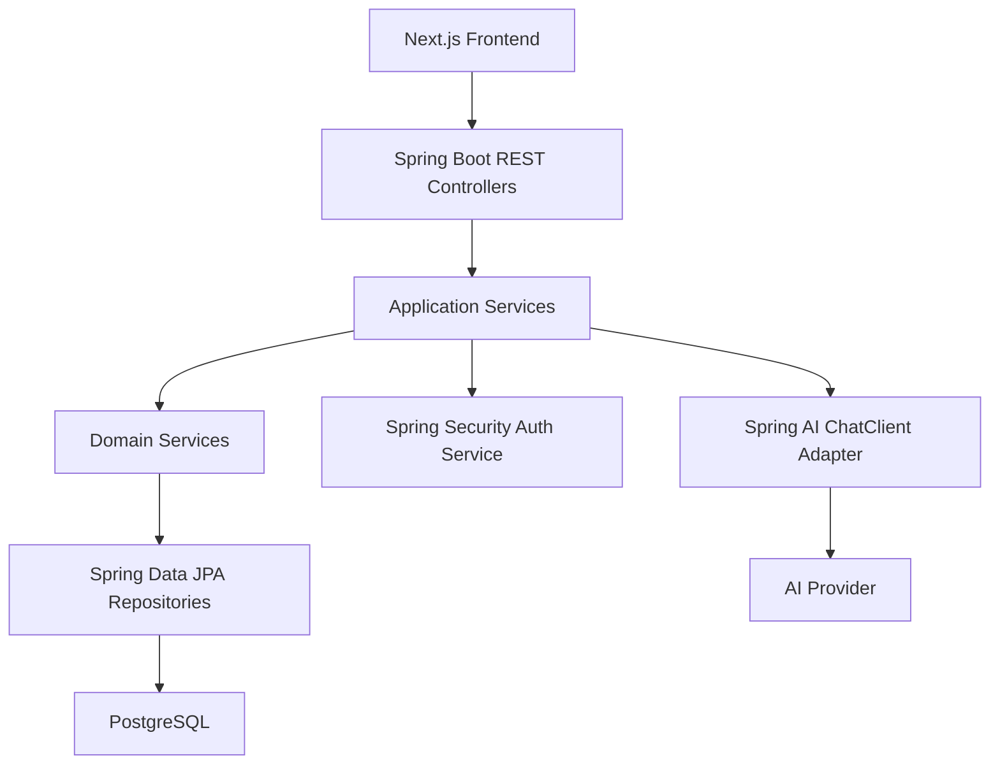
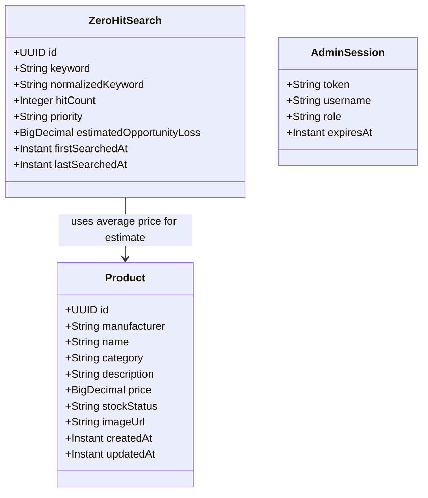
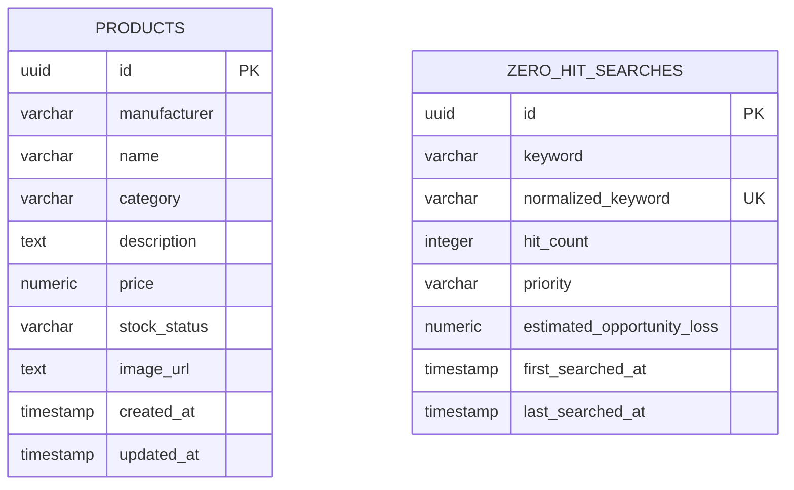
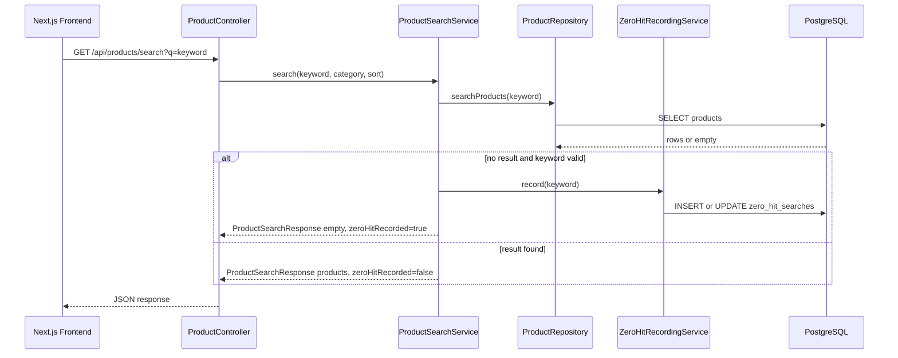
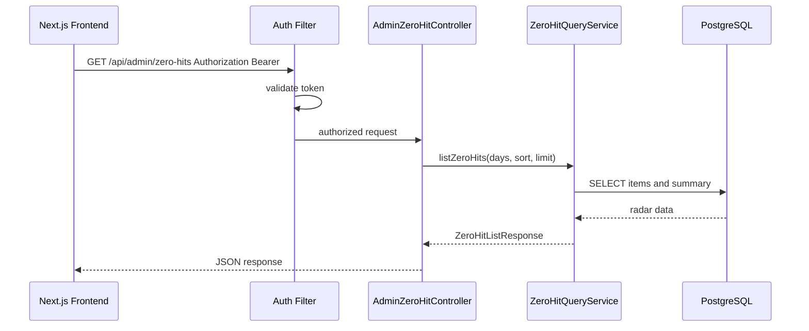
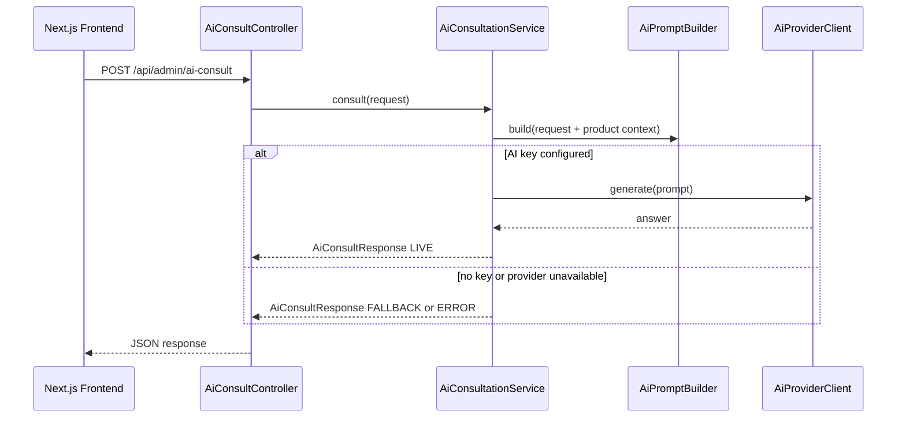

# Codex Ski Shop Backend Service Detailed Design Specification

## 1. Service Overview

### 1.1 Purpose and Responsibility Scope

The Backend Service provides the REST API, persistence, authentication, product search, Zero Hit Radar aggregation, and AI consultation functions for `Codex Ski Shop`. It is implemented with Java 21 and Spring Boot, persists product and zero-hit demand data in PostgreSQL, and exposes APIs consumed by the Next.js Frontend Service.

The backend owns product data, zero-hit keyword normalization, zero-hit upsert logic, administrator authentication, admin authorization checks, and AI provider integration. The frontend owns rendering and user interaction only.

### 1.2 Architectural Principles

- Keep API contracts explicit and stable for the Next.js frontend.
- Record zero-hit keywords only on valid non-empty searches whose result count is 0.
- Use normalized keywords and database constraints to avoid duplicate demand records.
- Keep authentication simple for MVP while protecting admin endpoints.
- Keep AI integration optional at runtime so the demo works without an API key.
- Use Docker and environment variables so the service starts cleanly with docker compose.

### 1.3 Technology Stack

| Technology Item | Selected Technology | Usage |
| --- | --- | --- |
| Language | Java 21 | Backend implementation |
| Framework | Spring Boot | REST API, dependency injection, configuration, validation |
| Web | Spring Web MVC | REST controllers and JSON APIs |
| Validation | Spring Boot Validation / Jakarta Validation | Request DTO validation with `@Valid`, `@NotBlank`, and related annotations |
| Persistence | Spring Data JPA | Product and zero-hit repositories |
| Database | PostgreSQL | Product and zero-hit persistence |
| Migration/Seed | Flyway preferred, SQL initializer acceptable | Schema and 100 product seed data |
| Security | Spring Security | Authentication, admin endpoint protection, CORS, security filter chain |
| Auth Token | Spring Security filter + simple bearer token or signed JWT for MVP | Protect admin APIs |
| AI | Spring AI | AI chat client integration, prompt construction, provider abstraction |
| AI HTTP Fallback | Spring WebClient or RestClient | Optional fallback only if Spring AI provider configuration is unavailable |
| Observability | Spring Boot Actuator | Health checks and operational endpoints |
| Build | Maven or Gradle | Java build |
| Container | Docker multi-stage build | Build and runtime image |
| Testing | JUnit 5, Spring Boot Test, Testcontainers optional | API and service verification |

## 2. Overall Architecture Design

### 2.1 Architecture Overview



### 2.2 Layered Architecture

| Layer | Responsibility | Example Classes |
| --- | --- | --- |
| Controller | HTTP endpoints, validation, response mapping | `ProductController`, `AuthController`, `AdminZeroHitController`, `AiConsultController` |
| Application Service | Use-case orchestration | `ProductSearchService`, `ZeroHitQueryService`, `AdminAuthService`, `AiConsultationService` |
| Domain Service | Business rules | `KeywordNormalizer`, `OpportunityLossCalculator`, `AiPromptBuilder` |
| Repository | Data access | `ProductRepository`, `ZeroHitSearchRepository` |
| Infrastructure | External services and config | `SpringAiConfig`, `SecurityConfig`, `CorsConfig`, `BearerTokenAuthenticationFilter` |

### 2.3 Data Ownership

| Data | Owner | Notes |
| --- | --- | --- |
| Products | Backend/PostgreSQL | Seeded with 100 real manufacturer/product based records |
| Zero Hit searches | Backend/PostgreSQL | Upserted by normalized keyword |
| Admin credentials | Environment variables | `ADMIN_USERNAME`, `ADMIN_PASSWORD` |
| Admin token | Backend | Issued on login, validated on admin APIs |
| AI answers | Backend transient response | Not persisted in MVP |

## 3. Domain Model Design

### 3.1 Entity Class Diagram



### 3.2 Entity Definitions

#### Product

Represents a ski shop product. Products are read-only in the MVP and seeded during database initialization.

#### ZeroHitSearch

Represents aggregated demand for a search keyword that returned no products. The table stores one row per normalized keyword and increments `hitCount` on repeat zero-hit searches.

#### AdminSession

Represents an authenticated admin session. For MVP, this may be implemented as a signed token rather than a persisted table.

## 4. Database Design

### 4.1 ER Diagram



### 4.2 Table Definitions

#### `products`

| Column | Type | Constraint | Notes |
| --- | --- | --- | --- |
| `id` | UUID | PK | Generated by application or DB |
| `manufacturer` | VARCHAR(100) | NOT NULL | Atomic, Salomon, Rossignol, etc. |
| `name` | VARCHAR(255) | NOT NULL | Real product based sample name |
| `category` | VARCHAR(80) | NOT NULL | Ski, Boots, Goggles, Helmet, etc. |
| `description` | TEXT | NOT NULL | Search target |
| `price` | NUMERIC(12,2) | NOT NULL | JPY sample price |
| `stock_status` | VARCHAR(40) | NOT NULL | `IN_STOCK`, `LOW_STOCK`, `OUT_OF_STOCK` |
| `image_url` | TEXT | NULL | Category placeholder allowed |
| `created_at` | TIMESTAMP | NOT NULL | Created time |
| `updated_at` | TIMESTAMP | NOT NULL | Updated time |

#### `zero_hit_searches`

| Column | Type | Constraint | Notes |
| --- | --- | --- | --- |
| `id` | UUID | PK | Generated by application or DB |
| `keyword` | VARCHAR(255) | NOT NULL | Display keyword |
| `normalized_keyword` | VARCHAR(255) | NOT NULL, UNIQUE | Duplicate prevention |
| `hit_count` | INTEGER | NOT NULL | Starts at 1 |
| `priority` | VARCHAR(20) | NOT NULL | `HIGH`, `MEDIUM`, or `LOW` |
| `estimated_opportunity_loss` | NUMERIC(12,2) | NULL | Calculated estimate |
| `first_searched_at` | TIMESTAMP | NOT NULL | First zero-hit time |
| `last_searched_at` | TIMESTAMP | NOT NULL | Last zero-hit time |

### 4.3 Index Design

| Table | Index | Purpose |
| --- | --- | --- |
| `products` | `idx_products_name_lower` | Product name search |
| `products` | `idx_products_manufacturer_lower` | Manufacturer search |
| `products` | `idx_products_category` | Category filter |
| `zero_hit_searches` | `uk_zero_hit_normalized_keyword` | Upsert duplicate control |
| `zero_hit_searches` | `idx_zero_hit_hit_count` | Sort by demand strength |
| `zero_hit_searches` | `idx_zero_hit_last_searched_at` | Sort/filter by recency |

### 4.4 Initial Data

- Seed 100 products by default.
- Product data uses real ski manufacturers and real product names as the basis.
- Categories include skis, ski boots, bindings, goggles, helmets, wear, gloves, poles, wax, and tuning goods.
- Seed data must include manufacturer, name, category, description, price, stock status, and image placeholder.

## 5. RESTful API Endpoint Design

### 5.1 Product API

| Method | Endpoint | Description | Parameters | Response |
| --- | --- | --- | --- | --- |
| GET | `/api/products` | List products | Query: `limit`, `category`, `sort` | `ProductListResponse` |
| GET | `/api/products/search` | Search products and record zero-hit when no result | Query: `q`, `category`, `sort` | `ProductSearchResponse` |

### 5.2 Authentication API

| Method | Endpoint | Description | Parameters | Response |
| --- | --- | --- | --- | --- |
| POST | `/api/auth/login` | Admin login | Body: `LoginRequest` | `LoginResponse` |
| GET | `/api/auth/me` | Validate current admin token | Header: `Authorization` | `AuthMeResponse` |

Login failure should return `401 Unauthorized` with an error payload. If the implementation returns `LoginResponse.success=false` for MVP simplicity, the frontend must still treat it as a failed login and must not store a token.

### 5.3 Admin API

| Method | Endpoint | Description | Parameters | Response |
| --- | --- | --- | --- | --- |
| GET | `/api/admin/zero-hits` | List and summarize zero-hit demand | Query: `days`, `sort`, `limit`; Header: `Authorization` | `ZeroHitListResponse` |
| POST | `/api/admin/ai-consult` | Ask AI about a zero-hit keyword or business question | Body: `AiConsultRequest`; Header: `Authorization` | `AiConsultResponse` |

### 5.4 Health API

| Method | Endpoint | Description | Response |
| --- | --- | --- | --- |
| GET | `/actuator/health` | Spring health check | Actuator health payload |

## 6. API DTO Design

### 6.1 Product DTOs

```java
public record ProductDto(
    UUID id,
    String manufacturer,
    String name,
    String category,
    String description,
    BigDecimal price,
    String stockStatus,
    String imageUrl,
    Instant createdAt,
    Instant updatedAt
) {}

public record ProductListResponse(
    List<ProductDto> items,
    long totalCount
) {}

public record ProductSearchResponse(
    List<ProductDto> items,
    long totalCount,
    boolean zeroHitRecorded
) {}
```

### 6.2 Auth DTOs

```java
public record LoginRequest(
    @NotBlank String username,
    @NotBlank String password
) {}

public record LoginResponse(
    boolean success,
    String token,
    AdminUserDto user
) {}

public record AdminUserDto(
    String username,
    String role
) {}

public record AuthMeResponse(
    boolean authenticated,
    AdminUserDto user
) {}
```

When `authenticated=false`, `user` may be `null` or omitted from the JSON response.

### 6.3 Zero Hit DTOs

```java
public record ZeroHitItemDto(
    UUID id,
    String keyword,
    String normalizedKeyword,
    int hitCount,
    Priority priority,
    BigDecimal estimatedOpportunityLoss,
    Instant firstSearchedAt,
    Instant lastSearchedAt
) {}

public enum Priority {
    HIGH,
    MEDIUM,
    LOW
}

public record ZeroHitSummaryDto(
    long zeroHitKeywordCount,
    long searchVolume,
    BigDecimal estimatedOpportunityLoss
) {}

public record ZeroHitListResponse(
    List<ZeroHitItemDto> items,
    ZeroHitSummaryDto summary
) {}
```

### 6.4 AI DTOs

```java
public record AiConsultRequest(
    String keyword,
    @NotBlank String question,
    Integer hitCount,
    Instant lastSearchedAt
) {}

public record AiConsultResponse(
    String answer,
    ProviderStatus providerStatus
) {}

public enum ProviderStatus {
    LIVE,
    FALLBACK,
    ERROR
}
```

## 7. Implementation Class Design

### 7.1 Controller Classes

#### `ProductController`

| Method | Description | Parameters | Return Value | Business Logic |
| --- | --- | --- | --- | --- |
| `listProducts()` | Return product list | `limit`, `category`, `sort` | `ProductListResponse` | Delegates to `ProductQueryService` |
| `searchProducts()` | Search products | `q`, `category`, `sort` | `ProductSearchResponse` | Delegates to `ProductSearchService` and records zero-hit if needed |

#### `AuthController`

| Method | Description | Parameters | Return Value | Business Logic |
| --- | --- | --- | --- | --- |
| `login()` | Authenticate admin | `LoginRequest` | `LoginResponse` | Validates env credentials and issues token |
| `me()` | Validate token | `Authorization` header | `AuthMeResponse` | Returns admin identity if valid |

#### `AdminZeroHitController`

| Method | Description | Parameters | Return Value | Business Logic |
| --- | --- | --- | --- | --- |
| `listZeroHits()` | Return radar data | `days`, `sort`, `limit` | `ZeroHitListResponse` | Requires admin token and builds summary |

#### `AiConsultController`

| Method | Description | Parameters | Return Value | Business Logic |
| --- | --- | --- | --- | --- |
| `consult()` | Ask AI for business advice | `AiConsultRequest` | `AiConsultResponse` | Requires Spring Security admin authentication, builds prompt, calls Spring AI adapter |

### 7.2 Application Service Classes

#### `ProductQueryService`

| Method | Description | Parameters | Return Value |
| --- | --- | --- | --- |
| `listProducts()` | Fetch products with optional category and sorting | `limit`, `category`, `sort` | `ProductListResponse` |

#### `ProductSearchService`

| Method | Description | Parameters | Return Value |
| --- | --- | --- | --- |
| `search()` | Search products and record zero-hit when needed | `keyword`, `category`, `sort` | `ProductSearchResponse` |

Business rules:

- Trim keyword.
- Empty keyword returns product list or empty controlled response without zero-hit recording.
- Search manufacturer, name, category, and description.
- If search result count is 0, call `ZeroHitRecordingService.record(keyword)`.

#### `ZeroHitRecordingService`

| Method | Description | Parameters | Return Value |
| --- | --- | --- | --- |
| `record()` | Upsert zero-hit keyword | `keyword` | `ZeroHitSearch` |

Business rules:

- Normalize keyword through `KeywordNormalizer`.
- If normalized keyword exists, increment `hitCount` and update `lastSearchedAt`.
- If not exists, insert with `hitCount=1`, `firstSearchedAt=now`, `lastSearchedAt=now`.
- Recalculate `estimatedOpportunityLoss`.
- Recalculate `priority` from `hitCount`, recency, and estimated opportunity loss. MVP thresholds may be simple, for example `HIGH` for `hitCount >= 5`, `MEDIUM` for `hitCount >= 2`, and `LOW` otherwise.

#### `ZeroHitQueryService`

| Method | Description | Parameters | Return Value |
| --- | --- | --- | --- |
| `listZeroHits()` | Query radar rows and summary | `days`, `sort`, `limit` | `ZeroHitListResponse` |

#### `AdminAuthService`

| Method | Description | Parameters | Return Value |
| --- | --- | --- | --- |
| `login()` | Validate admin credentials | `username`, `password` | `LoginResponse` |
| `validateToken()` | Validate bearer token | `token` | `AdminUserDto` |

Spring Security integration:

- `AdminAuthService` is used by the login endpoint and bearer token validation filter.
- The authenticated administrator should be represented as a Spring Security `Authentication` with role `ROLE_ADMIN`.
- Controller methods under `/api/admin/**` should rely on Spring Security authorization instead of manually checking credentials inside each controller.

#### `AiConsultationService`

| Method | Description | Parameters | Return Value |
| --- | --- | --- | --- |
| `consult()` | Build prompt and obtain advice | `AiConsultRequest` | `AiConsultResponse` |

Spring AI integration:

- `AiConsultationService` depends on an adapter that uses Spring AI `ChatClient`.
- `AiPromptBuilder` creates the prompt text and structured context.
- Spring AI provider configuration is injected through Spring Boot configuration properties and environment variables.
- If Spring AI is not configured, the service returns `ProviderStatus.FALLBACK` with a useful demo answer or `ProviderStatus.ERROR` with a controlled message.

### 7.3 Domain Service Classes

#### `KeywordNormalizer`

| Method | Input | Output | Rule |
| --- | --- | --- | --- |
| `normalize()` | Raw keyword | Normalized keyword | Trim, lower-case, collapse repeated whitespace |

#### `OpportunityLossCalculator`

| Method | Input | Output | Rule |
| --- | --- | --- | --- |
| `calculate()` | `hitCount` | JPY amount | `hitCount × averageProductPrice` |

The average product price may be a fixed MVP constant or computed from `products`.

#### `AiPromptBuilder`

Builds a Japanese administrator-facing prompt containing:

- Keyword.
- Hit count.
- Last searched time.
- Existing product categories.
- Existing manufacturers.
- Instruction to answer with conclusion, reason, candidate products, risks, and next actions.

### 7.4 Repository Classes

#### `ProductRepository`

| Method | Purpose |
| --- | --- |
| `findInitialProducts()` | Fetch initial product list |
| `searchProducts()` | Search manufacturer, name, category, description |
| `averagePrice()` | Calculate estimated opportunity loss basis |
| `findDistinctCategories()` | Optional category filter support |
| `findDistinctManufacturers()` | AI prompt context |

#### `ZeroHitSearchRepository`

| Method | Purpose |
| --- | --- |
| `findByNormalizedKeyword()` | Locate existing zero-hit record |
| `save()` | Insert/update record |
| `findRadarItems()` | Filter by date and sort |
| `sumHitCount()` | Summary search volume |
| `sumEstimatedOpportunityLoss()` | Summary opportunity loss |

## 8. Security Design

### 8.1 Spring Security Policy

The backend must use Spring Security for authentication and authorization. Security rules are defined in `SecurityConfig` with a `SecurityFilterChain`.

Endpoint policy:

| Path | Access |
| --- | --- |
| `GET /api/products` | Public |
| `GET /api/products/search` | Public |
| `POST /api/auth/login` | Public |
| `GET /api/auth/me` | Bearer token required |
| `/api/admin/**` | `ROLE_ADMIN` required |
| `/actuator/health` | Public for local development |

Recommended Spring Security components:

- `SecurityConfig`
- `BearerTokenAuthenticationFilter` or equivalent custom `OncePerRequestFilter`
- `AdminAuthService`
- `AdminAuthenticationPrincipal`
- `AuthenticationEntryPoint` for `401 Unauthorized`
- `AccessDeniedHandler` for `403 Forbidden`

CSRF policy:

- Because the frontend calls JSON APIs with bearer tokens, CSRF may be disabled for API endpoints in MVP.
- If HttpOnly cookie authentication is selected later, CSRF protection must be enabled and the frontend must send CSRF tokens.

### 8.2 Authentication

Admin credentials come from:

- `ADMIN_USERNAME`
- `ADMIN_PASSWORD`

Password handling:

- MVP may compare environment variable value directly.
- Prefer hashed password support if implementation time permits.
- Credentials must never be hard-coded into source.

### 8.3 Token

MVP token options:

- Signed JWT using an application secret.
- Opaque in-memory token with expiry.

Required behavior:

- Login returns token.
- Admin endpoints require `Authorization: Bearer <token>`.
- Invalid token returns `401 Unauthorized`.
- Valid token creates a Spring Security `Authentication` with authority `ROLE_ADMIN`.

### 8.4 CORS

Allowed origins come from `CORS_ALLOWED_ORIGINS`.

During docker compose local development:

- `http://localhost:3000`

CORS should be configured through Spring Security or Spring MVC CORS configuration so the Next.js frontend can call backend APIs without browser CORS failures.

## 9. AI Integration Design

### 9.1 Spring AI Integration Policy

AI consultation must be implemented with Spring AI as the primary integration layer.

Recommended components:

- Spring AI `ChatClient`
- `AiConsultationService`
- `AiPromptBuilder`
- `SpringAiConfig`

Implementation flow:

1. `AiConsultController` receives `AiConsultRequest`.
2. Spring Security confirms the requester has `ROLE_ADMIN`.
3. `AiConsultationService` loads lightweight context such as existing categories and manufacturers.
4. `AiPromptBuilder` builds a Japanese business consultation prompt.
5. Spring AI `ChatClient` sends the prompt to the configured model.
6. The backend returns `AiConsultResponse`.

### 9.2 Runtime Behavior

| AI Configuration | Behavior |
| --- | --- |
| Spring AI provider and `AI_API_KEY` configured | Call AI provider through Spring AI and return `providerStatus=LIVE` |
| API key missing | Return useful demo fallback or `providerStatus=FALLBACK` |
| Provider error | Return controlled error or fallback answer without crashing |

### 9.3 Prompt Requirements

The prompt must request business-oriented advice for a ski shop administrator:

- Demand possibility.
- Candidate brands or product types.
- Whether inventory should be considered.
- Sourcing risks and seasonality.
- Related or substitute products.
- Recommended next action.

### 9.4 Response Format

The answer should be Japanese prose with clear sections:

- Conclusion
- Rationale
- Procurement candidates
- Considerations
- Next actions

### 9.5 Spring AI Configuration

The design should support provider configuration through Spring Boot properties and environment variables. The exact provider can be selected at implementation time, but the application code should depend on Spring AI abstractions rather than provider-specific HTTP calls.

Example configuration keys:

- `spring.ai.openai.api-key`
- `spring.ai.openai.chat.options.model`

Environment variable mapping:

- `AI_API_KEY` maps to the provider API key.
- `AI_MODEL` maps to the chat model name.

If a provider other than OpenAI is selected, the same service contract and `AiConsultResponse` must remain unchanged for the frontend.

## 10. Frontend Integration Contract

### 10.1 JSON Naming

The backend returns camelCase JSON field names to match frontend TypeScript DTOs:

- `stockStatus`
- `imageUrl`
- `createdAt`
- `updatedAt`
- `normalizedKeyword`
- `hitCount`
- `priority`
- `estimatedOpportunityLoss`
- `firstSearchedAt`
- `lastSearchedAt`
- `zeroHitRecorded`

Spring Boot should configure Jackson default camelCase mapping from Java fields.

### 10.2 Endpoint Alignment Checklist

| Contract Item | Backend Requirement | Frontend Requirement |
| --- | --- | --- |
| Product list | `GET /api/products` returns `ProductListResponse` | Calls same endpoint on top/products pages |
| Product search | `GET /api/products/search` records zero hit if empty | Does not separately record zero hit |
| Auth login | `POST /api/auth/login` returns token | Stores and sends token |
| Auth check | `GET /api/auth/me` validates token | Used by admin route guard |
| Zero hit list | `GET /api/admin/zero-hits` returns items with `priority` and summary | Renders cards, priority labels, and table |
| AI consult | `POST /api/admin/ai-consult` accepts keyword/question context | Sends selected keyword and question |

## 11. Error Handling Design

### 11.1 Error Response

Use Spring `ProblemDetail` or an equivalent JSON response:

```json
{
  "status": 400,
  "message": "Invalid request",
  "code": "VALIDATION_ERROR"
}
```

If Spring `ProblemDetail` is used, populate `title` or `detail` with a frontend-friendly message. If a custom error object is used, include `status`, `message`, and optional `code`.

### 11.2 HTTP Status Rules

| Status | Use Case |
| --- | --- |
| 200 | Successful query or command response |
| 400 | Invalid parameters or blank required fields |
| 401 | Missing or invalid admin token |
| 403 | Authenticated but not admin, if roles expand later |
| 500 | Unexpected backend error |
| 503 | AI provider unavailable when fallback is not used |

## 12. Sequence Diagrams

### 12.1 Product Search and Zero Hit Upsert



### 12.2 Admin Dashboard Query



### 12.3 AI Consultation



## 13. Environment Variables

| Name | Required | Description | Example |
| --- | --- | --- | --- |
| `SPRING_DATASOURCE_URL` | Yes | PostgreSQL JDBC URL | `jdbc:postgresql://db:5432/skishop` |
| `SPRING_DATASOURCE_USERNAME` | Yes | DB username | `skishop` |
| `SPRING_DATASOURCE_PASSWORD` | Yes | DB password | `skishop` |
| `ADMIN_USERNAME` | Yes | Admin login username | `admin@example.com` |
| `ADMIN_PASSWORD` | Yes | Admin login password | `change-me` |
| `AI_API_KEY` | No | AI provider key | empty for fallback |
| `AI_MODEL` | No | AI model name | `gpt-4.1-mini` |
| `CORS_ALLOWED_ORIGINS` | Yes | Frontend allowed origins | `http://localhost:3000` |

Spring Boot property mapping should be documented in `application.yml` or `application-docker.yml`. For Spring AI, environment variables should be mapped to Spring AI provider properties, for example `spring.ai.openai.api-key` and `spring.ai.openai.chat.options.model` when OpenAI-compatible configuration is used.

## 14. Docker and Compose Design

### 14.1 Backend Dockerfile

Use a multi-stage build:

1. Build stage with Maven or Gradle and JDK 21.
2. Runtime stage with JRE 21.
3. Copy built jar.
4. Run with `java -jar app.jar`.

### 14.2 Compose Integration

Service name: `backend`.

Dependencies:

- `db`

Default port:

- `8080`

Compose environment:

- Database connection using service name `db`.
- Admin credentials.
- AI configuration.
- CORS origin `http://localhost:3000`.

The backend container must publish port `8080` to the host so browser-side frontend code can call `http://localhost:8080`. The compose service name `backend` is only for container-to-container calls.

## 15. Testing Design

### 15.1 Unit Tests

- `KeywordNormalizer` trims, lowercases, and collapses whitespace.
- `OpportunityLossCalculator` calculates expected amount.
- `AiPromptBuilder` includes keyword, hit count, and business guidance sections.
- `AdminAuthService` accepts valid credentials and rejects invalid credentials.
- Spring Security configuration permits public product/search/login endpoints.
- Spring Security configuration rejects unauthenticated `/api/admin/**` requests.
- Spring AI fallback path returns `ProviderStatus.FALLBACK` when no API key is configured.

### 15.2 Integration Tests

- `GET /api/products` returns seeded products.
- `GET /api/products/search?q=Atomic` returns matching products.
- `GET /api/products/search?q=non-existing-keyword` returns empty items and `zeroHitRecorded=true`.
- Repeating the same zero-hit keyword increments `hitCount`.
- `GET /api/admin/zero-hits` rejects requests without token.
- Admin login token allows `GET /api/admin/zero-hits`.
- AI endpoint returns fallback when `AI_API_KEY` is not configured.
- AI endpoint uses the Spring AI-backed service when provider configuration is present.

### 15.3 Manual Verification

- `docker compose up --build` starts db, backend, and frontend.
- Product seed count is 100.
- Zero Hit Radar shows search volume and estimated opportunity loss.
- Frontend can call all backend APIs without CORS errors.

## 16. Operational Design

### 16.1 Logging

Log:

- API request path, status, and duration.
- Zero-hit recording events with normalized keyword.
- AI provider status without logging secrets.
- Authentication failures without logging passwords.

Do not log:

- Admin password.
- AI API key.
- Raw bearer token.

### 16.2 Health and Readiness

- `/actuator/health` reports application health.
- Database connectivity should be included in health checks.
- AI provider health is optional and should not block base service readiness.

### 16.3 Data Recovery

For MVP:

- Product seed can be reapplied by recreating the database volume.
- Zero Hit Radar data persists in PostgreSQL volume.
- No AI conversation recovery is required because AI answers are not persisted.

## 17. Implementation Notes

- Use `Codex Ski Shop` consistently in seed descriptions and API documentation.
- Keep package names understandable, for example `com.codexskishop`.
- Keep product search readable; PostgreSQL `ILIKE` or lower-case comparison is acceptable for MVP.
- If Flyway is used, keep schema and seed files deterministic.
- The backend must remain usable even when AI configuration is absent.
- Use Spring Security for endpoint protection; do not implement ad hoc authorization checks inside every controller.
- Use Spring AI `ChatClient` as the primary AI integration; avoid provider-specific HTTP code unless it is a clearly isolated fallback adapter.
