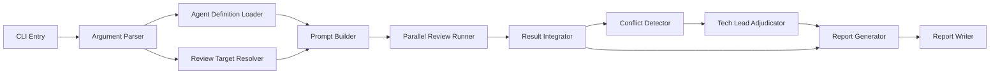

# Codex SDK Java Code Review Orchestrator Detailed Design

## 1. Purpose

This document defines the detailed design for implementing a review orchestration CLI application with the TypeScript version of the Codex SDK, using the Java source code review agents defined under `docs/`.

The application must be suitable for integration into development workflows. It reviews specified Java/Spring Boot code in parallel from multiple perspectives and generates a final report that consolidates the results.

The key requirements are as follows.

- Reproduce the execution principles of `docs/orchest-code-review.agent.md` as an application.
- Run each perspective-specific agent in parallel as a separate Codex SDK thread.
- When findings conflict, `orchest-code-review-tech-lead` makes the final adjudication.
- Allow CLI arguments to specify one agent, multiple agents, or `full`.
- Ensure the implementation is readable, understandable, and of sufficient quality for OSS publication.

## 2. Reference Specifications

### 2.1 Official SDK Specification

The TypeScript version of the Codex SDK is provided as `@openai/codex-sdk`. The SDK wraps the `@openai/codex` CLI and exchanges JSONL events with the CLI process through stdin/stdout.

The following SDK features are used.

| Feature | Purpose |
| --- | --- |
| `new Codex()` | Create a Codex SDK client |
| `codex.startThread()` | Create an independent review thread for each agent |
| `codex.resumeThread(threadId)` | Resume an existing review session after interruption or for a retry |
| `thread.run(prompt, { outputSchema })` | Obtain review results as structured JSON |
| `thread.runStreamed(prompt, { outputSchema, signal })` | Incrementally collect progress logs, usage, thread id, and failure events |
| `workingDirectory` | Specify the working directory of the repository under review |
| `skipGitRepoCheck` | Allow reviews outside a Git repository |
| `sandboxMode` | Enforce read-only execution dedicated to review |
| `approvalPolicy` | Fix the approval policy to prevent interactive waits in CI/CD |
| `additionalDirectories` | Explicitly allow references outside the repo, such as `../instructions/` |
| `modelReasoningEffort` | Balance review quality and cost |
| `config` | Override Codex CLI settings |

References:

- <https://developers.openai.com/codex/sdk>
- <https://github.com/openai/codex/tree/main/sdk/typescript>

### 2.2 SDK Usage Policy

This application uses the Codex SDK as the execution platform for review agents, rather than merely as a prompt execution wrapper.

| SDK Feature | Usage | Benefit |
| --- | --- | --- |
| Independent Thread | Assign one thread to each specialist agent | Prevent perspective contamination and guarantee independent reviews |
| Parallel Thread Execution | Execute concurrently with `Promise.allSettled` and a concurrency queue | Reduce execution time for reviews across 14 perspectives |
| Structured Output | Enforce JSON review results with `outputSchema` | Stabilize integration, deduplication, and conflict detection |
| Streaming Events | Use `runStreamed` events for logging, auditing, and usage aggregation | Make progress and failure causes traceable in CI/CD |
| AbortSignal | Propagate cancellation to the Codex CLI child process on timeout | Prevent runaway reviews |
| Sandbox | Set `sandboxMode: "read-only"` on each thread | Prevent source changes during review |
| Resume | Save `thread.id` and resume when necessary | Support long-running reviews and retries |

Important: The "multi-agent" design does not depend on Codex subagent functionality. The application explicitly orchestrates multiple Codex threads created through the TypeScript SDK, injecting the specialist agent definition from `docs/*.agent.md` into each thread as a prompt.

### 2.3 Local Agent Definitions

The application treats `docs/*.agent.md` as the sole source of agent definitions. It loads these files at startup and incorporates their review perspective, persona, checklist, and output format into the prompt.

| Logical Name | Definition File | Role |
| --- | --- | --- |
| `architecture` | `docs/orchest-code-review-architecture.agent.md` | Layer structure, dependency direction, and project structure |
| `ddd-domain` | `docs/orchest-code-review-ddd-domain.agent.md` | DDD tactical patterns, aggregates, and value objects |
| `api-endpoint` | `docs/orchest-code-review-api-endpoint.agent.md` | Spring MVC controllers, URLs, and input validation |
| `java-standards` | `docs/orchest-code-review-java-standards.agent.md` | Java 21 coding standards, naming, and prohibited patterns |
| `async-concurrency` | `docs/orchest-code-review-async-concurrency.agent.md` | Asynchronous processing, concurrency, and Virtual Threads |
| `error-logging` | `docs/orchest-code-review-error-logging.agent.md` | Exception handling, logging, and observability |
| `data-access` | `docs/orchest-code-review-data-access.agent.md` | JPA, repositories, queries, and Flyway |
| `config-di` | `docs/orchest-code-review-config-di.agent.md` | Spring DI, configuration, and Security Filter Chain |
| `security` | `docs/orchest-code-review-security.agent.md` | OWASP Top 10, STRIDE, and attack resistance |
| `dependency` | `docs/orchest-code-review-dependency.agent.md` | Maven dependencies, prohibited dependencies, and licenses |
| `test-quality` | `docs/orchest-code-review-test-quality.agent.md` | Test quality, AAA, and coverage |
| `performance` | `docs/orchest-code-review-performance.agent.md` | Performance, N+1, memory, and pagination |
| `resilience` | `docs/orchest-code-review-resilience.agent.md` | Fault tolerance, retries, timeouts, and health checks |
| `tech-lead` | `docs/orchest-code-review-tech-lead.agent.md` | Cross-cutting review, prohibited patterns, and conflict adjudication |

Load `docs/orchest-code-review.agent.md` as the orchestrator specification and use it as the basis for the execution flow, decision criteria, conflict-resolution rules, and report format.

## 3. System Overview

### 3.1 Application Type

Implement the system as a Node.js / TypeScript CLI application.

Recommended package name:

```text
java-code-review-orchestrator
```

Recommended CLI name:

```text
code-review
```

### 3.2 Overall Architecture



### 3.3 Execution Model

1. Parse CLI arguments.
2. Load the agent definitions under `docs/`.
3. Resolve the files to review.
4. Create an independent Codex SDK thread for each specified agent.
5. Run reviews in parallel with `Promise.allSettled` and concurrency limits.
6. Receive structured JSON review results from each agent.
7. Deduplicate findings and retain the highest severity.
8. If findings conflict, run the Tech Lead agent in a separate thread for adjudication.
9. Save the integrated report in Markdown and JSON formats.

## 4. CLI Specification

### 4.1 Basic Commands

```bash
code-review --target full --agents full
code-review --target-dir src/main/java/com/skishop/controller --agents security
code-review --target src/main/java/com/skishop/controller --agents security
code-review --target src/main/java --agents security,performance,data-access
```

### 4.2 Arguments

| Argument | Required | Default | Description |
| --- | ---: | --- | --- |
| `--target <path\|full>` | Conditional | None | Review target. Specify `full`, a file, or a directory |
| `--target-dir <directory>` | Conditional | None | Explicitly specify the review target directory. A directory-only option that communicates intent more clearly than `--target` |
| `--agents <name[,name]\|full>` | No | `full` | Agents to run |
| `--repo <path>` | No | `process.cwd()` | Repository to review |
| `--docs <path>` | No | `<repo>/docs` | Agent definition directory |
| `--out <path>` | No | `<repo>/../review-reports/code-review` | Report output root |
| `--concurrency <number>` | No | `7` | Maximum number of concurrent perspective-specific reviews |
| `--timeout-ms <number>` | No | `900000` | Timeout per agent |
| `--model <model>` | No | Codex CLI default | Model used by Codex SDK threads |
| `--reasoning <minimal\|low\|medium\|high\|xhigh>` | No | `high` | `modelReasoningEffort` |
| `--sandbox <read-only\|workspace-write\|danger-full-access>` | No | `read-only` | Sandbox used for review execution. Normally unchanged |
| `--web-search <disabled\|cached\|live>` | No | `disabled` | Web search policy during review |
| `--format <markdown\|json\|both>` | No | `both` | Output format |
| `--fail-on <critical\|high\|none>` | No | `critical` | Minimum severity that causes a failure exit code |
| `--skip-git-repo-check` | No | `false` | Skip the Codex SDK Git repository check |
| `--dry-run` | No | `false` | Display only the execution plan |
| `--verbose` | No | `false` | Emit detailed logs |

Exactly one of `--target` and `--target-dir` is required. If both are specified, stop with exit code `2` as a CLI argument error to avoid an ambiguous review scope.

### 4.3 Agent Selection

`--agents` accepts the following formats.

```text
full
security
security,performance,data-access
orchest-code-review-security
```

Normalization rules:

- `full` means all 14 agents.
- The `orchest-code-review-` prefix is optional.
- The `.agent.md` extension must not be specified. Treat it as an error when present.
- Reject unknown agent names before execution starts.
- `tech-lead` may be selected as a regular review agent. During conflict adjudication, however, run it additionally in a thread separate from the regular review.

### 4.4 Target Selection Rules

| Selection Method | Example | Handling |
| --- | --- | --- |
| Full review | `--target full` | Review everything under `--repo` |
| File selection | `--target src/main/java/com/skishop/Product.java` | Review only the specified file |
| Directory selection | `--target src/main/java/com/skishop/controller` | Review the contents of the specified directory |
| Explicit directory selection | `--target-dir src/main/java/com/skishop/controller` | Review the contents of the specified directory. File paths are not allowed |

`--target-dir` is a dedicated option that clearly expresses the intent to review a directory in CI/CD or npm scripts. If the specified value does not exist or is not a directory, stop with exit code `3`.

### 4.5 Exit Codes

| Exit Code | Meaning |
| ---: | --- |
| `0` | Review completed without meeting the `fail-on` condition |
| `1` | Review completed but met the `fail-on` condition |
| `2` | CLI argument or configuration error |
| `3` | Invalid review target path or zero target files |
| `4` | All agent executions failed |
| `5` | Report persistence failed |

## 5. Directory Structure

The following implementation structure is recommended.

```text
.
├── package.json
├── tsconfig.json
├── src
│   ├── cli.ts
│   ├── config
│   │   └── defaults.ts
│   ├── agents
│   │   ├── agent-definition-loader.ts
│   │   ├── agent-registry.ts
│   │   └── agent-types.ts
│   ├── targets
│   │   ├── target-resolver.ts
│   │   └── file-patterns.ts
│   ├── prompts
│   │   ├── review-prompt-builder.ts
│   │   └── adjudication-prompt-builder.ts
│   ├── codex
│   │   ├── codex-client-factory.ts
│   │   ├── review-runner.ts
│   │   └── timeout.ts
│   ├── results
│   │   ├── review-schema.ts
│   │   ├── result-normalizer.ts
│   │   ├── finding-deduplicator.ts
│   │   ├── conflict-detector.ts
│   │   └── verdict-calculator.ts
│   ├── reports
│   │   ├── markdown-report-generator.ts
│   │   ├── json-report-generator.ts
│   │   └── report-writer.ts
│   └── utils
│       ├── logger.ts
│       ├── path-utils.ts
│       └── errors.ts
└── test
    ├── unit
    └── fixtures
```

### 5.1 Recommended npm Dependencies

```json
{
  "dependencies": {
    "@openai/codex-sdk": "<implementation-time-exact-version>",
    "commander": "^12.0.0",
    "fast-glob": "^3.3.0",
    "gray-matter": "^4.0.0",
    "zod": "^3.23.0",
    "zod-to-json-schema": "^3.23.0"
  },
  "devDependencies": {
    "@types/node": "^20.0.0",
    "eslint": "^9.0.0",
    "tsx": "^4.0.0",
    "typescript": "^5.0.0",
    "vitest": "^1.0.0"
  }
}
```

At implementation time, confirm the latest version of `@openai/codex-sdk` and pin an exact version rather than using `^`. Include the lockfile in the OSS release to prevent CI failures caused by breaking SDK changes. Replace `<implementation-time-exact-version>` above with the actual version during implementation.

## 6. Data Model

### 6.1 Severity

```typescript
export type Severity = "Critical" | "High" | "Medium" | "Low";
```

Severity precedence:

```typescript
const severityRank = {
  Critical: 4,
  High: 3,
  Medium: 2,
  Low: 1,
} as const;
```

### 6.2 AgentDefinition

```typescript
export interface AgentDefinition {
  id: string;
  displayName: string;
  filePath: string;
  description: string;
  bodyMarkdown: string;
  isTechLead: boolean;
}
```

### 6.3 ReviewTarget

```typescript
export interface ReviewTarget {
  rawTarget: string;
  targetKind: "full" | "file" | "directory";
  targetName: string;
  repoRoot: string;
  files: string[];
  standardsFiles: string[];
  designReferenceFiles: string[];
}
```

### 6.4 AppOptions

```typescript
export interface AppOptions {
  repoRoot: string;
  docsDir: string;
  outputRoot: string;
  rawTarget: string;
  targetDir?: string;
  selectedAgents: string[];
  concurrency: number;
  timeoutMs: number;
  format: "markdown" | "json" | "both";
  failOn: "critical" | "high" | "none";
  skipGitRepoCheck: boolean;
  dryRun: boolean;
  verbose: boolean;
  apiKey?: string;
  baseUrl?: string;
  codexPathOverride?: string;
  model?: string;
  modelReasoningEffort?: "minimal" | "low" | "medium" | "high" | "xhigh";
  sandboxMode?: "read-only" | "workspace-write" | "danger-full-access";
  webSearchMode?: "disabled" | "cached" | "live";
  additionalDirectories?: string[];
}
```

### 6.5 Finding

```typescript
export interface Finding {
  id: string;
  severity: Severity;
  category: string;
  title: string;
  description: string;
  targetFile: string;
  lineStart?: number;
  lineEnd?: number;
  evidence?: string;
  suggestedFix?: string;
  sourceAgents: string[];
  confidence: "high" | "medium" | "low";
}
```

### 6.6 AgentReviewResult

```typescript
export interface UsageMetrics {
  inputTokens: number;
  cachedInputTokens: number;
  outputTokens: number;
  reasoningOutputTokens: number;
}

export interface EscalationItem {
  priority: "highest" | "high" | "normal";
  sourceAgents: string[];
  description: string;
  recommendedDecisionMaker: string;
}

export interface DesignDeviation {
  document: string;
  description: string;
  targetFile: string;
}

export interface AgentReviewResult {
  agentId: string;
  threadId?: string;
  status: "completed" | "timeout" | "error";
  verdict: "pass" | "warning" | "fail" | "incomplete";
  summary: string;
  findings: Finding[];
  escalations: EscalationItem[];
  designDeviations: DesignDeviation[];
  score?: number;
  usage?: UsageMetrics;
  rawMarkdown?: string;
  errorMessage?: string;
  startedAt: string;
  completedAt?: string;
  durationMs?: number;
}
```

### 6.7 Conflict

```typescript
export interface Conflict {
  id: string;
  agentA: string;
  agentB: string;
  findingA: Finding;
  findingB: Finding;
  pattern: string;
  description: string;
  initialResolutionRule?: string;
}
```

### 6.8 AdjudicationResult

```typescript
export interface AdjudicationResult {
  conflictId: string;
  decision: "prefer_a" | "prefer_b" | "merge" | "escalate";
  finalSeverity: Severity;
  finalFindingTitle: string;
  rationale: string;
  recommendedAction: string;
}
```

### 6.9 ReviewJob / Runner Models

Use the following runtime models at the Codex SDK invocation boundary.

```typescript
import type { Codex, ThreadEvent, ThreadOptions } from "@openai/codex-sdk";

export interface ReviewJob {
  agentId: string;
  agentDefinition: AgentDefinition;
  prompt: string;
  outputSchema: unknown;
  codex: Codex;
  threadOptions: ThreadOptions;
  timeoutMs: number;
  eventSink?: ReviewEventSink;
}

export type ReviewEventSink = (agentId: string, event: ThreadEvent) => void;

export interface ReviewExecutionPlan {
  target: ReviewTarget;
  agents: AgentDefinition[];
  jobs: ReviewJob[];
  concurrency: number;
  outputRoot: string;
  dryRun: boolean;
}
```

`ReviewJob` contains all information required for SDK execution. This allows `ReviewRunner` to remain unaware of CLI arguments and file-discovery details and focus solely on executing a job and returning an `AgentReviewResult`.

### 6.10 TargetInput

Immediately after parsing, normalize the CLI options `--target` and `--target-dir` into the following union type.

```typescript
export type TargetInput =
  | { kind: "full"; raw: "full" }
  | { kind: "file"; raw: string; absolutePath: string }
  | { kind: "directory"; raw: string; absolutePath: string };
```

Treat `AppOptions.rawTarget` as the original input for display and reporting, and `TargetInput` as the validated input used internally by the resolver.

## 7. Structured Output Schemas

Use the Codex SDK method `thread.run(prompt, { outputSchema })` to require each agent to return results in JSON format. Because relying only on Markdown reports makes integration unstable, JSON must always be the authoritative format for integration.

### 7.1 Review Result Schema

```typescript
export const agentReviewOutputSchema = {
  type: "object",
  properties: {
    verdict: { type: "string", enum: ["pass", "warning", "fail"] },
    summary: { type: "string" },
    findings: {
      type: "array",
      items: {
        type: "object",
        properties: {
          severity: { type: "string", enum: ["Critical", "High", "Medium", "Low"] },
          category: { type: "string" },
          title: { type: "string" },
          description: { type: "string" },
          targetFile: { type: "string" },
          lineStart: { type: "number" },
          lineEnd: { type: "number" },
          evidence: { type: "string" },
          suggestedFix: { type: "string" },
          confidence: { type: "string", enum: ["high", "medium", "low"] }
        },
        required: ["severity", "category", "title", "description", "targetFile", "confidence"],
        additionalProperties: false
      }
    },
    escalations: {
      type: "array",
      items: {
        type: "object",
        properties: {
          priority: { type: "string", enum: ["highest", "high", "normal"] },
          description: { type: "string" },
          recommendedDecisionMaker: { type: "string" }
        },
        required: ["priority", "description", "recommendedDecisionMaker"],
        additionalProperties: false
      }
    },
    designDeviations: {
      type: "array",
      items: {
        type: "object",
        properties: {
          document: { type: "string" },
          description: { type: "string" },
          targetFile: { type: "string" }
        },
        required: ["document", "description", "targetFile"],
        additionalProperties: false
      }
    },
    score: { type: "number" },
    rawMarkdown: { type: "string" }
  },
  required: ["verdict", "summary", "findings", "escalations", "designDeviations", "rawMarkdown"],
  additionalProperties: false
} as const;
```

### 7.2 Tech Lead Adjudication Schema

```typescript
export const adjudicationOutputSchema = {
  type: "object",
  properties: {
    adjudications: {
      type: "array",
      items: {
        type: "object",
        properties: {
          conflictId: { type: "string" },
          decision: { type: "string", enum: ["prefer_a", "prefer_b", "merge", "escalate"] },
          finalSeverity: { type: "string", enum: ["Critical", "High", "Medium", "Low"] },
          finalFindingTitle: { type: "string" },
          rationale: { type: "string" },
          recommendedAction: { type: "string" }
        },
        required: [
          "conflictId",
          "decision",
          "finalSeverity",
          "finalFindingTitle",
          "rationale",
          "recommendedAction"
        ],
        additionalProperties: false
      }
    },
    summary: { type: "string" }
  },
  required: ["adjudications", "summary"],
  additionalProperties: false
} as const;
```

### 7.3 Schema Implementation Policy

The implementation should use the Zod schema as the single source of truth and generate the JSON Schema passed to the Codex SDK with `zod-to-json-schema`.

```typescript
import { z } from "zod";
import { zodToJsonSchema } from "zod-to-json-schema";

export const AgentReviewSchema = z.object({
  verdict: z.enum(["pass", "warning", "fail"]),
  summary: z.string(),
  findings: z.array(FindingSchema),
  escalations: z.array(EscalationSchema),
  designDeviations: z.array(DesignDeviationSchema),
  score: z.number().optional(),
  rawMarkdown: z.string()
});

export const agentReviewOutputSchema = zodToJsonSchema(AgentReviewSchema, {
  target: "openAi"
});
```

Process responses in the following order.

1. Obtain `turn.finalResponse` or the final `agent_message.text` from streaming.
2. Convert it to an object with `JSON.parse`.
3. Validate it with `AgentReviewSchema.safeParse`.
4. Set `AgentReviewResult.status = "completed"` only when validation succeeds.
5. On failure, set `status = "error"` and `verdict = "incomplete"`, and save the raw response and validation error.

Differences between the output schema and the internal model:

- Do not require `findings[].sourceAgents` in agent output. The normalizer assigns the executing `agentId` as `sourceAgents: [agentId]`.
- Do not require `escalations[].sourceAgents` in agent output either. The normalizer assigns it.
- The normalizer generates `finding.id` with a stable hash.
- Populate `threadId`, `usage`, `startedAt`, `completedAt`, and `durationMs` from SDK execution results.
- Keep `lineStart` / `lineEnd` optional, but require specific line numbers in the prompt whenever possible.

## 8. Agent Definition Loader

### 8.1 Files to Load

Load `orchest-code-review-*.agent.md` files under `docs/`. Treat `docs/orchest-code-review.agent.md` separately as an orchestrator definition rather than an agent.

### 8.2 Front Matter

Extract at least `description` and `user-invocable` from the YAML front matter at the beginning of each definition file.

Use of `gray-matter` is recommended for the implementation.

```typescript
import matter from "gray-matter";
```

### 8.3 Validation

Validate the following at startup.

- All 14 agent definitions exist.
- The `tech-lead` definition exists.
- `orchest-code-review.agent.md` exists.
- Agent IDs are unique.
- `full` contains exactly 14 agents.

If any requirement is missing, stop before execution with exit code `2`.

## 9. Review Target Resolution

### 9.1 Target File Patterns

In accordance with `docs/orchest-code-review.agent.md`, include the following review targets.

```text
**/*.java
**/pom.xml
**/application*.properties
**/application*.yml
**/application*.yaml
**/*Application.java
**/*Config.java
**/SecurityConfig.java
**/db/migration/*.sql
**/Dockerfile
**/.dockerignore
```

### 9.2 `full`

For `--target full`, enumerate target files from the entire tree under `--repo`.

Excluded directories:

```text
.git
node_modules
target
build
dist
.gradle
.idea
.vscode
review-reports
```

### 9.3 Directory Selection

For `--target-dir <directory>`, enumerate only files under the specified directory that match the review target file patterns.

Implementation rules:

- `<directory>` accepts either a path relative to `--repo` or an absolute path.
- Resolve relative paths with `path.resolve(repoRoot, targetDir)`.
- If the resolved path is not under `repoRoot`, stop with exit code `2`.
- If the resolved path does not exist or is not a directory, stop with exit code `3`.
- Determine `targetName` by converting the directory name to a slug. For example, `src/main/java/com/skishop/controller` becomes `controller`.
- If a file path is specified with `--target-dir`, treat it as misuse of the directory-only option and stop with exit code `3`.

Use the same enumeration process when `--target <path>` specifies a directory. To make CLI intent explicit, however, documentation and CI/CD examples should recommend `--target-dir` for directory selection.

### 9.4 Target Resolver Pseudocode

```typescript
export async function resolveTarget(options: AppOptions): Promise<ReviewTarget> {
  if (!options.rawTarget && !options.targetDir) {
    throw new CliError("Either --target or --target-dir is required", 2);
  }

  if (options.rawTarget && options.targetDir) {
    throw new CliError("--target and --target-dir cannot be used together", 2);
  }

  const targetInput = await normalizeTargetInput(options);
  const files = await enumerateReviewableFiles(targetInput, options.repoRoot);

  if (files.length === 0) {
    throw new CliError("No reviewable files found", 3);
  }

  return {
    rawTarget: targetInput.raw,
    targetKind: targetInput.kind,
    targetName: buildTargetName(targetInput),
    repoRoot: options.repoRoot,
    files,
    standardsFiles: await findStandardsFiles(options.repoRoot),
    designReferenceFiles: await findDesignReferenceFiles(options.repoRoot)
  };
}
```

Rules for `normalizeTargetInput`:

| Input | Result |
| --- | --- |
| `--target full` | `{ kind: "full" }` |
| `--target <existing-file>` | `{ kind: "file" }` |
| `--target <existing-directory>` | `{ kind: "directory" }` |
| `--target-dir <existing-directory>` | `{ kind: "directory" }` |
| `--target-dir <file>` | `CliError(exitCode: 3)` |
| Absolute path outside the repo | `CliError(exitCode: 2)` |

### 9.5 Standards and Design Reference Files

The resolver discovers reference files to include in the review prompt and passes only those that exist.

```text
AGENTS.md
design-docs/**
docs/migration/DESIGN.md
docs/migration/PLAN.md
../instructions/*.instructions.md
```

Because `../instructions/` may be outside `repoRoot`, add its parent directory to `ThreadOptions.additionalDirectories` when it exists. If it does not exist, emit only a warning.

### 9.6 File Count Limits

An OSS-quality implementation must remain controllable for large repositories.

Recommendations:

- If there are zero target files, use exit code `3`.
- Warn when the target file count exceeds 300.
- Do not paste the contents of every file into a single agent prompt.
- Pass the file list, target paths, and reference document locations in the prompt, and instruct Codex to read them within the working directory.

## 10. Prompt Design

### 10.1 Common Review Prompt

Use the following prompt structure for each agent.

```text
You are running as the agent defined below.

<agent-definition>
{agentDefinition.bodyMarkdown}
</agent-definition>

Review target:
- Repository root: {repoRoot}
- Target argument: {rawTarget}
- Target files:
{targetFiles}

Standards and design references:
- AGENTS.md if present
- design-docs/ if present
- docs/migration/DESIGN.md if present
- docs/migration/PLAN.md if present
- ../instructions/ if present

Task:
Review the target code only from your own specialized perspective.
Do not modify files.
Return findings with concrete file paths and line numbers whenever possible.
If evidence is insufficient, report confidence as low instead of inventing facts.

Output:
Return JSON matching the provided schema.
Also include a concise markdown detail report in rawMarkdown.
```

### 10.2 Independence Guarantee

Do not pass results from other agents into a perspective-specific review prompt. This preserves the principle in `docs/orchest-code-review.agent.md` that each agent makes an independent judgment.

### 10.3 Tech Lead Adjudication Prompt

After detecting conflicts, pass the following only to the Tech Lead.

```text
You are the Tech Lead final adjudicator defined below.

<agent-definition>
{techLeadDefinition.bodyMarkdown}
</agent-definition>

Conflicts:
{conflictJson}

Context:
- Repository root: {repoRoot}
- Review target: {rawTarget}
- Relevant findings are from independent specialist agents.

Task:
Adjudicate each conflict based on maximum business outcome,
balancing security, data integrity, implementation cost,
long-term maintainability, and mission-critical risk tolerance.

Output:
Return JSON matching the adjudication schema.
```

## 11. Codex SDK Execution Design

### 11.1 Client Creation

```typescript
import { Codex } from "@openai/codex-sdk";

export function createCodexClient(options: AppOptions): Codex {
  return new Codex({
    apiKey: options.apiKey,
    baseUrl: options.baseUrl,
    codexPathOverride: options.codexPathOverride,
    config: {
      show_raw_agent_reasoning: false
    },
    env: buildCodexEnv(process.env)
  });
}
```

When `env` is specified, the SDK does not automatically inherit environment variables from the Node.js process. Therefore, explicitly pass through only the environment required to run the Codex CLI, such as `PATH`, `HOME`, and `CODEX_API_KEY`. Do not log API key values.

`config` is converted into CLI `--config key=value` overrides. Specify per-thread settings such as the sandbox and working directory in the `ThreadOptions` passed to `startThread`, not in `config`.

### 11.2 ThreadOptions

Assign an independent thread to each review agent and enforce read-only execution dedicated to review.

```typescript
import type { ThreadOptions } from "@openai/codex-sdk";

export function buildThreadOptions(options: AppOptions): ThreadOptions {
  return {
    workingDirectory: options.repoRoot,
    skipGitRepoCheck: options.skipGitRepoCheck,
    sandboxMode: options.sandboxMode ?? "read-only",
    approvalPolicy: "never",
    model: options.model,
    modelReasoningEffort: options.modelReasoningEffort ?? "high",
    networkAccessEnabled: false,
    webSearchMode: options.webSearchMode ?? "disabled",
    additionalDirectories: options.additionalDirectories
  };
}
```

| Setting | Policy |
| --- | --- |
| `sandboxMode: "read-only"` | Prevent file changes during review |
| `approvalPolicy: "never"` | Avoid waiting for interactive approval in CI/CD |
| `networkAccessEnabled: false` | Prefer evaluation limited to the code and definition files under review |
| `webSearchMode: "disabled"` | Prevent differences in external information between agents |
| `additionalDirectories` | Explicitly declare required references outside the repo, such as `../instructions/` |
| `modelReasoningEffort` | Default to `high`; allow changes through a CLI argument when cost is prioritized |

Thread creation:

```typescript
const thread = codex.startThread(buildThreadOptions(options));
```

Do not share a thread among multiple agents. Sharing would mix review perspectives and compromise independence.

### 11.3 Review Execution and Structured Response Processing

Use `runStreamed` in the standard implementation. `run()` may be used in a simple implementation that needs only the final result, but streaming is recommended for production to provide CI/CD auditability, progress display, usage aggregation, and thread id persistence.

```typescript
export async function runSingleAgentReview(job: ReviewJob): Promise<AgentReviewResult> {
  const controller = new AbortController();
  const timeout = setTimeout(() => controller.abort(), job.timeoutMs);
  const startedAt = new Date().toISOString();

  try {
    const thread = job.codex.startThread(job.threadOptions);
    const { events } = await thread.runStreamed(job.prompt, {
      outputSchema: agentReviewOutputSchema,
      signal: controller.signal
    });

    let finalResponse = "";
    let usage: Usage | null = null;
    const items: ThreadItem[] = [];

    for await (const event of events) {
      job.eventSink?.(job.agentId, event);

      if (event.type === "item.completed") {
        items.push(event.item);
        if (event.item.type === "agent_message") {
          finalResponse = event.item.text;
        }
      }

      if (event.type === "turn.completed") {
        usage = event.usage;
      }

      if (event.type === "turn.failed" || event.type === "error") {
        throw new Error(event.type === "turn.failed" ? event.error.message : event.message);
      }
    }

    const parsed = parseAgentReviewJson(finalResponse);
    return normalizeAgentReviewResult({
      agentId: job.agentId,
      threadId: thread.id,
      parsed,
      items,
      usage,
      startedAt,
      completedAt: new Date().toISOString()
    });
  } catch (error) {
    return normalizeAgentFailure(job.agentId, error, startedAt);
  } finally {
    clearTimeout(timeout);
  }
}
```

Because `finalResponse` is returned as a string even when structured output is used, always apply `JSON.parse` and runtime validation with Zod or an equivalent validator. If validation fails, retain the raw response with `status: "error"` and record it under Incomplete Reviews in the integrated report.

### 11.4 Simple Implementation Using `run()`

In the minimal configuration, use `run()` as follows.

```typescript
const thread = codex.startThread(buildThreadOptions(options));
const turn = await thread.run(prompt, { outputSchema: agentReviewOutputSchema });
const parsed = parseAgentReviewJson(turn.finalResponse);
```

Because `run()` buffers until completion, prefer `runStreamed()` for long-running reviews to support progress logs and cancellation handling.

### 11.5 Parallel Execution

Run with a maximum concurrency of 7 by default. To reproduce the two-batch structure in `docs/orchest-code-review.agent.md`, set the default concurrency for `full` to `7`.

The implementation must use a general-purpose queue controlled by `--concurrency`, rather than two fixed batches. This supports future increases or decreases in the number of agents.

```typescript
export async function runReviewsInParallel(
  jobs: ReviewJob[],
  concurrency: number
): Promise<AgentReviewResult[]> {
  return runWithConcurrency(jobs, concurrency, async (job) => {
    return runSingleAgentReview(job);
  });
}
```

### 11.6 Timeout

Apply `--timeout-ms` to each agent. Implement timeouts with `AbortController`, not merely `Promise.race`, and pass the `signal` to the Codex SDK. This propagates cancellation to the Codex CLI child process started by the SDK.

```typescript
function createTimeoutController(timeoutMs: number): {
  signal: AbortSignal;
  dispose: () => void;
} {
  const controller = new AbortController();
  const timer = setTimeout(() => controller.abort(), timeoutMs);
  return {
    signal: controller.signal,
    dispose: () => clearTimeout(timer)
  };
}
```

Record a timed-out agent with `status: "timeout"` and continue the other reviews.

### 11.7 Thread ID and Resume

Save `threadId` in each agent result.

```typescript
export interface AgentReviewResult {
  agentId: string;
  threadId?: string;
  status: "completed" | "timeout" | "error";
  // ...
}
```

In the future, use `codex.resumeThread(threadId)` when a long-running review must resume or an investigation must continue. Within the same review execution, however, never resume another agent's thread, in order to preserve specialist-agent independence.

### 11.8 Failure Handling

Use `Promise.allSettled` so that one agent failure does not stop the entire process.

| Situation | Handling |
| --- | --- |
| Some agents fail | Generate the integrated report and mark failed agents as Incomplete |
| All agents fail | Exit code `4` |
| Invalid structured JSON | Save the raw response with `status: "error"` |
| Tech Lead adjudication fails | Add the unresolved conflict to Escalation Items |

### 11.9 Responsibilities at the Codex SDK Boundary

`src/codex/review-runner.ts` is responsible only for the following.

- Start a thread from the `Codex` client.
- Invoke `runStreamed`.
- Pass each `ThreadEvent` to `eventSink`.
- Extract the final `agent_message.text`.
- Collect usage and thread id.
- Normalize timeout, abort, and SDK error conditions into `AgentReviewResult`.

It is not responsible for the following.

- Agent selection.
- Target file discovery.
- Prompt generation.
- Finding deduplication.
- Verdict calculation.
- Report persistence.

This boundary allows tests to substitute a Fake runner that does not use the Codex SDK.

## 12. Result Integration

### 12.1 Early Critical Detection

After reviews complete, scan all results at the beginning of integration. If one or more Critical findings exist, automatically set the final verdict to `Rejected`.

### 12.2 Deduplication

Deduplication key:

```text
normalized(targetFile)
+ ":" + lineStart
+ ":" + normalized(category)
+ ":" + normalized(title)
```

When lineStart is absent, determine duplicates by the similarity of `targetFile + category + description`.

Recommended algorithm:

- Perform primary integration with exact-match keys.
- To keep similarity evaluation lightweight, treat normalized strings with a Jaccard similarity of 0.85 or greater as duplicate candidates.
- For duplicate findings, retain the highest severity.
- Merge `sourceAgents`.
- Retain the longest and most specific description.

### 12.3 Verdict Rules

| Condition | Verdict |
| --- | --- |
| One or more Critical findings | `Rejected` |
| One or more Incomplete reviews | `Conditional Approval` |
| No Critical findings, but one or more High findings | `Conditional Approval` |
| Only Medium/Low findings | `Approved with Notes` |
| No findings and all agents pass | `Approved` |

## 13. Conflict Detection

### 13.1 Predefined Conflict Patterns

Store the conflict patterns from `docs/orchest-code-review.agent.md` as implementation data.

| Agent A | Agent B | Pattern | Initial Rule |
| --- | --- | --- | --- |
| `architecture` | `java-standards` | Abstraction vs KISS | Prefer architecture while considering design intent |
| `security` | `performance` | Add restrictions vs relax restrictions | Prefer security in principle |
| `data-access` | `performance` | Normalization/constraints vs denormalization/relaxation | Prefer data-access unless there is a clear reason not to |
| `java-standards` | `test-quality` | Java 21 features vs testability | Use Java 21 to the extent that testability is not impaired |
| `resilience` | `performance` | Add retries vs reduce latency | Allow retries only for idempotent operations |
| `ddd-domain` | `data-access` | Aggregate boundaries vs query efficiency | Prefer DDD boundaries and address efficiency with an alternative solution |

### 13.2 Detection Logic

Identify a conflict candidate when the following conditions apply.

- The findings refer to the same `targetFile` or functional area.
- The `sourceAgents` combination matches a predefined conflict pattern.
- The finding `title` or `description` contains opposing terms.

Examples of opposing terms:

```text
add/remove
increase/decrease
strict/relax
introduce/eliminate
split/merge
abstract/simplify
retry/no retry
cache/no cache
```

### 13.3 Undefined Conflicts

Even when no pattern is predefined, treat opposing fix proposals for the same line in the same file as a conflict candidate. Request adjudication from the Tech Lead; if adjudication is impossible, treat it as a human escalation.

## 14. Report Design

### 14.1 Output Location

Follow the rules in `docs/orchest-code-review.agent.md`.

```text
../review-reports/code-review/<target-name>/check-report-<N>.md
../review-reports/code-review/<target-name>/check-report-<N>.json
```

Determine `<N>` by scanning existing `check-report-*.md` files under the same target and adding 1 to the maximum value.

### 14.2 Markdown Report Structure

```markdown
# Source Code Review Integrated Report

## Verdict
- Target:
- Verdict:
- Review Date:
- Project:
- Agents:

## Findings Summary
| Agent | Thread ID | Status | Verdict | Critical | High | Medium | Low | Score |

## Verdict Rationale

## Critical/High Findings List
| # | Severity | Source Agent | Category | Target File | Line | Finding | Suggested Fix |

## All Findings
| # | Severity | Source Agent | Category | Target File | Line | Finding |

## Escalation Items
| # | Priority | Source Agent | Description | Recommended Decision Maker |

## Conflict Resolution Record
| # | Agent A | Agent B | Conflict Description | Tech-Lead Adjudication | Rationale |

## Design Document Cross-Reference Results

## Incomplete Reviews

## Codex SDK Execution Summary
| Agent | Thread ID | Duration | Input Tokens | Cached Input Tokens | Output Tokens | Reasoning Tokens |

## Individual Agent Detail Reports
```

### 14.3 JSON Report

Save the JSON report for CI/CD and dashboard integration. It retains the same information as the Markdown report in machine-readable form.

```typescript
export interface IntegratedReviewReport {
  target: ReviewTarget;
  verdict: "Approved" | "Approved with Notes" | "Conditional Approval" | "Rejected";
  reviewDate: string;
  agents: string[];
  results: AgentReviewResult[];
  findings: Finding[];
  conflicts: Conflict[];
  adjudications: AdjudicationResult[];
  escalations: EscalationItem[];
  sdkExecution: {
    sdkPackage: "@openai/codex-sdk";
    concurrency: number;
    sandboxMode: string;
    approvalPolicy: string;
    webSearchMode: string;
    model?: string;
    modelReasoningEffort?: string;
  };
  outputFiles: {
    markdown?: string;
    json?: string;
  };
}
```

## 15. CI/CD Integration

### 15.1 GitHub Actions Example

```yaml
name: Java Code Review

on:
  pull_request:
    paths:
      - "**/*.java"
      - "**/pom.xml"
      - "**/application*.yml"
      - "**/application*.properties"

jobs:
  code-review:
    runs-on: ubuntu-latest
    steps:
      - uses: actions/checkout@v4
      - uses: actions/setup-node@v4
        with:
          node-version: "20"
      - run: npm ci
      - run: npx code-review --target full --agents full --fail-on critical
        env:
          CODEX_API_KEY: ${{ secrets.CODEX_API_KEY }}
```

### 15.2 PR Diff Review

`--target changed` may be added as a future extension. It is not currently required, but the design makes it easy to add because `ReviewTarget` contains a file array.

## 16. Logging

Write only progress and final results to standard output.

```text
[review] target resolved: full, 128 files
[review] agents: 14, concurrency: 7
[review] started: security
[review] completed: security, findings=5, duration=123456ms
[review] conflict detected: security vs performance
[review] report written: ../review-reports/code-review/full/check-report-3.md
```

Emit prompt length, SDK events, and failure details only when `--verbose` is specified.

To protect secrets, do not write environment variable values or API keys to logs.

### 16.1 SDK Event Audit Log

Allow the minimum necessary subset of `ThreadEvent` data obtained from `runStreamed()` to be saved as JSONL.

Output location:

```text
../review-reports/code-review/<target-name>/check-report-<N>.events.jsonl
```

Events to persist:

| Event | Persisted Content |
| --- | --- |
| `thread.started` | agentId, thread_id |
| `turn.started` | agentId, timestamp |
| `item.completed` | agentId, item.type, command exit_code, file_change status, error message |
| `turn.completed` | usage |
| `turn.failed` / `error` | Error message |

Do not persist full `reasoning` items, full command output, environment variables, or strings that appear to contain secrets. Emit detailed logs only during local execution with `--verbose`.

## 17. Error Design

### 17.1 Error Type

```typescript
export class CliError extends Error {
  constructor(
    message: string,
    public readonly exitCode: number
  ) {
    super(message);
  }
}
```

### 17.2 Representative Errors

| Error | Condition | Exit Code |
| --- | --- | ---: |
| `InvalidAgentSelectionError` | Unknown agent selection | `2` |
| `AgentDefinitionMissingError` | Required definition file is missing | `2` |
| `TargetNotFoundError` | Target path does not exist | `3` |
| `NoReviewableFilesError` | Zero target files | `3` |
| `AllAgentsFailedError` | All reviews failed | `4` |
| `ReportWriteError` | Report persistence failed | `5` |

### 17.3 CLI Validation List

Validate the following immediately after startup and fail before executing the Codex SDK.

| Validation | On Failure |
| --- | --- |
| Exactly one of `--target` and `--target-dir` is specified | exit `2` |
| `--concurrency >= 1` | exit `2` |
| `--timeout-ms >= 1000` | exit `2` |
| `--sandbox` is an allowed value | exit `2` |
| `--web-search` is an allowed value | exit `2` |
| `--reasoning` is an allowed value | exit `2` |
| `--format` is an allowed value | exit `2` |
| `--fail-on` is an allowed value | exit `2` |
| `--agents` is a known agent or `full` | exit `2` |
| `--repo` is an existing directory | exit `2` |
| `--docs` is an existing directory | exit `2` |
| The target exists | exit `3` |
| The target contains at least one reviewable file | exit `3` |

## 18. Quality Requirements

### 18.1 Implementation Policy

- Set TypeScript to `strict: true`.
- Give public functions explicit types.
- Prohibit `any` in principle. When unavoidable, such as for values returned by an external SDK, normalize it at the boundary.
- Separate side-effecting operations from pure operations.
- Isolate Codex SDK invocations in `codex/review-runner.ts`.
- Implement agent definitions, target resolution, integration, and report generation primarily as pure functions that can be unit tested.
- Use absolute file paths internally and normalize them to repository-relative paths for report display.

### 18.2 Security

- Do not modify the code under review.
- Do not log API keys or environment variable values.
- Limit evidence included in reports to the minimum necessary excerpt from the target source.
- Do not include files outside the scope specified by `--repo` in the review target.
- Allow the report destination to be specified explicitly with `--out`, and do not overwrite existing reports.

### 18.3 OSS Publication Quality

Provide at least the following.

- `README.md`: Installation, usage, required environment variables, and CI examples
- `LICENSE`: License for OSS publication
- `CONTRIBUTING.md`: Contribution instructions
- `npm run lint`
- `npm run test`
- `npm run build`
- Sample report
- Instructions for adding agent definitions

## 19. Test Plan

### 19.1 Unit Tests

| Target | Test Coverage |
| --- | --- |
| AgentDefinitionLoader | Front matter extraction, missing-data detection, and ID normalization |
| AgentRegistry | `full` expansion, single/multiple selection, and unknown-name errors |
| TargetResolver | `full`, `--target-dir`, `--target` directory, file selection, rejection of paths outside the repo, and excluded directories |
| CliValidator | Reject simultaneous target options, numeric ranges, enum values, and repo/docs existence checks |
| PromptBuilder | Includes the agent definition and target information |
| ReviewRunner | Normalizes finalResponse, usage, and threadId from SDK events |
| FindingDeduplicator | Merges duplicate findings, maximizes severity, and merges sourceAgents |
| ConflictDetector | Predefined conflicts and undefined conflict candidates |
| VerdictCalculator | Critical, High, Incomplete, and no-finding decisions |
| ReportWriter | Sequence numbering, overwrite prevention, and Markdown/JSON persistence |

### 19.2 Integration Tests

Because tests that invoke the Codex SDK directly incur cost and external dependencies, define an interface for `ReviewRunner` and use a Fake runner in regular tests.

```typescript
export interface AgentRunner {
  run(job: ReviewJob): Promise<AgentReviewResult>;
}
```

Verify the following in integration tests.

- Selecting 3 agents generates 3 jobs.
- Selecting `full` generates 14 jobs.
- With `--target-dir`, only files under the target directory are included in the job prompt.
- A report is generated even when one job times out.
- A Tech Lead adjudication job is added only when a conflict exists.
- If the Fake runner returns invalid JSON, the relevant agent becomes Incomplete and the overall report is generated.

### 19.3 E2E Tests

Create a small Java/Spring Boot fixture and use a Fake Codex runner to verify the flow from the CLI through report generation.

E2E tests using the real Codex SDK are optional and must run in CI only when the environment variable `RUN_CODEX_E2E=true` is set.

## 20. Implementation Steps

### Phase 1: CLI and Static Processing

1. Create `package.json`, `tsconfig.json`, and the basic directories.
2. Implement CLI argument parsing.
3. Implement the agent definition loader.
4. Implement target file resolution.
5. Implement dry-run.

### Phase 2: Codex SDK Review Execution

1. Add `@openai/codex-sdk`.
2. Implement `CodexClientFactory`.
3. Implement `ReviewRunner`.
4. Apply the structured output schema.
5. Implement timeout and error handling.

### Phase 3: Integration and Adjudication

1. Implement result normalization.
2. Implement deduplication.
3. Implement conflict detection.
4. Implement Tech Lead adjudication execution.
5. Implement verdict calculation.

### Phase 4: Reports and CI Support

1. Implement Markdown report generation.
2. Implement JSON report generation.
3. Implement report writer sequence numbering and persistence.
4. Prepare the README and GitHub Actions example.
5. Ensure tests, lint, and build pass.

## 21. Acceptance Criteria

Implementation is complete when all of the following criteria are met.

- `code-review --target full --agents full` runs 14 agents with a maximum concurrency of 7.
- `code-review --target <path> --agents security` runs only one agent.
- `code-review --target-dir <directory> --agents security` reviews only the contents of the specified directory.
- `code-review --target <path> --agents security,performance,data-access` runs only the specified 3 agents.
- Specifying `--target` and `--target-dir` together stops with exit code `2`.
- If one agent fails, a report is still generated from the other review results.
- If one or more Critical findings exist, the final verdict is `Rejected`.
- If there are only High findings, the final verdict is `Conditional Approval`.
- If there are only Medium/Low findings, the final verdict is `Approved with Notes`.
- If a conflict candidate exists, Tech Lead adjudication runs in a separate thread.
- The report is saved to `../review-reports/code-review/<target-name>/check-report-<N>.md` without overwriting existing files.
- A JSON report is also saved for use by CI/CD and dashboards.
- Each agent result records the Codex `threadId` and usage.
- On timeout, `AbortSignal` cancels Codex SDK execution.
- Review execution defaults to `sandboxMode: "read-only"` and `approvalPolicy: "never"`.
- Results that fail structured output JSON parsing or Zod validation are treated as Incomplete.
- `npm run build`, `npm run lint`, and `npm run test` succeed.

## 22. Design Completeness Check

This design document covers the following implementation details.

| Area | Coverage |
| --- | --- |
| CLI specification | Defines target, target-dir, agents, repo, docs, out, concurrency, timeout, model, reasoning, sandbox, web search, format, and fail-on |
| Agent management | Defines loading `docs/*.agent.md`, front matter parsing, validation of 14 agents, and `full` expansion |
| Review target resolution | Defines full, file, target-dir, Java, pom, application configuration, Flyway, and Docker targets and excluded directories |
| Codex SDK usage | Defines `Codex`, `startThread`, `resumeThread`, `runStreamed`, `outputSchema`, `AbortSignal`, `ThreadOptions`, usage, and events |
| Multi-agent execution | Defines independent threads per agent, maximum concurrency of 7, `Promise.allSettled`, and continuation after timeout |
| Structured results | Defines Zod, JSON Schema, parsing, validation, and normalization |
| Result integration | Defines deduplication, severity maximization, sourceAgents merging, and verdict calculation |
| Conflict resolution | Defines predefined conflicts, undefined conflicts, and Tech Lead adjudication in a separate thread |
| Reports | Defines Markdown, JSON, events JSONL, sequence numbering, overwrite prevention, and the SDK execution summary |
| Quality | Defines strict TypeScript, pure-function separation, OSS publication artifacts, and security policy |
| Tests | Defines unit, integration, fake runner, and optional real Codex E2E tests |
| CI/CD | Defines the GitHub Actions example, exit codes, and fail-on |

### 22.1 Codex SDK Effective-Use Verification

This design uses the Codex SDK effectively for the following reasons.

- The application creates multiple `Thread` instances and parallelizes specialist reviews.
- Each thread receives a different agent-definition prompt and is treated as an independent specialist review.
- `outputSchema` makes review results available as machine-processable JSON.
- `runStreamed` obtains progress, failures, usage, and thread id in CI/CD.
- `sandboxMode: "read-only"` and `approvalPolicy: "never"` create a secure execution environment dedicated to review.
- `AbortSignal` propagates timeout cancellation to SDK execution.
- The design leaves room for `resumeThread`, supporting long-running reviews and follow-up investigations.

Areas likely to expose gaps or ambiguity during implementation are the `ThreadOptions` names for each SDK version, Codex CLI sandbox settings, and detailed JSON Schema constraints for structured output. Verify these by pinning the lockfile and running real Codex E2E tests.

## 23. Non-Goals

The following are currently outside the implementation scope.

- Automatic modification of Java source code.
- Automatic posting of PR comments.
- GitHub Checks API integration.
- Web UI.
- A `changed` target dedicated to diff reviews.
- Automatic generation of agent definitions.

However, design the data model and report JSON to support these future extensions.
