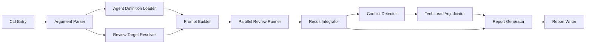

# Codex SDK Java Code Review Orchestrator 詳細設計書

## 1. 目的

本設計書は、`docs/` 配下に定義された Java ソースコードレビュー用エージェント群を利用し、Codex SDK TypeScript 版でレビューオーケストレーション CLI アプリケーションを実装するための詳細設計を定義する。

このアプリケーションは、開発プロセスのワークフローに組み込める品質で、指定された Java/Spring Boot コードを複数の観点から並列レビューし、結果を統合した最終レポートを生成する。

重要要件は次の通り。

- `docs/orchest-code-review.agent.md` の実行思想をアプリケーションとして再現する。
- 観点別エージェントは Codex SDK の別スレッドとして並列実行する。
- 競合する指摘がある場合は `orchest-code-review-tech-lead` が最終裁定する。
- CLI 引数で単一エージェント、複数エージェント、または `full` を指定できる。
- 実装コードは読みやすく、理解しやすく、OSS として公開しても問題ない品質にする。

## 2. 参照仕様

### 2.1 公式 SDK 仕様

Codex SDK TypeScript 版は `@openai/codex-sdk` として提供される。SDK は `@openai/codex` CLI をラップし、CLI プロセスと JSONL イベントを stdin/stdout で交換する。

採用する SDK 機能は次の通り。

| 機能 | 用途 |
|---|---|
| `new Codex()` | Codex SDK クライアント生成 |
| `codex.startThread()` | エージェントごとの独立レビュー用スレッド生成 |
| `codex.resumeThread(threadId)` | 中断・再試行時に既存レビューセッションを再開 |
| `thread.run(prompt, { outputSchema })` | レビュー結果を構造化 JSON で取得 |
| `thread.runStreamed(prompt, { outputSchema, signal })` | 進捗ログ、usage、thread id、失敗イベントを逐次収集 |
| `workingDirectory` | レビュー対象リポジトリの作業ディレクトリ指定 |
| `skipGitRepoCheck` | Git リポジトリ外でもレビュー可能にするオプション |
| `sandboxMode` | レビュー専用の read-only 実行を強制 |
| `approvalPolicy` | CI/CD で対話待ちにならないよう承認方針を固定 |
| `additionalDirectories` | `../instructions/` など repo 外参照を明示的に許可 |
| `modelReasoningEffort` | レビュー品質とコストの調整 |
| `config` | Codex CLI 設定の上書き |

参考:

- https://developers.openai.com/codex/sdk
- https://github.com/openai/codex/tree/main/sdk/typescript

### 2.2 SDK 活用方針

本アプリケーションでは、Codex SDK を単なるプロンプト実行ラッパーではなく、レビューエージェント実行基盤として積極的に活用する。

| SDK 機能 | 活用方法 | 効果 |
|---|---|---|
| 独立 Thread | 各専門エージェントに 1 thread を割り当てる | 観点の混線を防ぎ、独立レビューを保証 |
| 並列 Thread 実行 | `Promise.allSettled` と concurrency queue で同時実行 | 14 観点レビューの実行時間を短縮 |
| Structured Output | `outputSchema` で JSON レビュー結果を強制 | 統合、重複排除、競合検出を安定化 |
| Streaming Events | `runStreamed` の event をログ・監査・usage 集計に利用 | CI/CD で進捗と失敗原因を追跡可能 |
| AbortSignal | timeout 時に Codex CLI 子プロセスへキャンセルを伝播 | runaway review を防止 |
| Sandbox | `sandboxMode: "read-only"` を thread に指定 | レビュー中のソース変更を防止 |
| Resume | `thread.id` を保存し、必要に応じて再開 | 長時間レビューや再試行に対応 |

重要: 本設計の「マルチ・エージェント」は Codex の subagent 機能に依存しない。TypeScript SDK で複数の Codex thread を生成し、それぞれに `docs/*.agent.md` の専門エージェント定義をプロンプトとして注入することで、アプリケーション側が明示的にオーケストレーションする。

### 2.3 ローカルエージェント定義

本アプリケーションは、`docs/*.agent.md` をエージェント定義の唯一の情報源として扱う。エージェント定義ファイルはアプリケーション起動時に読み込み、レビュー観点、ペルソナ、チェック項目、出力形式をプロンプトに組み込む。

| 論理名 | 定義ファイル | 役割 |
|---|---|---|
| `architecture` | `docs/orchest-code-review-architecture.agent.md` | レイヤ構造、依存方向、プロジェクト構造 |
| `ddd-domain` | `docs/orchest-code-review-ddd-domain.agent.md` | DDD 戦術パターン、集約、値オブジェクト |
| `api-endpoint` | `docs/orchest-code-review-api-endpoint.agent.md` | Spring MVC Controller、URL、入力検証 |
| `java-standards` | `docs/orchest-code-review-java-standards.agent.md` | Java 21 コーディング標準、命名、禁止パターン |
| `async-concurrency` | `docs/orchest-code-review-async-concurrency.agent.md` | 非同期処理、並行性、Virtual Thread |
| `error-logging` | `docs/orchest-code-review-error-logging.agent.md` | 例外処理、ログ、可観測性 |
| `data-access` | `docs/orchest-code-review-data-access.agent.md` | JPA、Repository、Query、Flyway |
| `config-di` | `docs/orchest-code-review-config-di.agent.md` | Spring DI、設定、Security Filter Chain |
| `security` | `docs/orchest-code-review-security.agent.md` | OWASP Top 10、STRIDE、攻撃耐性 |
| `dependency` | `docs/orchest-code-review-dependency.agent.md` | Maven 依存、禁止依存、ライセンス |
| `test-quality` | `docs/orchest-code-review-test-quality.agent.md` | テスト品質、AAA、カバレッジ |
| `performance` | `docs/orchest-code-review-performance.agent.md` | 性能、N+1、メモリ、ページング |
| `resilience` | `docs/orchest-code-review-resilience.agent.md` | 障害耐性、リトライ、タイムアウト、ヘルスチェック |
| `tech-lead` | `docs/orchest-code-review-tech-lead.agent.md` | 横断レビュー、禁止パターン、競合裁定 |

`docs/orchest-code-review.agent.md` はオーケストレータ仕様として読み込み、実行フロー、判定基準、競合解決ルール、レポート形式の基準にする。

## 3. システム概要

### 3.1 アプリケーション種別

Node.js / TypeScript の CLI アプリケーションとして実装する。

推奨パッケージ名:

```text
java-code-review-orchestrator
```

推奨 CLI 名:

```text
code-review
```

### 3.2 全体アーキテクチャ



### 3.3 実行モデル

1. CLI 引数を解析する。
2. `docs/` 配下のエージェント定義を読み込む。
3. レビュー対象ファイルを解決する。
4. 指定されたエージェントごとに Codex SDK の独立スレッドを生成する。
5. `Promise.allSettled` と同時実行数制御でレビューを並列実行する。
6. 各エージェントから構造化 JSON のレビュー結果を受け取る。
7. 指摘を重複排除し、最高 severity を採用する。
8. 矛盾する指摘があれば Tech Lead エージェントを別スレッドで再実行し裁定する。
9. 統合レポートを Markdown と JSON で保存する。

## 4. CLI 仕様

### 4.1 基本コマンド

```bash
code-review --target full --agents full
code-review --target-dir src/main/java/com/skishop/controller --agents security
code-review --target src/main/java/com/skishop/controller --agents security
code-review --target src/main/java --agents security,performance,data-access
```

### 4.2 引数

| 引数 | 必須 | 既定値 | 説明 |
|---|---:|---|---|
| `--target <path|full>` | 条件付き | なし | レビュー対象。`full`、ファイル、またはディレクトリを指定 |
| `--target-dir <directory>` | 条件付き | なし | レビュー対象ディレクトリを明示指定。`--target` より意図が明確なディレクトリ専用オプション |
| `--agents <name[,name]|full>` | No | `full` | 実行するエージェント |
| `--repo <path>` | No | `process.cwd()` | レビュー対象リポジトリ |
| `--docs <path>` | No | `<repo>/docs` | エージェント定義ディレクトリ |
| `--out <path>` | No | `<repo>/../review-reports/code-review` | レポート出力ルート |
| `--concurrency <number>` | No | `7` | 観点別レビューの最大同時実行数 |
| `--timeout-ms <number>` | No | `900000` | 1 エージェントあたりのタイムアウト |
| `--model <model>` | No | Codex CLI 既定 | Codex SDK thread で使うモデル |
| `--reasoning <minimal|low|medium|high|xhigh>` | No | `high` | `modelReasoningEffort` |
| `--sandbox <read-only|workspace-write|danger-full-access>` | No | `read-only` | レビュー実行時の sandbox。通常は変更しない |
| `--web-search <disabled|cached|live>` | No | `disabled` | レビュー中の web search 利用方針 |
| `--format <markdown|json|both>` | No | `both` | 出力形式 |
| `--fail-on <critical|high|none>` | No | `critical` | 終了コードを失敗にする最低 severity |
| `--skip-git-repo-check` | No | `false` | Codex SDK の Git リポジトリ確認をスキップ |
| `--dry-run` | No | `false` | 実行計画のみ表示 |
| `--verbose` | No | `false` | 詳細ログ出力 |

`--target` と `--target-dir` のどちらか一方は必須とする。両方を同時に指定した場合は、曖昧なレビュー範囲を避けるため CLI 引数エラーとして終了コード `2` で停止する。

### 4.3 エージェント指定

`--agents` は次の形式を受け付ける。

```text
full
security
security,performance,data-access
orchest-code-review-security
```

正規化ルール:

- `full` は全 14 エージェントを意味する。
- `orchest-code-review-` 接頭辞は省略可能。
- `.agent.md` 拡張子は指定不可。指定された場合はエラーにする。
- 不明なエージェント名は起動前にエラーにする。
- `tech-lead` は通常レビュー対象として指定可能。ただし競合裁定時は、通常レビューとは別スレッドで追加実行する。

### 4.4 ターゲット指定ルール

| 指定方法 | 例 | 扱い |
|---|---|---|
| 全体レビュー | `--target full` | `--repo` 配下全体をレビュー |
| ファイル指定 | `--target src/main/java/com/skishop/Product.java` | 指定ファイルのみレビュー |
| ディレクトリ指定 | `--target src/main/java/com/skishop/controller` | 指定ディレクトリ配下をレビュー |
| ディレクトリ明示指定 | `--target-dir src/main/java/com/skishop/controller` | 指定ディレクトリ配下をレビュー。ファイルパスは不可 |

`--target-dir` は、CI/CD や npm scripts で「ディレクトリをレビューする」という意図を明確にするための専用オプションである。指定値が存在しない、またはディレクトリではない場合は終了コード `3` で停止する。

### 4.5 終了コード

| 終了コード | 意味 |
|---:|---|
| `0` | レビュー完了。`fail-on` 条件に該当なし |
| `1` | レビュー完了。ただし `fail-on` 条件に該当 |
| `2` | CLI 引数または設定エラー |
| `3` | レビュー対象パス不正、または対象ファイルが 0 件 |
| `4` | 全エージェント実行失敗 |
| `5` | レポート保存失敗 |

## 5. ディレクトリ構成

実装時は次の構成を推奨する。

```text
.
├── package.json
├── tsconfig.json
├── src
│   ├── cli.ts
│   ├── config
│   │   └── defaults.ts
│   ├── agents
│   │   ├── agent-definition-loader.ts
│   │   ├── agent-registry.ts
│   │   └── agent-types.ts
│   ├── targets
│   │   ├── target-resolver.ts
│   │   └── file-patterns.ts
│   ├── prompts
│   │   ├── review-prompt-builder.ts
│   │   └── adjudication-prompt-builder.ts
│   ├── codex
│   │   ├── codex-client-factory.ts
│   │   ├── review-runner.ts
│   │   └── timeout.ts
│   ├── results
│   │   ├── review-schema.ts
│   │   ├── result-normalizer.ts
│   │   ├── finding-deduplicator.ts
│   │   ├── conflict-detector.ts
│   │   └── verdict-calculator.ts
│   ├── reports
│   │   ├── markdown-report-generator.ts
│   │   ├── json-report-generator.ts
│   │   └── report-writer.ts
│   └── utils
│       ├── logger.ts
│       ├── path-utils.ts
│       └── errors.ts
└── test
    ├── unit
    └── fixtures
```

### 5.1 推奨 npm 依存関係

```json
{
  "dependencies": {
    "@openai/codex-sdk": "<implementation-time-exact-version>",
    "commander": "^12.0.0",
    "fast-glob": "^3.3.0",
    "gray-matter": "^4.0.0",
    "zod": "^3.23.0",
    "zod-to-json-schema": "^3.23.0"
  },
  "devDependencies": {
    "@types/node": "^20.0.0",
    "eslint": "^9.0.0",
    "tsx": "^4.0.0",
    "typescript": "^5.0.0",
    "vitest": "^1.0.0"
  }
}
```

`@openai/codex-sdk` のバージョンは実装時点の最新版を確認し、`^` ではなく exact version で固定する。OSS 公開時は lockfile を含め、SDK の破壊的変更による CI 失敗を防ぐ。上記の `<implementation-time-exact-version>` は実装時に実バージョンへ置き換える。

## 6. データモデル

### 6.1 Severity

```typescript
export type Severity = "Critical" | "High" | "Medium" | "Low";
```

Severity の優先順位:

```typescript
const severityRank = {
  Critical: 4,
  High: 3,
  Medium: 2,
  Low: 1,
} as const;
```

### 6.2 AgentDefinition

```typescript
export interface AgentDefinition {
  id: string;
  displayName: string;
  filePath: string;
  description: string;
  bodyMarkdown: string;
  isTechLead: boolean;
}
```

### 6.3 ReviewTarget

```typescript
export interface ReviewTarget {
  rawTarget: string;
  targetKind: "full" | "file" | "directory";
  targetName: string;
  repoRoot: string;
  files: string[];
  standardsFiles: string[];
  designReferenceFiles: string[];
}
```

### 6.4 AppOptions

```typescript
export interface AppOptions {
  repoRoot: string;
  docsDir: string;
  outputRoot: string;
  rawTarget: string;
  targetDir?: string;
  selectedAgents: string[];
  concurrency: number;
  timeoutMs: number;
  format: "markdown" | "json" | "both";
  failOn: "critical" | "high" | "none";
  skipGitRepoCheck: boolean;
  dryRun: boolean;
  verbose: boolean;
  apiKey?: string;
  baseUrl?: string;
  codexPathOverride?: string;
  model?: string;
  modelReasoningEffort?: "minimal" | "low" | "medium" | "high" | "xhigh";
  sandboxMode?: "read-only" | "workspace-write" | "danger-full-access";
  webSearchMode?: "disabled" | "cached" | "live";
  additionalDirectories?: string[];
}
```

### 6.5 Finding

```typescript
export interface Finding {
  id: string;
  severity: Severity;
  category: string;
  title: string;
  description: string;
  targetFile: string;
  lineStart?: number;
  lineEnd?: number;
  evidence?: string;
  suggestedFix?: string;
  sourceAgents: string[];
  confidence: "high" | "medium" | "low";
}
```

### 6.6 AgentReviewResult

```typescript
export interface UsageMetrics {
  inputTokens: number;
  cachedInputTokens: number;
  outputTokens: number;
  reasoningOutputTokens: number;
}

export interface EscalationItem {
  priority: "highest" | "high" | "normal";
  sourceAgents: string[];
  description: string;
  recommendedDecisionMaker: string;
}

export interface DesignDeviation {
  document: string;
  description: string;
  targetFile: string;
}

export interface AgentReviewResult {
  agentId: string;
  threadId?: string;
  status: "completed" | "timeout" | "error";
  verdict: "pass" | "warning" | "fail" | "incomplete";
  summary: string;
  findings: Finding[];
  escalations: EscalationItem[];
  designDeviations: DesignDeviation[];
  score?: number;
  usage?: UsageMetrics;
  rawMarkdown?: string;
  errorMessage?: string;
  startedAt: string;
  completedAt?: string;
  durationMs?: number;
}
```

### 6.7 Conflict

```typescript
export interface Conflict {
  id: string;
  agentA: string;
  agentB: string;
  findingA: Finding;
  findingB: Finding;
  pattern: string;
  description: string;
  initialResolutionRule?: string;
}
```

### 6.8 AdjudicationResult

```typescript
export interface AdjudicationResult {
  conflictId: string;
  decision: "prefer_a" | "prefer_b" | "merge" | "escalate";
  finalSeverity: Severity;
  finalFindingTitle: string;
  rationale: string;
  recommendedAction: string;
}
```

### 6.9 ReviewJob / Runner Models

Codex SDK 呼び出しの境界では、次の実行時モデルを使う。

```typescript
import type { Codex, ThreadEvent, ThreadOptions } from "@openai/codex-sdk";

export interface ReviewJob {
  agentId: string;
  agentDefinition: AgentDefinition;
  prompt: string;
  outputSchema: unknown;
  codex: Codex;
  threadOptions: ThreadOptions;
  timeoutMs: number;
  eventSink?: ReviewEventSink;
}

export type ReviewEventSink = (agentId: string, event: ThreadEvent) => void;

export interface ReviewExecutionPlan {
  target: ReviewTarget;
  agents: AgentDefinition[];
  jobs: ReviewJob[];
  concurrency: number;
  outputRoot: string;
  dryRun: boolean;
}
```

`ReviewJob` は SDK 実行に必要な情報をすべて持つ。これにより、`ReviewRunner` は CLI 引数やファイル探索の詳細を知らず、単に job を実行して `AgentReviewResult` を返す責務に集中できる。

### 6.10 TargetInput

CLI の `--target` と `--target-dir` は、解析直後に次の union 型へ正規化する。

```typescript
export type TargetInput =
  | { kind: "full"; raw: "full" }
  | { kind: "file"; raw: string; absolutePath: string }
  | { kind: "directory"; raw: string; absolutePath: string };
```

`AppOptions.rawTarget` は表示・レポート用の元入力、`TargetInput` は resolver 内部の判定済み入力として扱う。

## 7. 構造化出力スキーマ

Codex SDK の `thread.run(prompt, { outputSchema })` を使い、各エージェントに JSON 形式の結果を要求する。Markdown レポートだけに依存すると統合処理が不安定になるため、統合処理は必ず JSON を正とする。

### 7.1 レビュー結果スキーマ

```typescript
export const agentReviewOutputSchema = {
  type: "object",
  properties: {
    verdict: { type: "string", enum: ["pass", "warning", "fail"] },
    summary: { type: "string" },
    findings: {
      type: "array",
      items: {
        type: "object",
        properties: {
          severity: { type: "string", enum: ["Critical", "High", "Medium", "Low"] },
          category: { type: "string" },
          title: { type: "string" },
          description: { type: "string" },
          targetFile: { type: "string" },
          lineStart: { type: "number" },
          lineEnd: { type: "number" },
          evidence: { type: "string" },
          suggestedFix: { type: "string" },
          confidence: { type: "string", enum: ["high", "medium", "low"] }
        },
        required: ["severity", "category", "title", "description", "targetFile", "confidence"],
        additionalProperties: false
      }
    },
    escalations: {
      type: "array",
      items: {
        type: "object",
        properties: {
          priority: { type: "string", enum: ["highest", "high", "normal"] },
          description: { type: "string" },
          recommendedDecisionMaker: { type: "string" }
        },
        required: ["priority", "description", "recommendedDecisionMaker"],
        additionalProperties: false
      }
    },
    designDeviations: {
      type: "array",
      items: {
        type: "object",
        properties: {
          document: { type: "string" },
          description: { type: "string" },
          targetFile: { type: "string" }
        },
        required: ["document", "description", "targetFile"],
        additionalProperties: false
      }
    },
    score: { type: "number" },
    rawMarkdown: { type: "string" }
  },
  required: ["verdict", "summary", "findings", "escalations", "designDeviations", "rawMarkdown"],
  additionalProperties: false
} as const;
```

### 7.2 Tech Lead 裁定スキーマ

```typescript
export const adjudicationOutputSchema = {
  type: "object",
  properties: {
    adjudications: {
      type: "array",
      items: {
        type: "object",
        properties: {
          conflictId: { type: "string" },
          decision: { type: "string", enum: ["prefer_a", "prefer_b", "merge", "escalate"] },
          finalSeverity: { type: "string", enum: ["Critical", "High", "Medium", "Low"] },
          finalFindingTitle: { type: "string" },
          rationale: { type: "string" },
          recommendedAction: { type: "string" }
        },
        required: [
          "conflictId",
          "decision",
          "finalSeverity",
          "finalFindingTitle",
          "rationale",
          "recommendedAction"
        ],
        additionalProperties: false
      }
    },
    summary: { type: "string" }
  },
  required: ["adjudications", "summary"],
  additionalProperties: false
} as const;
```

### 7.3 スキーマ実装方針

実装では Zod スキーマを単一の真実源にし、Codex SDK へ渡す JSON Schema は `zod-to-json-schema` で生成することを推奨する。

```typescript
import { z } from "zod";
import { zodToJsonSchema } from "zod-to-json-schema";

export const AgentReviewSchema = z.object({
  verdict: z.enum(["pass", "warning", "fail"]),
  summary: z.string(),
  findings: z.array(FindingSchema),
  escalations: z.array(EscalationSchema),
  designDeviations: z.array(DesignDeviationSchema),
  score: z.number().optional(),
  rawMarkdown: z.string()
});

export const agentReviewOutputSchema = zodToJsonSchema(AgentReviewSchema, {
  target: "openAi"
});
```

レスポンス処理は次の順で行う。

1. `turn.finalResponse` または streaming の最後の `agent_message.text` を取得する。
2. `JSON.parse` で object に変換する。
3. `AgentReviewSchema.safeParse` で検証する。
4. 成功した場合のみ `AgentReviewResult.status = "completed"` とする。
5. 失敗した場合は `status = "error"`、`verdict = "incomplete"` とし、raw response と validation error を保存する。

出力スキーマと内部モデルの差分:

- エージェント出力の `findings[].sourceAgents` は要求しない。normalizer が実行元 `agentId` を `sourceAgents: [agentId]` として付与する。
- エージェント出力の `escalations[].sourceAgents` も要求しない。normalizer が付与する。
- `finding.id` は normalizer が stable hash で生成する。
- `threadId`、`usage`、`startedAt`、`completedAt`、`durationMs` は SDK 実行結果から付与する。
- `lineStart` / `lineEnd` は optional とするが、Prompt では可能な限り具体的な行番号を要求する。

## 8. エージェント定義ローダー

### 8.1 読み込み対象

`docs/` 配下の `orchest-code-review-*.agent.md` を読み込む。ただし、`docs/orchest-code-review.agent.md` はエージェントではなくオーケストレータ定義として別扱いにする。

### 8.2 Front Matter

定義ファイル先頭の YAML front matter から最低限 `description` と `user-invocable` を抽出する。

実装には `gray-matter` の利用を推奨する。

```typescript
import matter from "gray-matter";
```

### 8.3 バリデーション

起動時に次を検証する。

- 全 14 エージェント定義が存在する。
- `tech-lead` 定義が存在する。
- `orchest-code-review.agent.md` が存在する。
- エージェント ID の重複がない。
- `full` に含まれるエージェント数が 14 である。

不足がある場合は実行前に終了コード `2` で停止する。

## 9. レビュー対象解決

### 9.1 対象ファイルパターン

`docs/orchest-code-review.agent.md` に従い、次をレビュー対象に含める。

```text
**/*.java
**/pom.xml
**/application*.properties
**/application*.yml
**/application*.yaml
**/*Application.java
**/*Config.java
**/SecurityConfig.java
**/db/migration/*.sql
**/Dockerfile
**/.dockerignore
```

### 9.2 `full`

`--target full` の場合、`--repo` 配下全体から対象ファイルを列挙する。

除外するディレクトリ:

```text
.git
node_modules
target
build
dist
.gradle
.idea
.vscode
review-reports
```

### 9.3 ディレクトリ指定

`--target-dir <directory>` の場合、指定ディレクトリ配下からレビュー対象ファイルパターンに一致するファイルのみを列挙する。

実装ルール:

- `<directory>` は `--repo` からの相対パス、または絶対パスを受け付ける。
- 相対パスは `path.resolve(repoRoot, targetDir)` で解決する。
- 解決後のパスが `repoRoot` 配下にない場合は終了コード `2` で停止する。
- 解決後のパスが存在しない場合、またはディレクトリではない場合は終了コード `3` で停止する。
- `targetName` はディレクトリ名を slug 化して決定する。例: `src/main/java/com/skishop/controller` は `controller`。
- `--target-dir` でファイルパスが指定された場合は、ディレクトリ専用オプションの誤用として終了コード `3` で停止する。

`--target <path>` にディレクトリが指定された場合も同じ列挙処理を利用する。ただし CLI の意図を明確にするため、ドキュメントや CI/CD 例ではディレクトリ指定に `--target-dir` を推奨する。

### 9.4 Target Resolver 疑似コード

```typescript
export async function resolveTarget(options: AppOptions): Promise<ReviewTarget> {
  if (!options.rawTarget && !options.targetDir) {
    throw new CliError("Either --target or --target-dir is required", 2);
  }

  if (options.rawTarget && options.targetDir) {
    throw new CliError("--target and --target-dir cannot be used together", 2);
  }

  const targetInput = await normalizeTargetInput(options);
  const files = await enumerateReviewableFiles(targetInput, options.repoRoot);

  if (files.length === 0) {
    throw new CliError("No reviewable files found", 3);
  }

  return {
    rawTarget: targetInput.raw,
    targetKind: targetInput.kind,
    targetName: buildTargetName(targetInput),
    repoRoot: options.repoRoot,
    files,
    standardsFiles: await findStandardsFiles(options.repoRoot),
    designReferenceFiles: await findDesignReferenceFiles(options.repoRoot)
  };
}
```

`normalizeTargetInput` のルール:

| 入力 | 判定 |
|---|---|
| `--target full` | `{ kind: "full" }` |
| `--target <existing-file>` | `{ kind: "file" }` |
| `--target <existing-directory>` | `{ kind: "directory" }` |
| `--target-dir <existing-directory>` | `{ kind: "directory" }` |
| `--target-dir <file>` | `CliError(exitCode: 3)` |
| repo 外の絶対パス | `CliError(exitCode: 2)` |

### 9.5 標準・設計参照ファイル

レビュー Prompt に含める参照ファイルは resolver で探索し、存在するものだけを渡す。

```text
AGENTS.md
design-docs/**
docs/migration/DESIGN.md
docs/migration/PLAN.md
../instructions/*.instructions.md
```

`../instructions/` は `repoRoot` 外にある可能性があるため、存在する場合は `ThreadOptions.additionalDirectories` に親ディレクトリを追加する。存在しない場合は warning に留める。

### 9.6 ファイル数制限

OSS 品質の実装として、巨大リポジトリに対しても制御可能にする。

推奨:

- 対象ファイル数が 0 件なら終了コード `3`。
- 対象ファイル数が 300 件を超える場合は警告を出す。
- 1 エージェントのプロンプトには全ファイル内容を貼り付けない。
- プロンプトにはファイル一覧、対象パス、参照ドキュメントの場所を渡し、Codex に作業ディレクトリ内で読むよう指示する。

## 10. プロンプト設計

### 10.1 共通レビュー Prompt

各エージェントに渡すプロンプトは次の構成にする。

```text
You are running as the agent defined below.

<agent-definition>
{agentDefinition.bodyMarkdown}
</agent-definition>

Review target:
- Repository root: {repoRoot}
- Target argument: {rawTarget}
- Target files:
{targetFiles}

Standards and design references:
- AGENTS.md if present
- design-docs/ if present
- docs/migration/DESIGN.md if present
- docs/migration/PLAN.md if present
- ../instructions/ if present

Task:
Review the target code only from your own specialized perspective.
Do not modify files.
Return findings with concrete file paths and line numbers whenever possible.
If evidence is insufficient, report confidence as low instead of inventing facts.

Output:
Return JSON matching the provided schema.
Also include a concise markdown detail report in rawMarkdown.
```

### 10.2 独立性の保証

観点別レビュー Prompt には他エージェントの結果を渡さない。これにより、`docs/orchest-code-review.agent.md` の「各 Agent は独立して判断する」原則を守る。

### 10.3 Tech Lead 裁定 Prompt

競合検出後、Tech Lead にだけ次を渡す。

```text
You are the Tech Lead final adjudicator defined below.

<agent-definition>
{techLeadDefinition.bodyMarkdown}
</agent-definition>

Conflicts:
{conflictJson}

Context:
- Repository root: {repoRoot}
- Review target: {rawTarget}
- Relevant findings are from independent specialist agents.

Task:
Adjudicate each conflict based on maximum business outcome,
balancing security, data integrity, implementation cost,
long-term maintainability, and mission-critical risk tolerance.

Output:
Return JSON matching the adjudication schema.
```

## 11. Codex SDK 実行設計

### 11.1 クライアント生成

```typescript
import { Codex } from "@openai/codex-sdk";

export function createCodexClient(options: AppOptions): Codex {
  return new Codex({
    apiKey: options.apiKey,
    baseUrl: options.baseUrl,
    codexPathOverride: options.codexPathOverride,
    config: {
      show_raw_agent_reasoning: false
    },
    env: buildCodexEnv(process.env)
  });
}
```

`env` を指定した場合、SDK は Node.js プロセスの環境変数を自動継承しない。そのため `PATH`、`HOME`、`CODEX_API_KEY` など Codex CLI 実行に必要な環境だけを明示的に引き継ぐ。API キーの値はログに出さない。

`config` は CLI の `--config key=value` 上書きに変換される。sandbox や working directory のような thread 単位の設定は `config` ではなく `startThread` の `ThreadOptions` に指定する。

### 11.2 ThreadOptions

各レビューエージェントに独立スレッドを割り当て、レビュー専用の read-only 実行を強制する。

```typescript
import type { ThreadOptions } from "@openai/codex-sdk";

export function buildThreadOptions(options: AppOptions): ThreadOptions {
  return {
    workingDirectory: options.repoRoot,
    skipGitRepoCheck: options.skipGitRepoCheck,
    sandboxMode: options.sandboxMode ?? "read-only",
    approvalPolicy: "never",
    model: options.model,
    modelReasoningEffort: options.modelReasoningEffort ?? "high",
    networkAccessEnabled: false,
    webSearchMode: options.webSearchMode ?? "disabled",
    additionalDirectories: options.additionalDirectories
  };
}
```

| 設定 | 方針 |
|---|---|
| `sandboxMode: "read-only"` | レビュー中のファイル変更を防止 |
| `approvalPolicy: "never"` | CI/CD で対話承認待ちを避ける |
| `networkAccessEnabled: false` | レビュー対象コードと定義ファイルに閉じた評価を優先 |
| `webSearchMode: "disabled"` | エージェント間で外部情報差が出ることを防ぐ |
| `additionalDirectories` | `../instructions/` など必要な repo 外参照を明示 |
| `modelReasoningEffort` | 既定は `high`。コスト優先時は CLI 引数で変更可能にする |

スレッド生成:

```typescript
const thread = codex.startThread(buildThreadOptions(options));
```

同一スレッドを複数エージェントで共有しない。共有するとレビュー観点が混ざり、独立性が損なわれる。

### 11.3 レビュー実行と構造化レスポンス処理

標準実装では `runStreamed` を使う。`run()` は最終結果だけが必要な簡易実装として利用できるが、CI/CD での監査性、進捗表示、usage 集計、thread id 保存のため、production 実装では streaming を推奨する。

```typescript
export async function runSingleAgentReview(job: ReviewJob): Promise<AgentReviewResult> {
  const controller = new AbortController();
  const timeout = setTimeout(() => controller.abort(), job.timeoutMs);
  const startedAt = new Date().toISOString();

  try {
    const thread = job.codex.startThread(job.threadOptions);
    const { events } = await thread.runStreamed(job.prompt, {
      outputSchema: agentReviewOutputSchema,
      signal: controller.signal
    });

    let finalResponse = "";
    let usage: Usage | null = null;
    const items: ThreadItem[] = [];

    for await (const event of events) {
      job.eventSink?.(job.agentId, event);

      if (event.type === "item.completed") {
        items.push(event.item);
        if (event.item.type === "agent_message") {
          finalResponse = event.item.text;
        }
      }

      if (event.type === "turn.completed") {
        usage = event.usage;
      }

      if (event.type === "turn.failed" || event.type === "error") {
        throw new Error(event.type === "turn.failed" ? event.error.message : event.message);
      }
    }

    const parsed = parseAgentReviewJson(finalResponse);
    return normalizeAgentReviewResult({
      agentId: job.agentId,
      threadId: thread.id,
      parsed,
      items,
      usage,
      startedAt,
      completedAt: new Date().toISOString()
    });
  } catch (error) {
    return normalizeAgentFailure(job.agentId, error, startedAt);
  } finally {
    clearTimeout(timeout);
  }
}
```

`finalResponse` は structured output 利用時も string として返るため、必ず `JSON.parse` し、Zod などで実行時検証する。検証に失敗した場合は `status: "error"` として raw response を保持し、統合レポートの Incomplete Reviews に記録する。

### 11.4 `run()` を使う簡易実装

最小構成では次のように `run()` を利用できる。

```typescript
const thread = codex.startThread(buildThreadOptions(options));
const turn = await thread.run(prompt, { outputSchema: agentReviewOutputSchema });
const parsed = parseAgentReviewJson(turn.finalResponse);
```

ただし `run()` は完了まで buffering するため、長時間レビューでは progress log と cancellation handling の観点から `runStreamed()` を優先する。

### 11.5 並列実行

標準では最大 7 並列で実行する。`docs/orchest-code-review.agent.md` の 2 バッチ構成を再現するため、`full` の既定同時実行数は `7` とする。

ただし実装は固定 2 バッチではなく、`--concurrency` で制御できる汎用キューにする。これにより、将来エージェント数が増減しても対応できる。

```typescript
export async function runReviewsInParallel(
  jobs: ReviewJob[],
  concurrency: number
): Promise<AgentReviewResult[]> {
  return runWithConcurrency(jobs, concurrency, async (job) => {
    return runSingleAgentReview(job);
  });
}
```

### 11.6 タイムアウト

1 エージェントごとに `--timeout-ms` を適用する。timeout は単なる `Promise.race` ではなく `AbortController` を使い、Codex SDK に `signal` を渡す。これにより SDK が起動した Codex CLI 子プロセスにもキャンセルを伝播できる。

```typescript
function createTimeoutController(timeoutMs: number): {
  signal: AbortSignal;
  dispose: () => void;
} {
  const controller = new AbortController();
  const timer = setTimeout(() => controller.abort(), timeoutMs);
  return {
    signal: controller.signal,
    dispose: () => clearTimeout(timer)
  };
}
```

タイムアウトしたエージェントは `status: "timeout"` として記録し、他のレビューは継続する。

### 11.7 thread id と再開

各エージェント結果には `threadId` を保存する。

```typescript
export interface AgentReviewResult {
  agentId: string;
  threadId?: string;
  status: "completed" | "timeout" | "error";
  // ...
}
```

将来、長時間レビューの途中再開や調査継続が必要な場合は `codex.resumeThread(threadId)` を利用する。ただし同一レビュー実行内では、専門エージェントの独立性を守るため、別エージェントの thread を resume しない。

### 11.8 失敗時の扱い

`Promise.allSettled` を使い、1 エージェントの失敗で全体を止めない。

| 状況 | 扱い |
|---|---|
| 一部エージェント失敗 | 統合レポートを生成し、失敗エージェントを Incomplete とする |
| 全エージェント失敗 | 終了コード `4` |
| 構造化 JSON 不正 | `status: "error"` として raw response を保存 |
| Tech Lead 裁定失敗 | 競合未解決として Escalation Items に追加 |

### 11.9 Codex SDK 境界の実装責務

`src/codex/review-runner.ts` は次だけを担当する。

- `Codex` client から thread を開始する。
- `runStreamed` を呼び出す。
- `ThreadEvent` を `eventSink` に渡す。
- 最後の `agent_message.text` を取り出す。
- usage と thread id を収集する。
- timeout、abort、SDK error を `AgentReviewResult` へ正規化する。

次は担当しない。

- エージェント選択。
- 対象ファイル探索。
- Prompt 生成。
- finding の重複排除。
- verdict 計算。
- レポート保存。

この境界により、Codex SDK を使わない Fake runner をテストで差し替えられる。

## 12. 結果統合

### 12.1 Critical 早期検出

レビュー完了後、統合処理の最初に全結果を走査し、Critical が 1 件以上あれば最終判定を自動的に `Rejected` とする。

### 12.2 重複排除

重複判定キー:

```text
normalized(targetFile)
+ ":" + lineStart
+ ":" + normalized(category)
+ ":" + normalized(title)
```

lineStart がない場合は、`targetFile + category + description` の類似度で判定する。

推奨アルゴリズム:

- 完全一致キーで一次統合。
- 類似度判定は軽量にするため、正規化文字列の Jaccard 類似度 0.85 以上を同一候補にする。
- 同一指摘では最高 severity を採用する。
- `sourceAgents` はマージする。
- description は最も長く、具体的なものを採用する。

### 12.3 判定ルール

| 条件 | Verdict |
|---|---|
| Critical が 1 件以上 | `Rejected` |
| Incomplete が 1 件以上 | `Conditional Approval` |
| Critical なし、High あり | `Conditional Approval` |
| Medium/Low のみ | `Approved with Notes` |
| 指摘なし、全エージェント pass | `Approved` |

## 13. 競合検出

### 13.1 定義済み競合パターン

`docs/orchest-code-review.agent.md` の競合パターンを実装データとして保持する。

| Agent A | Agent B | パターン | 初期ルール |
|---|---|---|---|
| `architecture` | `java-standards` | 抽象化 vs KISS | 設計意図を参照しつつ architecture 優先 |
| `security` | `performance` | 制限追加 vs 制限緩和 | 原則 security 優先 |
| `data-access` | `performance` | 正規化/制約 vs 非正規化/緩和 | 明確な理由がない限り data-access 優先 |
| `java-standards` | `test-quality` | Java 21 機能 vs テスタビリティ | テスタビリティを損なわない範囲で Java 21 |
| `resilience` | `performance` | retry 追加 vs latency 削減 | 冪等操作のみ retry 許容 |
| `ddd-domain` | `data-access` | 集約境界 vs クエリ効率 | DDD 境界優先、効率は別解で対処 |

### 13.2 検出ロジック

競合は次の条件で候補化する。

- 同じ `targetFile` または同じ機能領域を指している。
- `sourceAgents` の組み合わせが定義済み競合パターンに一致する。
- finding の `title` または `description` に相反語が含まれる。

相反語の例:

```text
add/remove
increase/decrease
strict/relax
introduce/eliminate
split/merge
abstract/simplify
retry/no retry
cache/no cache
```

### 13.3 未定義競合

未定義でも、同じファイル同じ行に対して相反する修正提案がある場合は競合候補にする。Tech Lead に裁定を依頼し、裁定不能なら human escalation として扱う。

## 14. レポート設計

### 14.1 保存先

`docs/orchest-code-review.agent.md` の規則に合わせる。

```text
../review-reports/code-review/<target-name>/check-report-<N>.md
../review-reports/code-review/<target-name>/check-report-<N>.json
```

`<N>` は同一 target 配下の既存 `check-report-*.md` を走査し、最大値 + 1 とする。

### 14.2 Markdown レポート構成

```markdown
# Source Code Review Integrated Report

## Verdict
- Target:
- Verdict:
- Review Date:
- Project:
- Agents:

## Findings Summary
| Agent | Thread ID | Status | Verdict | Critical | High | Medium | Low | Score |

## Verdict Rationale

## Critical/High Findings List
| # | Severity | Source Agent | Category | Target File | Line | Finding | Suggested Fix |

## All Findings
| # | Severity | Source Agent | Category | Target File | Line | Finding |

## Escalation Items
| # | Priority | Source Agent | Description | Recommended Decision Maker |

## Conflict Resolution Record
| # | Agent A | Agent B | Conflict Description | Tech-Lead Adjudication | Rationale |

## Design Document Cross-Reference Results

## Incomplete Reviews

## Codex SDK Execution Summary
| Agent | Thread ID | Duration | Input Tokens | Cached Input Tokens | Output Tokens | Reasoning Tokens |

## Individual Agent Detail Reports
```

### 14.3 JSON レポート

JSON レポートは CI/CD やダッシュボード連携用に保存する。Markdown と同じ情報を機械可読形式で保持する。

```typescript
export interface IntegratedReviewReport {
  target: ReviewTarget;
  verdict: "Approved" | "Approved with Notes" | "Conditional Approval" | "Rejected";
  reviewDate: string;
  agents: string[];
  results: AgentReviewResult[];
  findings: Finding[];
  conflicts: Conflict[];
  adjudications: AdjudicationResult[];
  escalations: EscalationItem[];
  sdkExecution: {
    sdkPackage: "@openai/codex-sdk";
    concurrency: number;
    sandboxMode: string;
    approvalPolicy: string;
    webSearchMode: string;
    model?: string;
    modelReasoningEffort?: string;
  };
  outputFiles: {
    markdown?: string;
    json?: string;
  };
}
```

## 15. CI/CD 連携

### 15.1 GitHub Actions 例

```yaml
name: Java Code Review

on:
  pull_request:
    paths:
      - "**/*.java"
      - "**/pom.xml"
      - "**/application*.yml"
      - "**/application*.properties"

jobs:
  code-review:
    runs-on: ubuntu-latest
    steps:
      - uses: actions/checkout@v4
      - uses: actions/setup-node@v4
        with:
          node-version: "20"
      - run: npm ci
      - run: npx code-review --target full --agents full --fail-on critical
        env:
          CODEX_API_KEY: ${{ secrets.CODEX_API_KEY }}
```

### 15.2 PR 差分レビュー

将来拡張として `--target changed` を追加できる。現時点の必須範囲には含めないが、設計上 `ReviewTarget` がファイル配列を持つため容易に追加可能。

## 16. ロギング

標準出力には進捗と最終結果のみを出す。

```text
[review] target resolved: full, 128 files
[review] agents: 14, concurrency: 7
[review] started: security
[review] completed: security, findings=5, duration=123456ms
[review] conflict detected: security vs performance
[review] report written: ../review-reports/code-review/full/check-report-3.md
```

`--verbose` 指定時のみ、プロンプト長、SDK イベント、失敗詳細を出す。

秘密情報保護のため、環境変数値や API キーはログに出力しない。

### 16.1 SDK イベント監査ログ

`runStreamed()` から得られる `ThreadEvent` は、必要最小限を JSONL で保存できるようにする。

保存先:

```text
../review-reports/code-review/<target-name>/check-report-<N>.events.jsonl
```

保存対象:

| Event | 保存内容 |
|---|---|
| `thread.started` | agentId、thread_id |
| `turn.started` | agentId、timestamp |
| `item.completed` | agentId、item.type、command の exit_code、file_change の status、error message |
| `turn.completed` | usage |
| `turn.failed` / `error` | error message |

`reasoning` item の全文、command output の全文、環境変数、秘密情報らしき文字列は保存しない。詳細ログは `--verbose` かつローカル実行時のみ出力する。

## 17. エラー設計

### 17.1 エラー型

```typescript
export class CliError extends Error {
  constructor(
    message: string,
    public readonly exitCode: number
  ) {
    super(message);
  }
}
```

### 17.2 代表エラー

| エラー | 発生条件 | 終了コード |
|---|---|---:|
| `InvalidAgentSelectionError` | 未知のエージェント指定 | `2` |
| `AgentDefinitionMissingError` | 必須定義ファイル不足 | `2` |
| `TargetNotFoundError` | 対象パスなし | `3` |
| `NoReviewableFilesError` | 対象ファイル 0 件 | `3` |
| `AllAgentsFailedError` | 全レビュー失敗 | `4` |
| `ReportWriteError` | レポート保存失敗 | `5` |

### 17.3 CLI バリデーション一覧

起動直後に次を検証し、Codex SDK 実行前に失敗させる。

| 検証 | 失敗時 |
|---|---|
| `--target` と `--target-dir` の片方だけが指定されている | exit `2` |
| `--concurrency >= 1` | exit `2` |
| `--timeout-ms >= 1000` | exit `2` |
| `--sandbox` が許可値である | exit `2` |
| `--web-search` が許可値である | exit `2` |
| `--reasoning` が許可値である | exit `2` |
| `--format` が許可値である | exit `2` |
| `--fail-on` が許可値である | exit `2` |
| `--agents` が既知エージェントまたは `full` である | exit `2` |
| `--repo` が存在するディレクトリである | exit `2` |
| `--docs` が存在するディレクトリである | exit `2` |
| target が存在する | exit `3` |
| target にレビュー可能ファイルが 1 件以上ある | exit `3` |

## 18. 品質要件

### 18.1 実装方針

- TypeScript は `strict: true`。
- public 関数には明確な型を付ける。
- `any` は原則禁止。外部 SDK の戻り値など避けられない場合は境界で正規化する。
- 副作用を持つ処理と純粋な処理を分離する。
- Codex SDK 呼び出しは `codex/review-runner.ts` に閉じ込める。
- エージェント定義、対象解決、統合、レポート生成は単体テスト可能な純粋関数中心にする。
- ファイルパスは内部では絶対パス、レポート表示ではリポジトリ相対パスに正規化する。

### 18.2 セキュリティ

- レビュー対象コードを変更しない。
- API キーや環境変数値をログに出さない。
- レポートに含める evidence は対象ソースの必要最小限の抜粋にする。
- `--repo` で指定された範囲外のファイルをレビュー対象に含めない。
- レポート保存先は `--out` で明示可能にし、既存レポートを上書きしない。

### 18.3 OSS 公開品質

最低限次を用意する。

- `README.md`: インストール、使い方、必要な環境変数、CI 例
- `LICENSE`: OSS 公開時のライセンス
- `CONTRIBUTING.md`: コントリビューション方法
- `npm run lint`
- `npm run test`
- `npm run build`
- サンプルレポート
- エージェント定義の追加方法

## 19. テスト計画

### 19.1 単体テスト

| 対象 | テスト内容 |
|---|---|
| AgentDefinitionLoader | front matter 抽出、欠損検出、ID 正規化 |
| AgentRegistry | `full` 展開、単一/複数指定、不明名エラー |
| TargetResolver | `full`、`--target-dir`、`--target` ディレクトリ、ファイル指定、repo 外パス拒否、除外ディレクトリ |
| CliValidator | target 同時指定拒否、数値範囲、enum 値、repo/docs 存在確認 |
| PromptBuilder | エージェント定義と対象情報が含まれること |
| ReviewRunner | SDK event から finalResponse、usage、threadId を正規化すること |
| FindingDeduplicator | 同一指摘統合、severity 最大化、sourceAgents マージ |
| ConflictDetector | 定義済み競合、未定義競合候補 |
| VerdictCalculator | Critical、High、Incomplete、指摘なしの判定 |
| ReportWriter | 採番、上書き回避、Markdown/JSON 保存 |

### 19.2 結合テスト

Codex SDK を直接呼ぶテストはコストと外部依存があるため、`ReviewRunner` に interface を設け、通常テストでは Fake runner を使う。

```typescript
export interface AgentRunner {
  run(job: ReviewJob): Promise<AgentReviewResult>;
}
```

結合テストでは次を確認する。

- 3 エージェント指定で 3 件のジョブが生成される。
- `full` 指定で 14 件のジョブが生成される。
- `--target-dir` 指定で対象ディレクトリ配下のファイルだけが job prompt に含まれる。
- 1 件 timeout してもレポートが生成される。
- conflict がある場合だけ Tech Lead 裁定ジョブが追加される。
- Fake runner が不正 JSON を返した場合、対象エージェントが Incomplete になり、全体レポートが生成される。

### 19.3 E2E テスト

小さな Java/Spring Boot fixture を作成し、Fake Codex runner で CLI からレポート生成まで確認する。

本物の Codex SDK を使う E2E は任意で、CI では環境変数 `RUN_CODEX_E2E=true` のときだけ実行する。

## 20. 実装ステップ

### Phase 1: CLI と静的処理

1. `package.json`、`tsconfig.json`、基本ディレクトリを作成する。
2. CLI 引数解析を実装する。
3. エージェント定義ローダーを実装する。
4. 対象ファイル解決を実装する。
5. dry-run を実装する。

### Phase 2: Codex SDK レビュー実行

1. `@openai/codex-sdk` を導入する。
2. `CodexClientFactory` を実装する。
3. `ReviewRunner` を実装する。
4. 構造化出力スキーマを適用する。
5. timeout と error handling を実装する。

### Phase 3: 統合と裁定

1. 結果正規化を実装する。
2. 重複排除を実装する。
3. 競合検出を実装する。
4. Tech Lead 裁定実行を実装する。
5. verdict 計算を実装する。

### Phase 4: レポートと CI 対応

1. Markdown レポート生成を実装する。
2. JSON レポート生成を実装する。
3. report writer の採番と保存を実装する。
4. README と GitHub Actions 例を整備する。
5. テスト、lint、build を通す。

## 21. 受け入れ基準

次を満たしたら実装完了とする。

- `code-review --target full --agents full` で 14 エージェントが最大 7 並列で実行される。
- `code-review --target <path> --agents security` で単一エージェントのみ実行される。
- `code-review --target-dir <directory> --agents security` で指定ディレクトリ配下のみレビューされる。
- `code-review --target <path> --agents security,performance,data-access` で指定 3 エージェントのみ実行される。
- `--target` と `--target-dir` を同時指定した場合は終了コード `2` で停止する。
- 1 エージェントが失敗しても他のレビュー結果でレポートが生成される。
- Critical が 1 件以上ある場合、最終 verdict は `Rejected` になる。
- High のみの場合、最終 verdict は `Conditional Approval` になる。
- 指摘が Medium/Low のみの場合、最終 verdict は `Approved with Notes` になる。
- 競合候補がある場合、Tech Lead の裁定が別スレッドで実行される。
- レポートは `../review-reports/code-review/<target-name>/check-report-<N>.md` に保存され、既存ファイルを上書きしない。
- JSON レポートも保存され、CI/CD やダッシュボードで利用できる。
- 各エージェント結果に Codex `threadId` と usage が記録される。
- timeout 時は `AbortSignal` により Codex SDK 実行がキャンセルされる。
- review 実行は `sandboxMode: "read-only"` と `approvalPolicy: "never"` を既定とする。
- structured output の JSON parse と Zod 検証に失敗した結果は Incomplete として扱われる。
- `npm run build`、`npm run lint`、`npm run test` が成功する。

## 22. 設計網羅性チェック

本設計書は、実装に必要な次の詳細を網羅する。

| 領域 | 網羅状況 |
|---|---|
| CLI 仕様 | target、target-dir、agents、repo、docs、out、concurrency、timeout、model、reasoning、sandbox、web search、format、fail-on を定義 |
| エージェント管理 | `docs/*.agent.md` の読み込み、front matter 解析、14 エージェント検証、`full` 展開を定義 |
| レビュー対象解決 | full、ファイル、target-dir、Java、pom、application 設定、Flyway、Docker 対象と除外ディレクトリを定義 |
| Codex SDK 利用 | `Codex`、`startThread`、`resumeThread`、`runStreamed`、`outputSchema`、`AbortSignal`、`ThreadOptions`、usage、events を定義 |
| マルチ・エージェント実行 | エージェントごとの独立 thread、最大 7 並列、`Promise.allSettled`、timeout 継続を定義 |
| 構造化結果 | Zod、JSON Schema、parse、validation、normalization を定義 |
| 結果統合 | 重複排除、severity 最大化、sourceAgents マージ、verdict 計算を定義 |
| 競合解決 | 定義済み競合、未定義競合、Tech Lead 別 thread 裁定を定義 |
| レポート | Markdown、JSON、events JSONL、採番、上書き禁止、SDK 実行サマリを定義 |
| 品質 | strict TypeScript、純粋関数分離、OSS 公開物、セキュリティ方針を定義 |
| テスト | unit、integration、fake runner、任意の実 Codex E2E を定義 |
| CI/CD | GitHub Actions 例、終了コード、fail-on を定義 |

### 22.1 Codex SDK 有効活用の確認結果

この設計では Codex SDK を次の理由で有効に活用している。

- 複数の `Thread` をアプリケーション側で生成し、専門レビューを並列化している。
- 各 thread に異なるエージェント定義 prompt を与え、独立した専門家レビューとして扱っている。
- `outputSchema` によってレビュー結果を機械処理可能な JSON にしている。
- `runStreamed` によって CI/CD 上の進捗、失敗、usage、thread id を取得している。
- `sandboxMode: "read-only"` と `approvalPolicy: "never"` によってレビュー専用の安全な実行環境を作っている。
- `AbortSignal` によって timeout を SDK 実行へ伝播している。
- `resumeThread` の余地を残し、長時間レビューや再調査に対応できる。

不足や曖昧さが実装時に出やすい領域は、SDK バージョンごとの `ThreadOptions` 名称、Codex CLI の sandbox 設定、structured output の細かな JSON Schema 制約である。これらは lockfile 固定と実 Codex E2E テストで検証する。

## 23. 非目標

現時点では次を実装対象外とする。

- Java ソースコードの自動修正。
- PR コメントの自動投稿。
- GitHub Checks API 連携。
- Web UI。
- 差分レビュー専用の `changed` ターゲット。
- エージェント定義そのものの自動生成。

ただし、データモデルとレポート JSON はこれらの将来拡張に対応できるように設計する。
