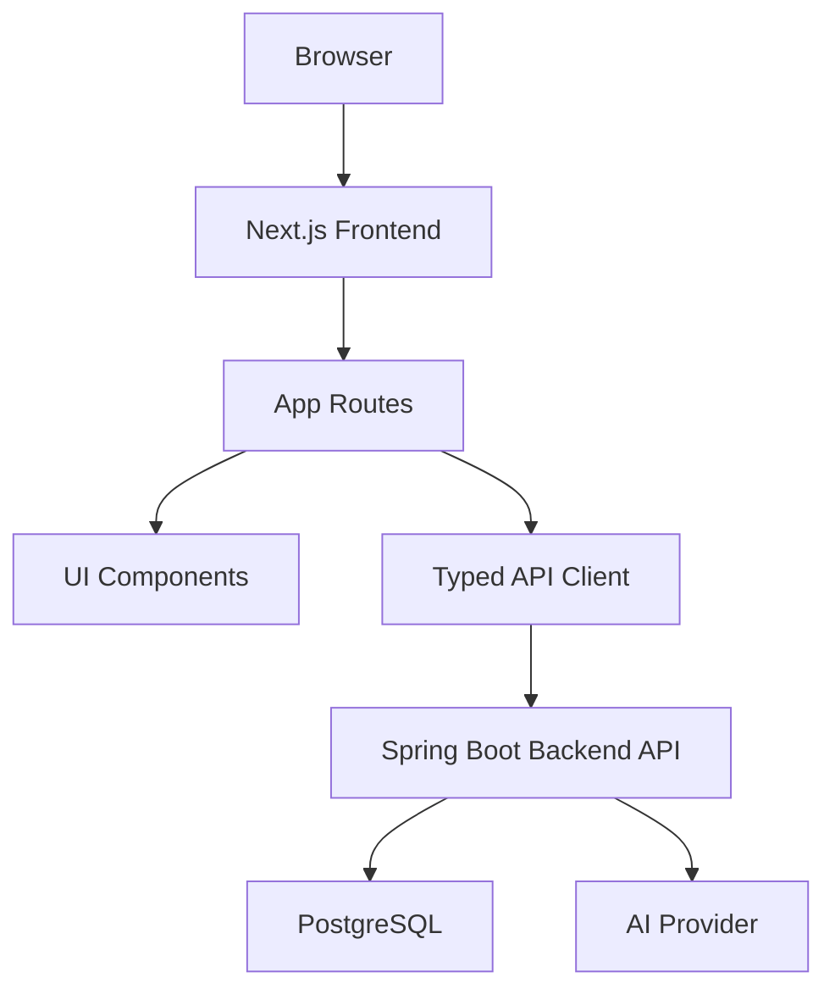
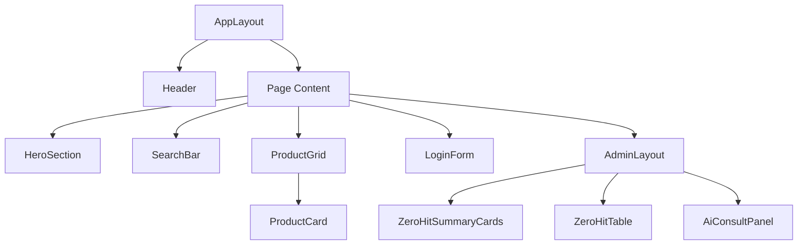
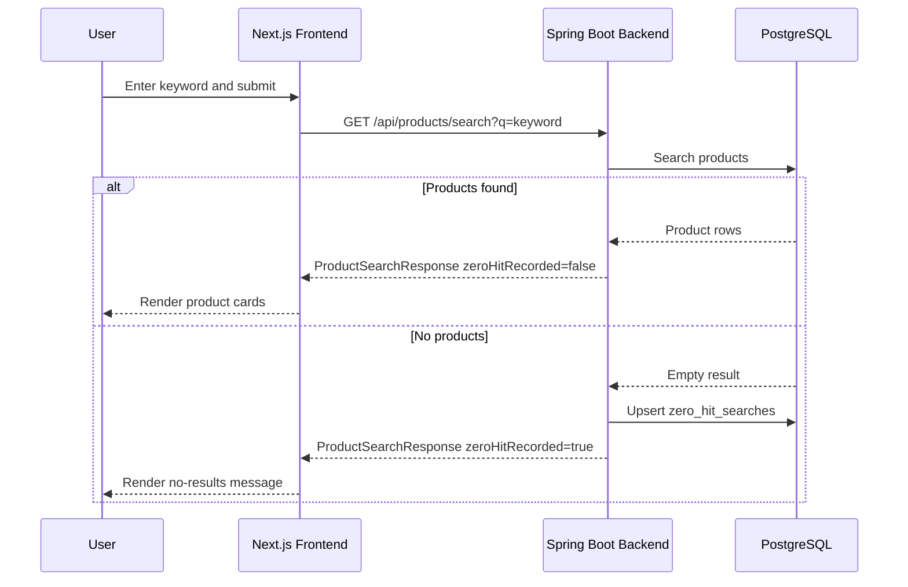
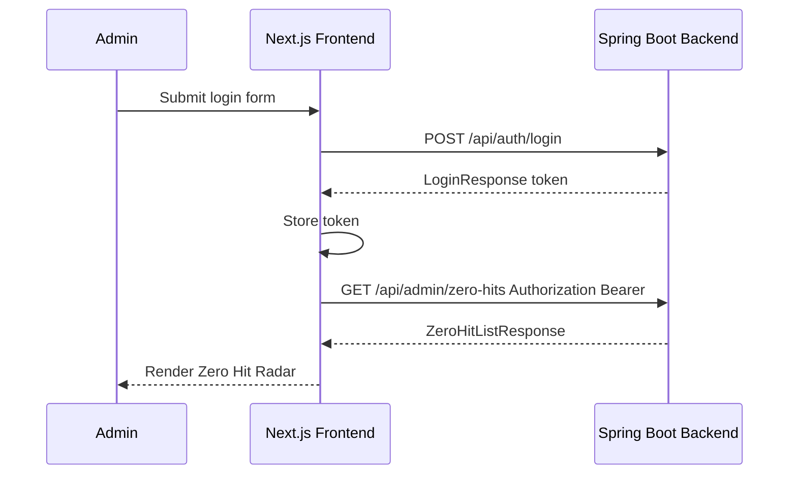
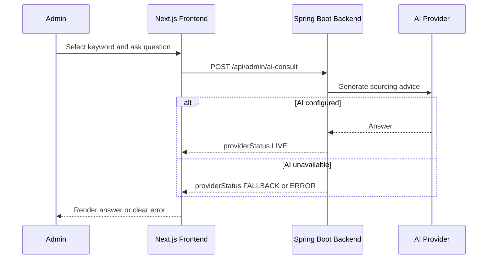

# Codex Ski Shop Frontend Service Detailed Design Specification

## 1. Service Overview

### 1.1 Purpose and Responsibility Scope

The Frontend Service provides the customer storefront and administrator console for `Codex Ski Shop` using Next.js. It renders the product discovery experience, captures user search intent through the backend search API, and gives administrators a Zero Hit Radar dashboard for discovering unmet demand.

The frontend does not own product data, zero-hit records, authentication decisions, or AI generation. Those responsibilities belong to the Spring Boot Backend Service. The frontend owns page routing, visual presentation, client-side state, form validation, API orchestration, authentication token storage, and resilient UX states such as loading, empty, and error views.

### 1.2 Architectural Principles

- Keep all business-critical persistence in the backend and PostgreSQL.
- Use typed API client functions so frontend request and response shapes remain aligned with the backend design.
- Treat Zero Hit Radar as a demand discovery workflow, not only a log viewer.
- Keep MVP interaction simple: product search, admin login, Zero Hit dashboard, and AI consultation.
- Provide polished loading, empty, success, and failure states so the app never appears unfinished.
- Follow the reference images in `images/`, replacing `Azure SkiShop` with `Codex Ski Shop`.

### 1.3 Technology Stack

| Technology Item | Selected Technology | Usage |
| --- | --- | --- |
| Language | TypeScript | Application code and API typing |
| Framework | Next.js | App Router based web application |
| UI | React components + CSS Modules or global CSS | Page layouts, forms, cards, dashboard panels |
| Icons | lucide-react | Navigation, search, admin, AI, refresh, send icons |
| API Client | Fetch API wrapper | Backend REST API integration |
| Auth Storage | HttpOnly cookie preferred, local/session storage acceptable for MVP | Admin token persistence |
| Testing | Playwright, optional Vitest | Browser verification and component/unit tests |
| Build | Docker multi-stage build | Containerized build and runtime |
| Runtime Config | `NEXT_PUBLIC_API_BASE_URL` | Backend API base URL |

## 2. Frontend Architecture Design

### 2.1 Architecture Overview



The frontend is a single Next.js application with public storefront routes and protected administrator routes. Public pages can be viewed without authentication. Administrator routes check login state and redirect unauthenticated users to `/login`.

### 2.2 Page Ownership

| Page | Route | Responsibility | Backend APIs |
| --- | --- | --- | --- |
| Top Page | `/` | Brand hero, search entry, initial 20 products | `GET /api/products`, `GET /api/products/search` |
| Product List | `/products` | Product grid, category filter, sorting, search results | `GET /api/products`, `GET /api/products/search` |
| Login | `/login` | Admin login form and error display | `POST /api/auth/login` |
| Admin Dashboard | `/admin/dashboard` | Zero Hit Radar, metrics, AI consultation | `GET /api/auth/me`, `GET /api/admin/zero-hits`, `POST /api/admin/ai-consult` |

### 2.3 Data Ownership

| Data | Frontend Responsibility | Backend Responsibility |
| --- | --- | --- |
| Product list | Render and filter UI state | Persist, search, return product DTOs |
| Search keyword | Capture and submit | Normalize and record zero-hit when result count is 0 |
| Zero Hit list | Render dashboard and selected keyword | Aggregate and persist keyword demand data |
| Admin auth token | Store and attach to admin API requests | Validate credentials and authorize admin APIs |
| AI consultation | Collect question and show answer | Build prompt, call AI provider, return answer |

## 3. Route and Screen Design

### 3.1 Top Page `/`

#### Purpose

Communicate that the site is `Codex Ski Shop` and let users quickly search ski products.

#### UI Composition

- Header with `Codex Ski Shop` brand, home, products, login, and admin link when authenticated.
- Search bar in the header or hero area.
- Ski shop hero area based on `images/Top-page-after-login.png`.
- Product preview section showing up to 20 products.
- Optional category chips based on product categories.
- Search empty state when no product matches.

#### State Design

| State | Behavior |
| --- | --- |
| Initial | Load `GET /api/products?limit=20&sort=createdAt,desc` |
| Searching | Disable duplicate submit and show subtle loading state |
| Results found | Render product grid and result count |
| Zero hit | Render no-results message and allow another search |
| API error | Show retryable error message without breaking layout |

### 3.2 Product List Page `/products`

#### Purpose

Show searchable and scannable product cards using real ski manufacturer and product names.

#### UI Composition

- Header and navigation consistent with top page.
- Page title and total count.
- Category filter chips: all, skis, boots, wear, accessories, poles, goggles.
- Sort selector: newest, price low to high, price high to low.
- Responsive product card grid based on `images/products-list.png`.

#### Product Card

| Field | Display |
| --- | --- |
| `manufacturer` | Uppercase small label |
| `name` | Main product name |
| `category` | Optional badge |
| `price` | Japanese yen format, e.g. `¥98,000` |
| `stockStatus` | Badge such as `在庫あり` |
| `imageUrl` | Product image or category placeholder |

`stockStatus` is received from the backend as an enum-like value such as `IN_STOCK`, `LOW_STOCK`, or `OUT_OF_STOCK`. The frontend maps it to Japanese display labels such as `在庫あり`, `残りわずか`, and `在庫なし`.

### 3.3 Login Page `/login`

#### Purpose

Authenticate an administrator and navigate to Zero Hit Radar.

#### UI Composition

- Centered login panel based on `images/login-screen.png`.
- `Codex Ski Shop` brand title.
- Username input.
- Password input.
- Login button.
- Error display.

#### Behavior

1. User submits username and password.
2. Frontend calls `POST /api/auth/login`.
3. On success, store returned token and route to `/admin/dashboard`.
4. On failure, backend returns `401 Unauthorized` or `success=false`; show an authentication error.

### 3.4 Admin Dashboard `/admin/dashboard`

#### Purpose

Let administrators discover unmet demand through Zero Hit Radar and consult AI about sourcing decisions.

#### UI Composition

- Admin sidebar and dashboard layout based on `images/admin-dash-board-zero-hit.png`.
- Zero Hit Radar header.
- Period selector: 7, 30, 90 days.
- Refresh button.
- Metric cards:
  - Zero hit keyword count.
  - Search volume.
  - Estimated opportunity loss.
- Zero Hit table/list:
  - Keyword.
  - Hit count.
  - Priority.
  - First searched at.
  - Last searched at.
  - Estimated opportunity loss.
  - Action to ask AI.
- AI consultation panel:
  - Selected keyword.
  - Free-form question input.
  - Send button.
  - Answer area.

#### State Design

| State | Behavior |
| --- | --- |
| Auth checking | Show dashboard skeleton |
| Unauthorized | Redirect to `/login` |
| Empty Zero Hit | Show natural empty state |
| Zero Hit loaded | Render metrics and keyword list |
| AI sending | Disable send button and show progress |
| AI success | Render answer with readable paragraphs |
| AI failure | Show error and keep question text |

## 4. Component Design

### 4.1 Component Tree



### 4.2 Component Responsibilities

| Component | Responsibility | Props |
| --- | --- | --- |
| `Header` | Brand, navigation, search entry | `isAdmin`, `onSearch` |
| `SearchBar` | Keyword input and submit | `value`, `onChange`, `onSubmit`, `loading` |
| `ProductGrid` | Responsive product list | `products`, `loading`, `emptyMessage` |
| `ProductCard` | Product display | `ProductDto` |
| `LoginForm` | Admin login | `onSubmit`, `loading`, `error` |
| `AdminLayout` | Sidebar and admin shell | `children` |
| `ZeroHitSummaryCards` | KPI cards | `ZeroHitSummaryDto` |
| `ZeroHitTable` | Keyword list and AI action | `items`, `onSelectKeyword` |
| `AiConsultPanel` | AI question and answer | `selectedKeyword`, `onSubmit`, `answer`, `loading`, `error` |

## 5. Frontend Data Model

### 5.1 TypeScript DTOs

```ts
export type ProductDto = {
  id: string;
  manufacturer: string;
  name: string;
  category: string;
  description: string;
  price: number;
  stockStatus: string;
  imageUrl?: string | null;
  createdAt: string;
  updatedAt: string;
};

export type ProductListResponse = {
  items: ProductDto[];
  totalCount: number;
};

export type ProductSearchResponse = {
  items: ProductDto[];
  totalCount: number;
  zeroHitRecorded: boolean;
};

export type LoginRequest = {
  username: string;
  password: string;
};

export type LoginResponse = {
  success: boolean;
  token: string;
  user: {
    username: string;
    role: "ADMIN";
  };
};

export type AuthMeResponse = {
  authenticated: boolean;
  user?: {
    username: string;
    role: "ADMIN";
  };
};

export type ZeroHitItemDto = {
  id: string;
  keyword: string;
  normalizedKeyword: string;
  hitCount: number;
  priority: "HIGH" | "MEDIUM" | "LOW";
  estimatedOpportunityLoss: number;
  firstSearchedAt: string;
  lastSearchedAt: string;
};

export type ZeroHitSummaryDto = {
  zeroHitKeywordCount: number;
  searchVolume: number;
  estimatedOpportunityLoss: number;
};

export type ZeroHitListResponse = {
  items: ZeroHitItemDto[];
  summary: ZeroHitSummaryDto;
};

export type AiConsultRequest = {
  keyword?: string;
  question: string;
  hitCount?: number;
  lastSearchedAt?: string;
};

export type AiConsultResponse = {
  answer: string;
  providerStatus: "LIVE" | "FALLBACK" | "ERROR";
};
```

## 6. Backend Integration Design

### 6.1 API Client Layout

```text
frontend/src
├── app
│   ├── page.tsx
│   ├── products/page.tsx
│   ├── login/page.tsx
│   └── admin/dashboard/page.tsx
├── components
├── lib
│   ├── api
│   │   ├── client.ts
│   │   ├── products.ts
│   │   ├── auth.ts
│   │   ├── zeroHits.ts
│   │   └── aiConsult.ts
│   └── authToken.ts
└── types
    └── api.ts
```

### 6.2 Endpoint Contract

| Frontend Function | Method | Backend Endpoint | Auth | Response Type |
| --- | --- | --- | --- | --- |
| `listProducts` | GET | `/api/products?limit=&category=&sort=` | No | `ProductListResponse` |
| `searchProducts` | GET | `/api/products/search?q=&category=&sort=` | No | `ProductSearchResponse` |
| `login` | POST | `/api/auth/login` | No | `LoginResponse` |
| `getMe` | GET | `/api/auth/me` | Bearer token | `AuthMeResponse` |
| `listZeroHits` | GET | `/api/admin/zero-hits?days=&sort=&limit=` | Bearer token | `ZeroHitListResponse` |
| `consultAi` | POST | `/api/admin/ai-consult` | Bearer token | `AiConsultResponse` |

### 6.3 API Client Rules

- Base URL comes from `NEXT_PUBLIC_API_BASE_URL`.
- For browser-side API calls in local docker compose, `NEXT_PUBLIC_API_BASE_URL` must be a browser-resolvable URL such as `http://localhost:8080`, not the internal compose hostname `http://backend:8080`.
- If server-side rendering or Next.js route handlers call the backend from inside the frontend container, an additional internal-only variable such as `INTERNAL_API_BASE_URL=http://backend:8080` may be introduced, but browser-side code must not use that internal hostname.
- Admin endpoints attach `Authorization: Bearer ${token}`.
- All requests send `Accept: application/json`.
- POST requests send `Content-Type: application/json`.
- The client maps backend `ProblemDetail` or error JSON into user-friendly UI messages.
- The frontend must not call PostgreSQL or AI providers directly.

### 6.4 Error Contract

The backend may return Spring Boot error payloads or application errors. The frontend normalizes them into:

```ts
export type ApiError = {
  status: number;
  message: string;
  code?: string;
};
```

When the backend returns Spring `ProblemDetail`, the frontend should derive `message` from `detail`, `title`, or `message` in that order.

User-facing messages:

| HTTP Status | Frontend Behavior |
| --- | --- |
| 400 | Show validation message near the form |
| 401 | Clear token and redirect to `/login` for admin routes |
| 403 | Show access denied |
| 404 | Show not found or empty state depending on route |
| 500 | Show retryable service error |

## 7. Sequence Diagrams

### 7.1 Product Search With Zero Hit



### 7.2 Admin Login and Dashboard



### 7.3 AI Consultation



## 8. UX and Visual Design

### 8.1 Reference Image Mapping

| Reference Image | Frontend Usage |
| --- | --- |
| `images/Top-page-after-login.png` | Header, hero, blue brand direction |
| `images/products-list.png` | Product grid, category chips, sort select, product card layout |
| `images/login-screen.png` | Centered login form |
| `images/admin-dash-board-zero-hit.png` | Admin sidebar, metric cards, Zero Hit empty state, AI question panel |

### 8.2 Responsive Rules

- Desktop product grid: 3 to 4 columns depending on width.
- Tablet product grid: 2 columns.
- Mobile product grid: 1 column.
- Header search collapses into full-width row on small screens.
- Admin dashboard sidebar may collapse or stack above content on mobile.
- Text must not overflow buttons, cards, or metric panels.

### 8.3 Accessibility Rules

- Inputs have visible labels or accessible labels.
- Buttons have clear names and disabled states.
- Color is not the only indicator for errors or state.
- Loading states include text visible to screen readers.
- Keyboard users can tab through forms and dashboard actions.

## 9. Authentication Design

### 9.1 Token Handling

Preferred implementation:

- Backend returns a token and the frontend stores it in an HttpOnly cookie through a Next.js route handler.

MVP acceptable implementation:

- Store token in `sessionStorage`.
- Attach token to admin API requests.
- Clear token on logout, 401, or browser session end.

### 9.2 Route Guard

`/admin/dashboard` performs:

1. Read token.
2. Call `GET /api/auth/me`.
3. If authenticated, render dashboard.
4. If unauthenticated, redirect to `/login`.

## 10. Environment Variables

| Name | Required | Description | Example |
| --- | --- | --- | --- |
| `NEXT_PUBLIC_API_BASE_URL` | Yes | Browser-resolvable backend API base URL | `http://localhost:8080` |
| `INTERNAL_API_BASE_URL` | No | Optional container-internal backend URL for server-side calls only | `http://backend:8080` |

## 11. Docker Design

### 11.1 Dockerfile

The frontend Dockerfile uses a multi-stage build:

1. `deps`: install dependencies.
2. `builder`: build Next.js app.
3. `runner`: run production Next.js server.

### 11.2 Compose Integration

- Service name: `frontend`.
- Depends on: `backend`.
- Default port: `3000`.
- Environment:
  - `NEXT_PUBLIC_API_BASE_URL=http://localhost:8080`.
  - `INTERNAL_API_BASE_URL=http://backend:8080` only if server-side proxy or route handlers are implemented.

## 12. Testing Design

### 12.1 Playwright Scenarios

- Top page renders `Codex Ski Shop`.
- Initial product cards are displayed.
- Existing product search returns cards.
- Non-existing search shows no-results state.
- Admin login redirects to `/admin/dashboard`.
- Zero Hit Radar displays the recorded keyword.
- AI consultation shows answer or configured error state.
- Desktop and mobile screenshots do not show layout overlap.

### 12.2 Unit Test Targets

- API client URL construction.
- Currency formatting.
- Date formatting.
- Auth token utility.
- Product search state reducer if implemented.

## 13. Frontend and Backend Contract Checklist

| Contract Item | Frontend Design | Backend Design |
| --- | --- | --- |
| API base path | Uses `/api` under backend base URL | Exposes `/api` endpoints |
| Product fields | `manufacturer`, `name`, `category`, `price`, `stockStatus` | Returns same JSON field names |
| Zero hit fields | Renders `keyword`, `hitCount`, `priority`, `estimatedOpportunityLoss`, `firstSearchedAt`, `lastSearchedAt` | Returns same JSON field names |
| Zero hit trigger | Calls search endpoint only | Backend records when result count is 0 |
| Admin auth | Sends Bearer token | Validates token on admin APIs |
| AI request | Sends keyword, question, hitCount, lastSearchedAt | Accepts same request body |
| Error handling | Normalizes HTTP errors | Returns status and message |
| Local browser connectivity | Uses `http://localhost:8080` for client-side calls | Exposes backend on host port `8080` and allows CORS from `http://localhost:3000` |

## 14. Implementation Notes

- Keep Japanese UI labels concise and polished.
- Do not show internal API names to end users.
- Use `Codex Ski Shop` consistently in visible UI.
- Preserve the MVP boundary: no cart, purchase, user registration, or product CRUD.
- Product images may use category placeholders if real images are unavailable.
